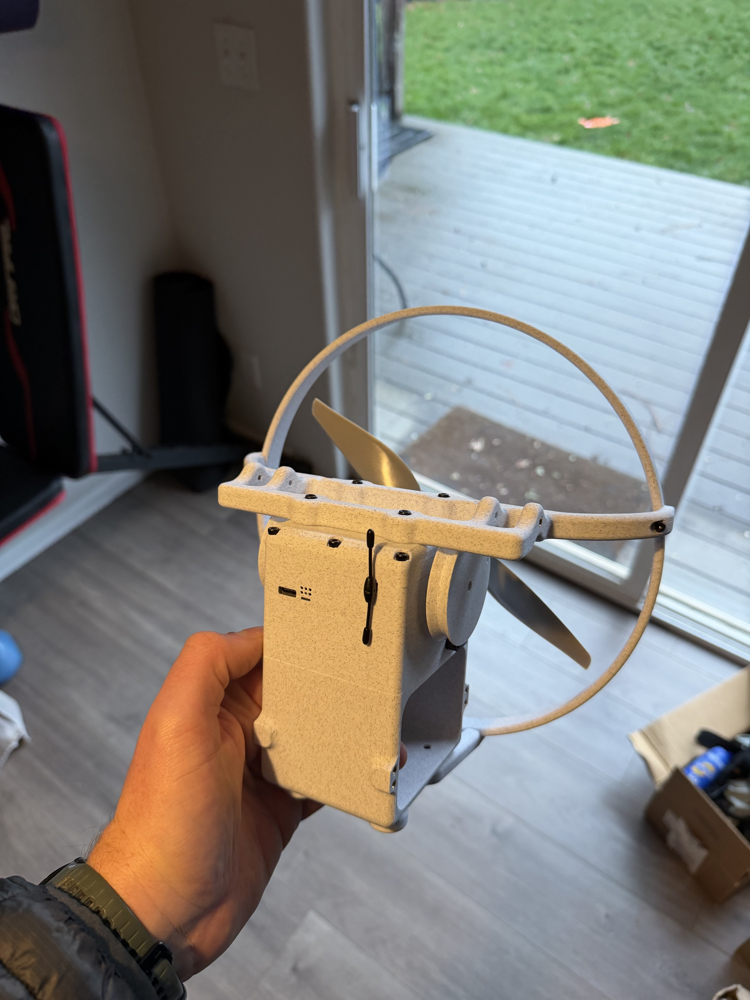

# Micro-AGU

**Micro Aerial Guidance Unit** is an experimental autonomous parafoil project built around an affordable HobbyKing V2 canopy, a custom printed payload and ArduPilot avionics. The powered aircraft provides a repeatable platform for studying guidance, canopy–payload dynamics and control.

This repository contains the mechanical design, flight-test articles, interactive visualizations, analysis scripts and simulation results. Start with the [project articles](https://davidingraham.github.io/research/?collection=ardupilot-tinkering), explore an [interactive landing replay](https://davidingraham.github.io/assets/microagu-viewer/landing.html), or open the [CAD assembly](cad/solidworks/microAGU.SLDASM).



## Project status

The original controller flew autonomous missions at Trout Lake after initial testing in Hood River. Subsequent work uses a 9-degree-of-freedom canopy–payload simulator to develop dedicated steering and longitudinal controllers, approach guidance and brake flare. These newer controller and landing results are simulation studies; they have not yet been validated in flight. The [next flight test card](docs/next-flight-test-card.md) describes the planned validation.

## Explore the project

| Directory | Contents |
|---|---|
| [cad/](cad/) | Native SolidWorks parts, assemblies and file manifest |
| [docs/](docs/) | Build, flight tests, controller design and landing articles |
| [viewer/](viewer/) | Three.js replay/live viewer, articulated models and export tools |
| [research/](research/) | Study scripts, final plots, configurations and compact replay excerpts |
| [tools/](tools/) | Analysis and archive utilities |
| [provenance/](provenance/) | Source revisions, artifact manifests and historical implementation records |
| [scratch/](scratch/) | Historical experiments, including superseded approaches |

### Read the design story

1. [Building Micro-AGU](docs/micro-agu-design.md): canopy, payload, propulsion and avionics.
2. [From First Tosses to Autonomous Missions](docs/flight-testing.md): launch technique, trim and flight measurements.
3. [Controllers through Trout Lake](docs/first-flight-controller.md): the original steering and altitude-control design.
4. [Simulation and controller refinement](docs/controller-design.md): articulated dynamics and classical control analysis.
5. [Spot landing](docs/spot-landing.md): approach guidance, brake allocation and flare.
6. [Toward a precision swoop landing](docs/swoop-landing.md): turning approaches and remaining touchdown limitations.
7. [What state-space analysis added](docs/controller-state-space.md): joint tuning, actuator and sensor diagnostics, and a full-state controller comparison.

[Data and methods](docs/data-and-methods.md) explains the evidence and model assumptions. [Plane trajectory planning](docs/trajectory.md) covers a related investigation into waypoint transitions.

## Run the viewer

The packaged replays run locally with **Node.js 22 or newer**. No ArduPilot build is needed to view them.

```sh
git clone https://github.com/DavidIngraham/micro-agu.git
cd micro-agu/viewer
npm ci
npm run dev -- --strictPort
```

Open [the landing replay](http://127.0.0.1:5173/landing.html) or [the joint-motion visualization](http://127.0.0.1:5173/joint-tour.html). Drag to orbit and scroll to zoom. The main page at `http://127.0.0.1:5173/` supports opening recordings and connecting to a live simulator.

See the [viewer guide](viewer/README.md) for recording formats, Python dependencies, live streaming and CAD export. To check the viewer from its directory:

```sh
npm test
npm run build
```

## Work with the CAD

Open `cad/solidworks/microAGU.SLDASM` in SolidWorks, keeping the neighboring parts and subassemblies together. The [CAD guide](cad/README.md) describes the assembly, derived rendering assets and known reference limitations. Native files are stored in ordinary Git; Git LFS is not required.

## Firmware and simulator

The flight controller, native autotests and 9-DOF simulator are developed in the [paraglider-high-dof-control branch of the ArduPilot fork](https://github.com/DavidIngraham/ardupilot/tree/paraglider-high-dof-control). They use ArduPilot's build and SITL infrastructure. This repository supplies the hardware design, viewer and supporting experiments rather than a second copy of the firmware.

For simulator setup and native tests, follow the [paraglider simulator README](https://github.com/DavidIngraham/ardupilot/blob/paraglider-high-dof-control/Tools/simulation/paraglider/README.md). Individual study directories record their configurations and source revisions; the current branch may be newer than a published result.

## Research data and reproducibility

Study directories contain the retained scripts, configurations, final plots, summaries and selected replay excerpts. Raw flight logs, full simulation traces and compiled binaries are not included. Some historical scripts require those external inputs or contain machine-specific paths that must be adjusted. Consult each study's reproduction instructions before running it; the repository is not a single turnkey experiment suite.

The [flight-data figure index](research/flight-log-analysis/index.html) and its [manifest](research/flight-log-analysis/manifest.json) connect retained figures to their generating scripts. Older experiments remain available as evidence, even when superseded by later designs.

### Historical archive

The initial research archive was captured on October 9, 2026. Its [artifact manifest](provenance/artifact-manifest.json), [omission manifest](provenance/omitted-raw-artifacts.json) and [branch provenance](provenance/branches-final.json) describe that snapshot, not the entire current repository. Large archived artifacts are losslessly compressed and do not require Git LFS.

To verify or restore those archived artifacts, run from the repository root with Python 3:

```sh
python3 tools/restore_artifacts.py --verify
python3 tools/restore_artifacts.py --destination ../micro-agu-restored
```

Restore before running historical scripts that expect the original uncompressed filenames. Use a separate ArduPilot checkout for historical runners that modify firmware sources.

## Licensing and acknowledgments

See [COPYING.txt](COPYING.txt) for the included GNU GPL v3 license. ArduPilot-derived code retains its upstream notices; third-party materials retain their own notices. The viewer declares GPL-3.0-or-later in its package metadata. Component CAD and other third-party assets should be checked for their individual reuse terms.

Development, analysis and documentation were assisted by Codex.
