# Designing the Micro-AGU Flight Controller

*Micro-AGU · Controller design, part 2 · [Through Trout Lake](first-flight-controller.md) · [Build](micro-agu-design.md) · [Flight tests](flight-testing.md) · [Controller design](controller-design.md) · [Data and methods](data-and-methods.md)*

The controller has two jobs: turn the aircraft along its route and use throttle to follow the requested altitude. Both jobs act on the same suspended system. A brake correction can excite payload pitch, and a throttle correction changes the motion seen by the steering loop. The design uses feedforward for the expected effort, modest feedback for tracking, and separate damping paths shaped around the coupled modes.

[Part 1](first-flight-controller.md) follows my independent preflight design work through the Trout Lake missions: adapting the roll loop, changing TECS to throttle-only altitude control, and disabling a pitch damper that made the motion worse. This second phase uses those flights to inform the articulated model and design the replacement controller. It brings steering and altitude together around the resulting architecture, its classical analysis and its simulation evidence.

## From flight logs to a model for controller design

The simple simulator had been useful for choosing the gains I took to Trout Lake. After the flights, I wanted it to answer a harder question: would a controller that looked good in simulation behave sensibly on the actual suspended aircraft? The achievable turn radius looked optimistic, sustained bank was harder to maintain in flight, and the pitch damper had exposed motion that a single rigid aircraft could not explain.

The starting evidence was the Hood River and Trout Lake logs: actuator commands, logged parameter ranges, payload attitude and rates, navigation velocity, altitude and battery measurements. Hood River included substantial manual flying to feel out the platform. Early Trout Lake throttle tests and the later sustained turns supplied more ordinary operating points. The powered, high-bank Hood River turn was useful as a stress case, but reproducing that maneuver stopped being the main objective. The controller needed a useful model of everyday glide, climb and sustained turns first.

### Reconstruct the aircraft before fitting its response

The two flights were not the same aircraft configuration. All-up mass was 1.385 kg without the added ballast and 1.758 kg with it—a 373 g difference, carried at the bottom of the payload. I had also adjusted the rigging. We therefore kept separate flight configurations instead of asking one set of coefficients to explain both through mass alone.

The logged PWM ranges mattered just as much as mass. Both main flights used 800–2100 μs on the left brake and a reversed 900–2400 μs range on the right, with no recorded in-flight changes to those ranges. The nominal conversion using the 55 mm drums and servo mapping gives about 62.4 mm of configured left travel and 72.0 mm on the right. The asymmetry is real; treating both outputs as identical normalized brakes would fit the wrong inputs. Effective slack and preload are separate from physical drum travel. Their fitted values can absorb rigging and canopy asymmetry, so they are not measurements of line length.


*Steady flight windows establish useful throttle/climb relationships. They do not identify the complete transient dynamics. Hood River’s erroneous current readings and false power limiting also prevent treating that flight as a clean propulsion calibration; the missing input capacitor was fixed before Trout Lake.*

The propulsion model uses the reported FFTY 3115-900KV motor and 9×4.5 propeller geometry, with an APC 9×4.5 aerodynamic map as a proxy. It includes rotor speed dynamics, reaction torque, rotor angular momentum and precession, and the reaction to spin acceleration. Rotation is clockwise viewed from behind. Component weights and CAD-informed dimensions supplied approximate mass distribution and inertia; these were engineering estimates where direct measurements were unavailable.

### Let the payload and canopy move independently

The important structural change was moving to two rigid bodies connected by a point joint. Each body has its own attitude and angular velocity. Their shared attachment constrains relative translation while allowing relative roll, pitch and yaw: twelve free-body degrees of freedom minus three positional constraints gives **nine mechanical degrees of freedom**.

[Open the interactive 3D motion tour](https://davidingraham.github.io/assets/microagu-viewer/joint-tour.html) to step through the three translations, three payload rotations and three relative canopy rotations. Use front, side or top views, pause, scrub, or slow playback. The second mode releases a small joint deflection in the actual simulator and compares the mission and softer-roll profiles.

<video autoplay muted loop playsinline controls preload="metadata" poster="assets/viewer/joint-tour/joint-tour.jpg" style="width:100%;height:auto"><source src="assets/viewer/joint-tour/joint-tour.mp4" type="video/mp4"></video>

*The first nine segments prescribe one coordinate at a time to explain the degrees of freedom. The final three replay simulated roll, pitch and yaw deflection releases with the mission profile. Prescribed motion is labeled separately from physics. The response view removes shared translation, preserving all rotations and relative displacement at their simulated amplitudes. The canopy is schematic; the carriage uses the SolidWorks model.*

A curved five-panel canopy supplies aerodynamic forces and moments. Effective joint stiffness and damping represent the suspension’s resistance to relative rotation, including a mass-dependent yaw restoring term. Thrust acts at the motor’s location relative to the payload CG. That geometry lets the carriage pitch nose-down immediately after a throttle increase while the aircraft eventually climbs. The simulated IMU follows the payload, including its offset from the CG; it does not report canopy attitude.

This is what makes the articulated animation relevant to control design: steering can excite pitch, and the payload gyro can see a motion quite different from the wing’s. Rotor and actuator dynamics add states to the equations without changing the nine mechanical freedoms.

### Why a pitch disturbance also produces yaw

In the [interactive joint-response viewer](https://davidingraham.github.io/assets/microagu-viewer/joint-tour.html), select **Open loop**, **Payload-only deflection**, **Pitch release**, **Mission profile**, and **9°**. The carriage pitches and also yaws, even though the brake commands stay fixed. Switch to **Canopy-only deflection** to see the same coupling excited through the wing.

The spinning propeller is the main source of that yaw in these simulated cases. Its angular momentum lies along the motor shaft. When the payload pitches, changing the direction of that momentum produces a gyroscopic reaction torque about the yaw axis. The model applies $\boldsymbol{\tau}_{\mathrm{gyro}}=-\boldsymbol{\omega}_{\mathrm{payload}}\times\mathbf{H}_{\mathrm{rotor}}$.

I checked this by replaying both releases with the rotor angular-momentum terms disabled, while retaining thrust, shaft reaction torque, body inertia, initial state, RPM, and fixed trim controls. Over the eight-second release, the maximum absolute change in **payload yaw from its initial heading** was:

| Initial pitch disturbance | Normal model | Rotor momentum disabled |
|---|---:|---:|
| Payload only, +9° | 7.1° | 0.7° |
| Canopy only, +9° | 11.7° | 0.8° |

That large reduction identifies gyroscopic coupling as the dominant source of the visible yaw in these cases. A canopy disturbance also drives payload pitch, which then excites the rotor coupling. The smaller remaining yaw comes from the rest of the coupled model. This establishes the mechanism in the simulator; its magnitude depends on the estimated rotor inertia and has not been isolated in flight data. The intervention removes both gyroscopic and spin-acceleration reaction terms, rather than switching off propeller thrust or shaft torque. [Numerical results](assets/viewer/joint-tour/pitch-yaw-coupling.json) and the [reproduction script](https://github.com/DavidIngraham/ArduPilot-tinkering/blob/main/viewer/tools/check_pitch_yaw_coupling.py) record the comparison.

<a id="watching-the-coupled-aircraft-move"></a>

### Fit useful behavior, retain competing explanations

We compared recorded-input responses over ordinary flight windows, examined steady glide/climb and turn equilibria, and checked attitude-rate spectra as well as trajectory error. A good ground track alone could hide the wrong rocking motion. Conversely, matching a rate RMS did not establish that the right physical mode produced it. Trim solving became part of the process so a controller comparison did not begin with an arbitrary force or moment imbalance.

Two profiles survived that work. The **mission profile** better represents ordinary trajectory performance and is the baseline used below. The **dynamic-roll profile** uses a softer roll joint with a corresponding trim correction; it better represents the observed faster roll motion. Keeping both exposes a real uncertainty: joint mechanics, damping, rigging and external excitation are not uniquely recoverable from these flights. The longitudinal screening includes that alternative, while the lateral filter study uses the mission profile.

The resulting model is more useful for controller design because it represents asymmetric brake authority, configuration-dependent trim, propulsion dynamics and the coupled motions missing from the original approximation. It is not a unique identification of the aircraft. Cross-axis phase errors and missing low-frequency yaw energy remain, and the powered Hood River equilibrium has a slow instability in the model. The same two flights guided development, so replay agreement is not independent flight validation.

### Connect the model to the real controller

The retained dynamics run through ArduPilot’s JSON SITL backend. Native navigation, TECS, steering code and the estimator receive simulated payload sensor data and return PWM commands through the flight-specific actuator mapping. Tests start from a solved airborne trim. This allows the full mission controller to be evaluated against the same mechanics used in the analysis, rather than relying only on a standalone ideal-sensor controller.

The model assumes an inflated canopy and a taut point connection. It does not simulate inflation, slack lines, collapse or landing. The canopy is rigid, the stall law is approximate, and the mission comparisons use constant voltage rather than battery discharge. Those limits set the scope of this article: up-and-away control, ordinary maneuvers and sensitivity to modeled disturbances.

[Model mechanics and configuration notes](https://github.com/DavidIngraham/ardupilot/blob/5f483ade60/Tools/simulation/paraglider/README.txt) preserve the calibration assumptions, competing profiles and reproduction details. The [data and methods appendix](data-and-methods.md) separates flight evidence from subsequent model and controller tests.

## One aircraft, two control paths

Navigation supplies a turn request and an altitude trajectory. Differential brake pull controls turning; throttle controls climb and descent. Symmetric braking is reserved for future landing work, rather than acting as an elevator during normal flight.

The analysis uses the 1.758 kg Trout Lake configuration, asymmetric brake trim, and modeled 9×4.5 pusher propulsion. Canopy and payload have separate attitudes. Rotor dynamics and active steering remain in the longitudinal plant.

Nine mechanical degrees of freedom do not mean nine linear states. The local plant uses 15 perturbation states after removing absolute position and arbitrary heading, including rotor RPM. Steering filters and integration add three states; altitude, climb integration, pitch filters and reference smoothing add five more to the full longitudinal model.

## Steering: track turn rate, damp roll separately


Feedforward supplies the expected differential-brake input. Heading-rate PI corrects tracking and asymmetric trim, while payload roll-rate feedback damps rocking. These paths have different jobs and independently adjustable gains.

Navigation's bank-encoded request is converted into heading rate, limited to ±25°/s, smoothed with a 0.1 s time constant, and limited to 40°/s² acceleration.

~~~text
heading_rate = (q sinφ + r cosφ) / cosθ
e = shaped_target − filtered_heading_rate
Sᵥ = clamp(5 / max(Vair, 2), 0.25, 2.5)

u_brake = clip[Sᵥ(0.009 target + 0.005 e − 0.003 filtered_p) + I, −1, +1]
İ = 0.002 e, with |I| ≤ 0.15 and conditional integration
~~~

Here p is body roll rate, q body pitch rate and r body yaw rate; controller rates are in degrees per second. Body roll rate only approximates the Euler bank-angle derivative near level attitude. The brake mixer maps the normalized output to the actual servo ranges.

The small P gain is deliberate. Large heading-rate feedback excited the payload instead of simply making turns more accurate. Feedforward carries most of the steady demand; feedback corrects the residual.

## Lateral classical analysis: why this steering loop works

The steering design needs enough low-frequency authority to track a turn without feeding the suspended modes. To quantify that tradeoff, I linearized the 9-DOF model at the Trout Lake straight, level trim: 1.758 kg, 4.383 m/s, 44.59% throttle, left brake released and right brake at 3.747 mm. That nonzero brake trim matters: small corrections stay on the right-brake branch rather than crossing the mixer’s change of side.

The local model keeps fourteen internal states after removing global position and heading. That is a state count, not fourteen mechanical degrees of freedom. Throttle and equilibrium rotor speed are held fixed for this lateral analysis. With differential brake command `u`, heading rate `ψ̇`, and body roll rate `p`, the plant is:

```text
Δẋ = A Δx + B Δu
Gψ(s) = Δψ̇/Δu = Cψ (sI − A)⁻¹ B
Gp(s) = Δp /Δu = Cp (sI − A)⁻¹ B

Gψ(0) = 98.00 deg/s per brake fraction
Gp(0) = −13.05 deg/s per brake fraction
```

A one-percent brake-command increment therefore produces about 0.98 deg/s of steady heading rate locally. Inverting that gain, including the speed multiplier, gives a feedforward gain of **0.00894**—almost exactly the selected 0.009. The linear plant therefore gives a physical basis for the feedforward setting, rather than leaving it as an empirical gain.


*The full plant has several coupled modes. Small-amplitude nonlinear sine tests match the sampled linear response within 0.005%; the slight difference from the continuous curve at high frequency is the input hold. This checks the linearization against the simulator.*

### The plant and closed-loop transfer functions

At fixed speed scaling, below the command and actuator limits, the implemented controller becomes:

```text
e(s) = r(s) − H(s) ψ̇(s)
u(s) = S K_FF r(s) + [S K_P + K_I/s] e(s) − S K_RD H(s) p(s)

K_FF = 0.009; K_P = 0.005; K_I = 0.002; K_RD = 0.003
S = 5 / 4.383 = 1.1408
H(s) = 25.133 / (s + 25.133)       [4 Hz measurement filter]
r(s) = r_requested(s) / (0.1s + 1) [when command limits are inactive]

L(s) = H(s){[S K_P + K_I/s] Gψ(s) + S K_RD Gp(s)}
ψ̇(s)/r_requested(s) = Gψ(s)[S(K_FF + K_P) + K_I/s]
                       / {(1 + L(s))(0.1s + 1)}
```

The integrator is not speed-scaled. Feedforward affects command response but does not move the feedback poles. Also, body roll rate is not zero in every steady banked turn: `p = φ̇ − ψ̇ sinθ`. Roll-rate damping therefore supplies a small steady-turn correction as well as opposing oscillation.

### Poles, zeros and the feedback-gain limit

The selected gains are locally stable, but the original larger feedback gains are unstable in this model. With the selected gains, a lightly damped pair sits at `−0.986 ± j15.969 s⁻¹`: about 2.54 Hz, with damping ratio 0.062. Scaling all feedback gains together reaches instability at **1.524 times nominal**, a gain margin of **3.66 dB**. Increasing heading-rate P alone reaches the boundary near 0.00791, with I and roll damping held fixed.


*Crosses are open-loop poles, circles are combined-loop zeros, and green squares are the selected closed-loop poles. The mode labels come from eigenvector participation: several motions mix pitch, yaw, and translation. The red star marks the gain-induced instability boundary. The lower-half-plane branches mirror the upper half.*

The slow oscillatory plant mode mixes pitch and forward speed at about 0.34 Hz. Another mixes sideways velocity and canopy yaw around 0.59 Hz; the fastest pair is predominantly relative canopy/payload roll at 5.86 Hz. Feedback changes these coupled motions rather than merely adding damping to a single isolated roll mode.

Zeros need a different interpretation: they describe cancellation in an input–output response, not another natural motion. The combined loop has a right-half-plane zero pair at `+6.944 ± j19.054 s⁻¹`. The individual heading-rate and roll-rate plants have different zeros, so those cannot be substituted as endpoints of this root locus. The output-specific maps below show the distinction. These are properties of the modeled plant, not modes or zeros identified directly from flight.

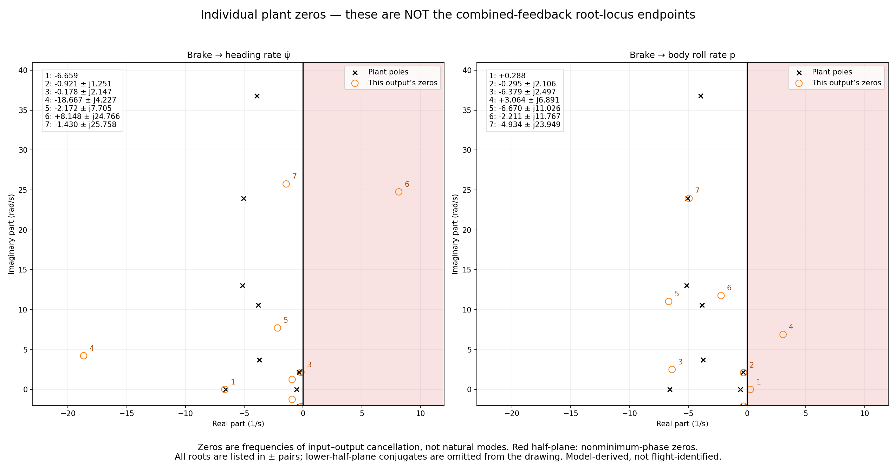

### Shape feedback without sacrificing feedforward

The filter comparison keeps every gain and model coefficient fixed and changes only measurement filtering. It compares six filters across level flight, climb and descent at ±0.5 m/s, and level turns at ±10 deg/s. Two candidates stood out: lowering the existing low-pass cutoff from 4 to 1 Hz, and adding a broad notch at 2.5 Hz.

```text
1 Hz candidate: H₁(s) = 6.283 / (s + 6.283)
Notch candidate: H_N(s) = H(s) (s² + 6.283s + 246.740)
                              / (s² + 21.991s + 246.740)
```

Both retain unity DC gain. Feedforward bypasses the measurement filters, so reducing feedback near the troublesome modes need not make every turn command sluggish.

| Measurement filter | Level-flight gain margin | Lowest margin across five trims |
|---|---:|---:|
| Existing 4 Hz low-pass | 3.66 dB | 2.31 dB |
| 1 Hz low-pass | 8.41 dB | 6.87 dB |
| Broad 2.5 Hz notch | 14.83 dB | 7.04 dB |


*Both candidates reduce the sensitivity peak near the troublesome mode. The notch has the strongest straight-flight margin, but its advantage over the simpler filter narrows in left turns.*

Local command tracking stayed similar. Eighteen nonlinear tests check that result: level flight and both turn directions, each with three filters and either zero or 80 ms of added sensing delay. These used the actual modeled brake travel limits, asymmetric PWM mapping, changing speed scaling, and integral limits. The requested increments were 2 deg/s, continuing in the existing turn direction.


*Solid lines have no added delay; dashed lines have 80 ms. The existing filter develops a large oscillation in the right turn, while both candidates keep tracking. The left-turn baseline remains well behaved, consistent with the asymmetric plant.*

In the delayed right-turn case, final-ten-second heading-rate RMS error was 26.65 deg/s with the existing filter, versus about 0.016 deg/s with either candidate. Without added delay, the 1 Hz filter’s integrated right-turn tracking error changed from 5.10 to 5.12 degrees over the 30-second run. The benefit is more tolerance of feedback phase lag, with little tracking cost in these tests.

### What the native 1 Hz experiment establishes

The native implementation trial includes the full ArduPlane controller, estimator, navigation and altitude loops together. It compares `PG_TURN_FILT = 4` and `1` Hz in calm air, moderate repeatable gusts, and a steady 2 m/s eastward wind. All gains and model coefficients stayed fixed. The 1.758 kg Trout Lake model flew the same mission at 22.2 V, including altitude changes and clockwise and counterclockwise loiters. **All six native AUTO tests passed.**

| Condition | Right-turn heading-rate RMS error, 4 → 1 Hz | Left-turn heading-rate RMS error, 4 → 1 Hz |
|---|---:|---:|
| Calm | 0.36 → 0.26 deg/s | 0.39 → 0.31 deg/s |
| Moderate gusts | 9.93 → 9.66 deg/s | 9.43 → 10.44 deg/s |
| Steady crosswind | 2.39 → 1.93 deg/s | 3.75 → 3.25 deg/s |

These errors compare the requested rate with the unfiltered simulated payload heading rate, rather than rewarding the filter for making its own feedback signal smoother. Across the six settled-loiter comparisons, brake-command content above 1 Hz fell by **34–69%**. Radial tracking stayed essentially unchanged or improved slightly. In gusts, altitude RMS error remained around 0.41 m, and none of the settled loiters saturated the differential-brake command.


*Blue is 1 Hz. Quieter commands are a consistent benefit; better heading-rate tracking is not universal. In particular, the gusty left turn had higher rate error even though radial tracking improved.*


*Matched settings, with each first-loiter entry aligned independently. Most of the remaining gust-driven rate error is below 1 Hz. Reducing high-frequency feedback does not remove that slower motion.*

**The 1 Hz filter is the preferred lateral candidate for the next combined SITL comparison, with the gains unchanged.** The selected full-loop longitudinal study retains the 4 Hz steering baseline so that its results isolate the climb-PI change; the two improvements have not yet been validated together. This is an incremental improvement, not a cure for gust response. These are single paired runs; the repeatable gust field has a different arrival phase when the trajectory changes. They also do not reproduce the earlier artificial 80 ms delay test or remeasure a stability margin. The existing mission videos and published default parameters still use 4 Hz. [Data and methods](data-and-methods.md#native-lateral-filter-trial) records the exact configurations, analysis and scope.

## Altitude: keep TECS's framework, use throttle as the actuator

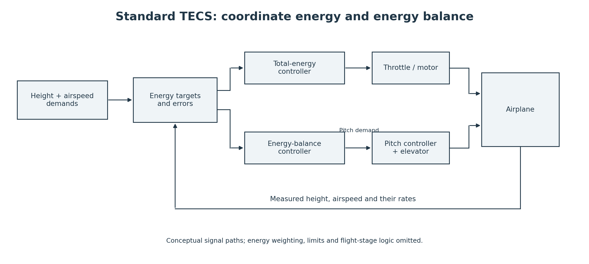

Standard TECS coordinates total energy and its distribution between height and airspeed using throttle and pitch demand. This parafoil has no elevator-like pitch actuator. Continuous symmetric braking would cost efficiency and wing stability. The adaptation treats airspeed as approximately trimmed and controls vertical speed through throttle.

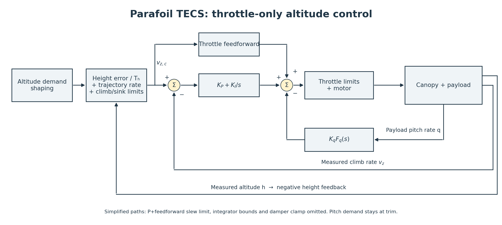

The outer loop adds an altitude-error correction to the altitude trajectory's rate of change:

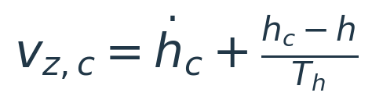

The climb demand is bounded. Throttle feedforward estimates the required power, PI feedback corrects climb-rate error, and filtered payload pitch rate supplies a separate damping correction:

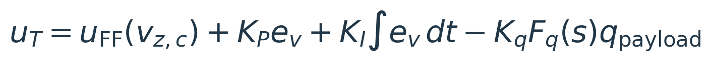

### Calibrate feedforward before increasing feedback

At 22.2 V, model trim requires about 44.6% throttle for level flight and 59.9% for a 1 m/s climb. Development settings use 45% trim, 60% maximum throttle, a 1 m/s climb calibration and a 2.5 m/s descent calibration. These calibrate the simulator's local throttle map; they do not replace flight-derived performance estimates.

~~~text
Climb:   u_FF = trim + (v_cmd / climb_limit) × (maximum − trim)
Descent: u_FF = trim + (v_cmd / sink_limit) × (trim − minimum)
~~~

ArduPlane's existing battery compensation scales output as voltage falls. The analysis includes that scaling and the compensated throttle limit returned to TECS. The integrator should not have to compensate for a battery path that was accidentally disabled.

A 0.5 s first-order filter smooths the trajectory derivative used for feedforward. Height feedback and climb/sink limits remain intact. This prevents abrupt altitude capture from becoming a throttle kick.

### Shape damping around the modes

The original ACRA-inspired damper assumed that adding throttle would oppose a nose-down rotation. Thrust above the payload CG initially pitches this payload down. A fast minus-sign damper can reinforce the motion it is intended to suppress.

The [free-body diagram and conceptual animation in part 1](first-flight-controller.md#the-damper-that-could-make-things-worse) show the original assumption and the independent payload response.

### Why reversing the damper was only half the answer

The later simulation reproduced the distinction the flight had exposed: the immediate payload rotation and the aircraft’s eventual climb are different responses. I first tested the obvious correction—reverse the damper sign. It suppressed the fast pitching but could excite slower motion. Disabling the damper, reversing it, and filtering the original sign therefore became separate design alternatives, not steps toward an assumed correct sign.

The sign-comparison and altitude-command animations below show that result directly. The useful design retained negative pitch-rate feedback but reduced its action around the troublesome fast modes with two 1.5 Hz first-order low-pass stages:


The combined filter reaches −3 dB near 0.97 Hz. Washout is disabled. The correction is bounded to ±0.25 throttle fraction before final throttle limits. This is a frequency-dependent design choice, not a claim that the original fast feedback was correct.

<a id="the-classical-analysis-that-sets-the-tuning"></a>

## Longitudinal classical analysis: tune the coupled altitude loop

The full-loop analysis keeps the motor, steering feedback, altitude loop, climb PI and pitch-rate filters together. Seven cases span level flight, climb, descent, lower voltage, a softer roll model and both feedforward slopes. Each is checked at three frozen lateral airspeed scales. A further sensitivity check varies the rotor response rate by ±30%.

Transfer functions come from the linearized state-space model. Numerical results retain poles and modal residues rather than expanding an ill-conditioned high-order polynomial:

~~~text
G_v(s) = C_v (sI − A)⁻¹ B       throttle → upward velocity
G_q(s) = C_q (sI − A)⁻¹ B       throttle → payload pitch rate
G(s)   = Σ residue_j / (s − pole_j)
~~~

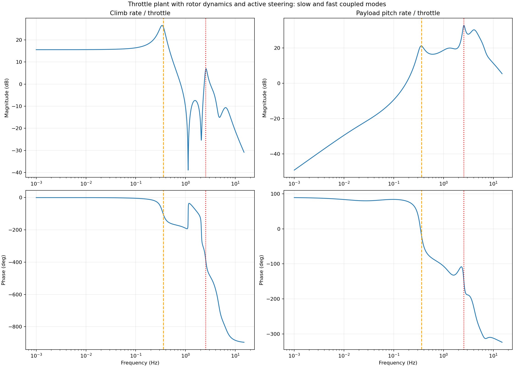

With steering closed at nominal level trim, important plant modes include:

| Mode | Poles, s⁻¹ | Design implication |
|---|---|---|
| Slow pitch / forward-speed motion | −0.307 ± j2.152 | About 0.34 Hz; sustained gust response |
| Relative-pitch / vertical motion | −0.969 ± j15.978 | About 2.54 Hz; constrains aggressive feedback |
| Relative pitch and body rates | −5.117 ± j25.402 | About 4.04 Hz; gyro motion is not a single mode |
| Rotor response | −56.94 | Motor dynamics remain part of the plant |

These labels describe dominant participating states, not independent subsystems. The model also contains roll/yaw modes and controller-filter poles.

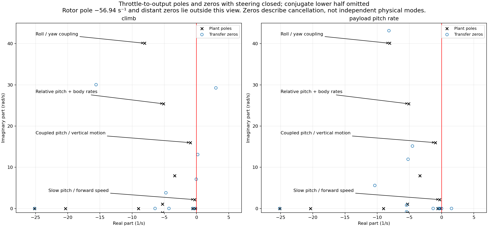

Zeros depend on the controlled output. The payload pitch-rate transfer has a real right-half-plane zero at +1.543 s⁻¹, consistent with its inverse response. With steering closed, the climb transfer includes right-half-plane zero pairs near +0.193 ± j13.086 and +3.014 ± j29.257 s⁻¹. They constrain high-frequency inversion; they do not imply that low-frequency climb has the same initial wrong-way response as payload pitch. A zero describes cancellation among paths, not an extra oscillation mode.

### Optimize the whole loop

The bounded optimization explored three directions: pitch-damper gain and filter shape, climb-rate PI strength, and altitude-loop speed. Ten configurations were screened across the operating cases; useful alternatives then faced matched nonlinear gust histories.

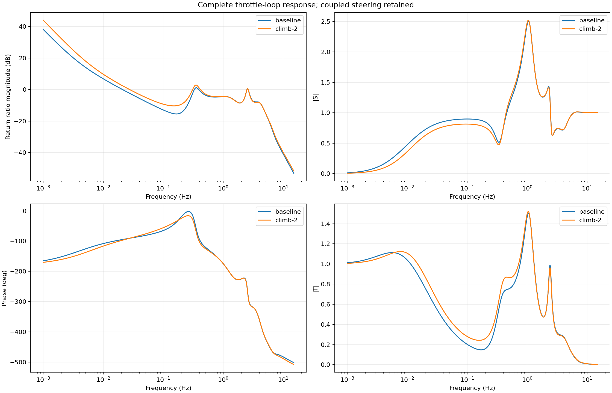

There are several unity-gain crossings. One phase-margin number would hide that structure. The study retains all crossings, examines the Nyquist locus and checks full closed-loop eigenvalues. Sensitivity peaks show where disturbances or model errors can be amplified; they do not replace nonlinear response checks.

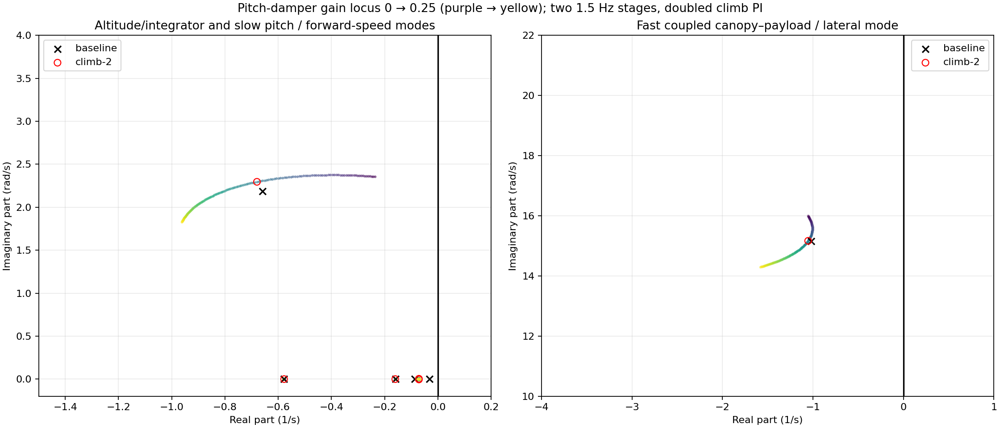

Lowering both pitch-filter cutoffs to 1 Hz improved the worst linear sensitivity peak but produced more pitch motion in both nonlinear gust realizations. Raising them to 2 Hz destabilized two screened cases. Larger damper gains also had an unfavorable motion/effort tradeoff. The pitch settings remain gain 0.1 with two 1.5 Hz stages.

The useful change is stronger climb-rate PI:

~~~text
K_P = positive_throttle_range / (TECS_TIME_CONST × TECS_VERT_ACC)
K_I = TECS_INTEG_GAIN × K_P
~~~

Changing TECS_VERT_ACC from 7 to 3.5 doubles both gains while preserving their ratio. At nominal voltage, K_P becomes 0.03429 throttle fraction per m/s and K_I becomes 0.01029 per metre. This parameter is the gain-scaling denominator in the paraglider path; it is not a newly measured physical acceleration limit.

The outer height time constant remains 10 s, derivative-feedforward smoothing remains 0.5 s, and feedforward calibration is unchanged. Faster altitude feedback improved the small-command tracking score but did not address gust disturbances as directly.

<a id="what-the-selected-tuning-achieves"></a>

## What the selected longitudinal tuning achieves

For a 0.1 m altitude ramp over two seconds, linear prediction differs from the nonlinear candidate by about 0.2 mm height RMS and 0.011°/s pitch-rate RMS. The nonlinear diagnostic includes discrete updates and piecewise feedforward, using simulated truth rather than the native estimator.

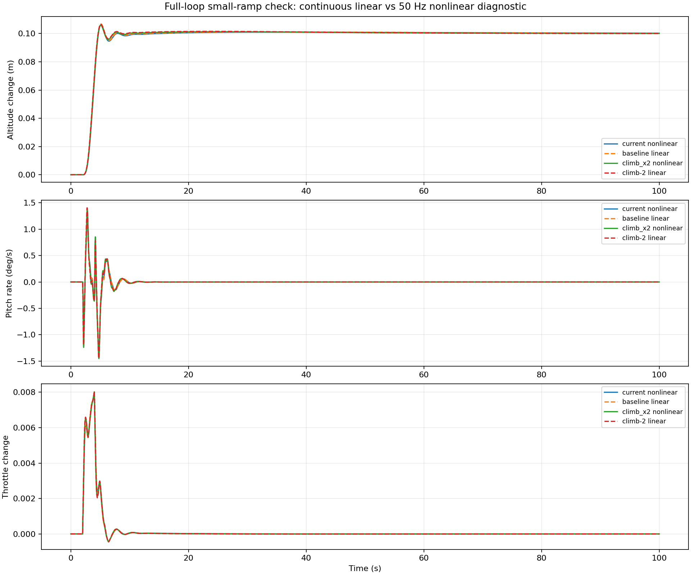

Matched gust histories show the tradeoff:

| Metric | Original gusts: baseline → selected | Different, 50% stronger gusts: baseline → selected |
|---|---:|---:|
| Height error RMS | 0.404 → 0.365 m | 0.531 → 0.480 m |
| Climb-rate RMS | 0.455 → 0.420 m/s | 0.544 → 0.506 m/s |
| Payload pitch standard deviation | 6.17 → 6.24° | 10.14 → 10.16° |
| Pitch-rate RMS | 18.03 → 18.77°/s | 25.08 → 25.58°/s |
| Throttle standard deviation | 2.65 → 3.07 percentage points | 3.91 → 4.43 percentage points |

The choice prioritizes altitude and climb control while accepting modestly more rate motion and throttle effort. No matched run saturates throttle. This is a useful refinement, not a dramatic change in the forced airframe response.

### Native AUTO verification

The selected configuration passed the existing full AUTO test in calm air and synthetic gusts, including altitude changes, both opposing two-turn loiters, home loiter and controller handover. Recorded parameters confirm that only TECS_VERT_ACC changed from the preceding baseline; the backend reported no errors or clipped packets.

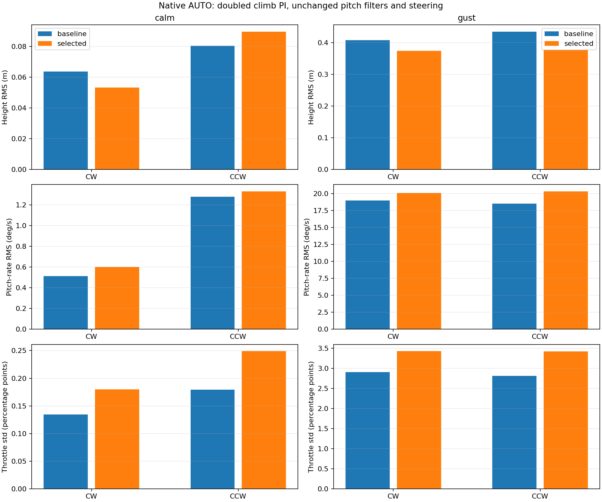

| Native result | Baseline → selected |
|---|---:|
| Gusty CW loiter height RMS | 0.408 → 0.375 m |
| Gusty CCW loiter height RMS | 0.435 → 0.379 m |
| Calm CW loiter height RMS | 0.064 → 0.053 m |
| Calm CCW loiter height RMS | 0.080 → 0.089 m |
| Gusty maximum waypoint height error | 2.26 → 2.20 m |
| Calm maximum waypoint height error | 1.71 → 1.66 m |
| Gusty maximum corner overshoot | 1.39 → 1.35 m |
| Calm maximum corner overshoot | 0.36 → 0.63 m |

Settled gusty pitch-rate RMS rises from 19.02 to 20.11°/s clockwise and 18.53 to 20.32°/s counterclockwise. Throttle standard deviation rises from 2.90/2.81 to 3.42/3.42 percentage points. These costs accompany the altitude improvement.

The baseline is the archived passing two-stage-damper run; the candidate uses the same route, model and gust generator. Arrival times differ, so the loiters encounter different gust phases. The matched nonlinear histories isolate the tuning change; the native tests establish integration behavior, rather than statistical superiority across weather.

The [feature branch’s paired mission-development parameter files](https://github.com/DavidIngraham/ardupilot/commit/5f483ade60) now select TECS_VERT_ACC = 3.5. This changes development tuning, not ArduPilot's generic parameter default. The new low-voltage and softer-roll results are local linear checks; the fresh native runs here use the nominal model at 22.2 V.

## Seeing why the damping path matters

These diagnostic videos retain the earlier climb-feedback setting to isolate the damper configurations. They explain the architecture; they are not recordings of the doubled-PI candidate.

<video controls muted loop playsinline preload="metadata" poster="assets/viewer/pitch-sign/pitch-sign-carriage.jpg" style="width:100%" autoplay>
  <source src="assets/viewer/pitch-sign/pitch-sign-carriage.mp4" type="video/mp4">
</video>

*Identical small pitch-rate disturbances: damper off, fast original sign, reversed sign, and two-stage filtering. The camera preserves carriage translation and rotation. Standalone truth-sensed simulation.*

<video controls muted loop playsinline preload="metadata" poster="assets/viewer/altitude-comparison/altitude-comparison-smooth-camera.jpg" style="width:100%" autoplay>
  <source src="assets/viewer/altitude-comparison/altitude-comparison-smooth-camera.mp4" type="video/mp4">
</video>

*A 100 → 105 m altitude command separates the fast-sign problem from slower instability. Off and two-stage-filtered cases settle; simply reversing the fast damper does not. These are diagnostic alternatives, not flight recordings.*

## The controller flying the aircraft

The calm, gust and crosswind clips below show native AUTO with the same two-stage damper and the preceding climb-feedback gains. They retain the CAD payload, articulated suspension, rotating capstans and propeller, throttle history, brake pull, wind indicator, ground track and altitude side profile. The numerical comparisons above document the subsequent PI refinement.

**Calm air**

<video muted loop playsinline controls preload="metadata" width="1280" height="852" poster="assets/viewer/auto-calm-profile-plain.jpg" aria-label="Calm-air native AUTO mission with ground track, altitude side profile, throttle history and brake pull" autoplay>
  <source src="assets/viewer/auto-calm-profile-plain.mp4" type="video/mp4">
  <source src="assets/viewer/auto-calm-profile-plain.webm" type="video/webm">
  Your browser does not support inline video.
</video>

**Moderate synthetic gusts**

<video muted loop playsinline controls preload="metadata" width="1280" height="852" poster="assets/viewer/auto-gust-profile-plain.jpg" aria-label="Gusty native AUTO mission with ground track, altitude side profile, throttle history and brake pull" autoplay>
  <source src="assets/viewer/auto-gust-profile-plain.mp4" type="video/mp4">
  <source src="assets/viewer/auto-gust-profile-plain.webm" type="video/webm">
  Your browser does not support inline video.
</video>

**Steady 2 m/s eastward wind**

<video muted loop playsinline controls preload="metadata" width="1280" height="852" poster="assets/viewer/auto-crosswind-profile-plain.jpg" aria-label="Native AUTO mission in steady 2 m/s eastward wind with ground track, altitude side profile, throttle history and brake pull" autoplay>
  <source src="assets/viewer/auto-crosswind-profile-plain.mp4" type="video/mp4">
  <source src="assets/viewer/auto-crosswind-profile-plain.webm" type="video/webm">
  Your browser does not support inline video.
</video>


## Bringing the two axes together

The lateral analysis supports strong feedforward, modest heading-rate feedback and less measurement feedback near the coupled modes. The longitudinal analysis supports calibrated throttle feedforward, two-stage pitch filtering and stronger climb-rate PI. Both designs separate command tracking from damping instead of asking a large feedback gain to do everything.

The remaining integration experiment is specific: compare the 1 Hz lateral candidate against the 4 Hz baseline with the selected doubled climb PI, using the same native missions and wind cases. The separate successful trials motivate that combination; they do not establish its combined performance.

## Scope and next steps

This is an up-and-away simulator controller, evaluated on a model informed by the flights. Original flight-tested settings remain distinct from new SITL settings. Launch, canopy collapse, landing flare and flight validation are outside this study. Saturation, estimator delay and model error remain reasons to check nonlinear and native behavior after linear design.

A relative-motion observer remains a possible extension. The present result uses the existing payload gyro and navigation estimates. Next comes aircraft validation and, separately, testing the lateral 1 Hz candidate alongside this longitudinal tuning.

[Data and methods](data-and-methods.md#full-loop-longitudinal-design) records reproduction commands, numerical results, parameter provenance and the archived experimental sequence. Raw trajectories and flight logs remain in Mission Planner.
