# Post-flight Controller Research Record

This appendix preserves the experimental sequence and historical configurations. The [controller design article](controller-design.md) is the current design narrative and selected tuning. References to current settings below describe each recorded experiment, not a universal latest configuration.

## Lateral experiments

### Why I came back to a dedicated turn-rate controller

The shortcut got the aircraft flying missions, but it still used bank angle as a stand-in for the response I cared about. Looking back at the flights, I wanted to understand what changing the roll gains was actually doing to the turns. Simulation gave me a way to separate the steering loop from the navigation geometry and test that question repeatedly.

Increasing the roll-to-servo gain produced a stronger differential-brake correction. It did not give me independent control over turn-rate tracking and roll damping. During a turn entry or an oscillation, bank and heading rate do not follow the steady-turn relationship instantaneously. Changes in speed also change their relationship. Those are the places where the convenient mathematical equivalence stops describing the full dynamics.

I therefore returned to the yaw-rate-controller idea, implementing it as a dedicated **heading-rate controller**. It tracks the rate of turning directly, with differential-brake feed-forward, PI feedback, rate and acceleration limits, and a separate roll-rate damping term. That lets me tune how quickly the aircraft turns without using the same gain to stand in for all of its lateral motion. The replacement was developed and tested in SITL; the real flights described here used the original approach.

The mission plots also made me question the waypoint radius. We could make the response better damped and still overshoot the next track if the requested turn was too tight. I asked us to base the turn geometry on achievable turn rate, then optimize for tighter turns with less overshoot and repeat the comparison across wind and turbulence. Those experiments helped separate guidance geometry from the steering-loop tuning.

These earlier simple-model gains and navigation settings are listed in the [appendix](data-and-methods.md#lateral-controller-evidence).

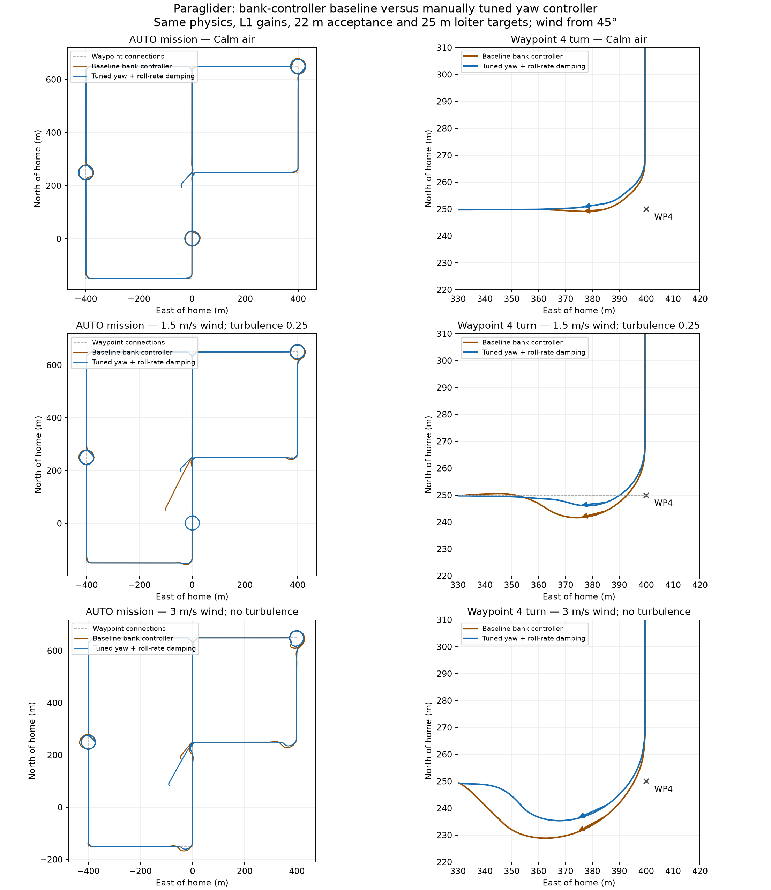

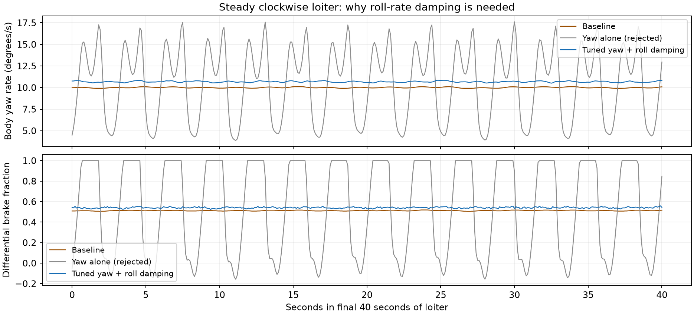

In that earlier simulator, we ran the selected gains through the normal calm AUTO mission and controller handover test; both passed. Calm corner overshoot was approximately 0.31 m in the selected validation. Results are not universally robust: the 3 m/s steady-wind case exceeded the 4 m corner limit, and turbulence 0.5 caused altitude aborts with both controllers. Each wind condition had a single comparison flight. Failed tuning candidates are retained.

[Yaw validation and selected comparisons](../scratch/paraglider-tests/yaw-controller/validation.json) records the exact settings and limitations. I also explored a Lua quicktuner based on Plane autotune and the other tuning scripts, including L1 tuning. I decided it had not yet proven its value, so I kept its source and binding patches separately in provenance and out of the durable branch.

### Tuning the dedicated loop with separate canopy and payload motion

The simulator now has **nine mechanical degrees of freedom**: three shared translations, three payload rotations, and three canopy rotations. Two free rigid bodies would have twelve; the point joint removes three independent translations while allowing relative roll, pitch, and yaw. Rotor RPM and actuator states are additional dynamics, rather than extra canopy–payload mechanical freedoms.

This 9-DOF simulator changed the tuning problem. It represents the heavier Trout Lake configuration at 1.758 kg, with separate canopy and payload motion. The controller could follow a route while continuously shaking the payload. That became particularly clear when I returned to the throttle damper: some of the pitch motion I was trying to suppress was being driven by steering.

I limited the next study to two controller revisions and held the model coefficients fixed. Removing individual steering terms in successive settled windows pointed to heading-rate proportional feedback as the main source of fast excitation. Payload pitch-rate RMS dropped from about 16.5 to 3.3 degrees per second with that term removed; restoring the original settings brought the motion back. Removing roll damping or acceleration feedforward alone had much less effect.

The first revision reduced heading-rate P from 0.04 to 0.005 and roll damping from 0.03 to 0.003. Straight flight became much quieter, but a roughly 10-degree-per-second turn request now produced about 35 degrees per second. Removing the fast oscillation exposed excessive feedforward.

Steady-turn calculations gave equivalent feedforward gains of about 0.0056 left and 0.0123 right, including the asymmetric trim. I selected 0.009, left the integrator to correct the residual bias, and disabled heading-acceleration feedforward. Final sustained-turn tracking errors were 0.31 degrees per second right and 0.14 left, measured as RMS error over each phase's final 20 seconds.

#### The current loop, one operation at a time

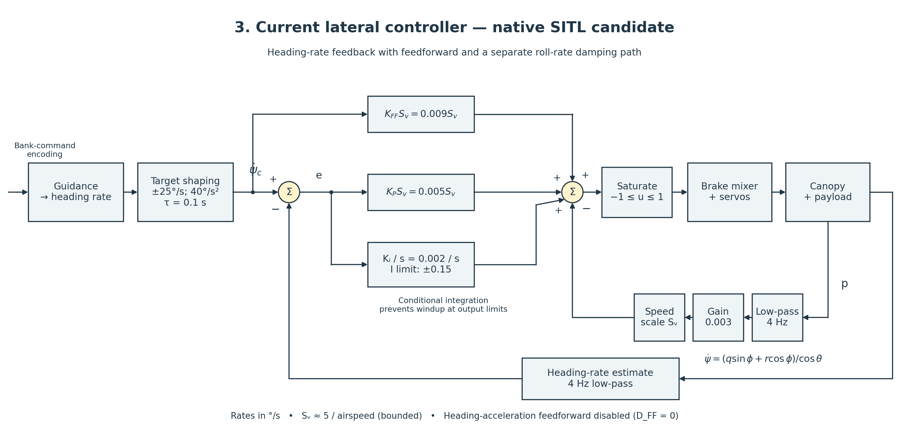

*The current native SITL candidate. Roll-rate feedback is expanded into its low-pass filter, damping gain, and airspeed scaling. It enters the output sum with a negative sign. The heading-rate P path is a different feedback term.*

Navigation still encodes its request as bank, but bank is no longer the feedback target. The code converts that request to heading rate using airspeed and, in automatic navigation, the heading/course projection. It limits the request to ±25 degrees per second, smooths it with a 0.1-second time constant, and limits its acceleration to 40 degrees per second squared.

The measured heading rate comes from the payload gyro and attitude:

```text
heading_rate = (q sinφ + r cosφ) / cosθ
error = shaped_heading_rate_target − filtered_heading_rate

u = clip[Sᵥ (0.009 × target + 0.005 × error − 0.003 × filtered_roll_rate) + I, −1, +1]
İ = 0.002 × error, with |I| ≤ 0.15 and conditional integration at output saturation
```

Rates here are in degrees per second. Both measured rates pass through 4 Hz low-pass filters. The airspeed multiplier is `Sᵥ = clamp(5 / max(Vair, 2), 0.25, 2.5)` for this configuration. The integral term is not multiplied by that scale. The normalized output passes through ArduPlane's brake mixer and servo mapping.

Here `p` is body-axis roll rate measured by the payload gyro. It is only approximately the Euler bank-angle rate `φ̇` near level attitude. In general, `φ̇ = p + (q sinφ + r cosφ) tanθ`. The damping path uses `p`, not that Euler-angle derivative. Its gain is labeled `K_RD`, alongside `K_FF`, `K_P`, and `K_I`; the separate `Sᵥ` block applies airspeed scaling.
This separates three jobs: feedforward supplies the expected brake input, heading-rate PI corrects tracking and trim error, and roll-rate feedback damps rocking. There is no roll-angle holding loop inside it. Heading-acceleration feedforward remains available in the implementation but is zero in this candidate.

#### A mission that tracks without the repeated rocking

The revised lateral settings and the [longitudinal changes](longitudinal-observer.md#returning-to-native-mission-control) passed the existing native AUTO test, with its original altitude, corner, opposing-loiter, home-loiter and controller-handover checks unchanged.

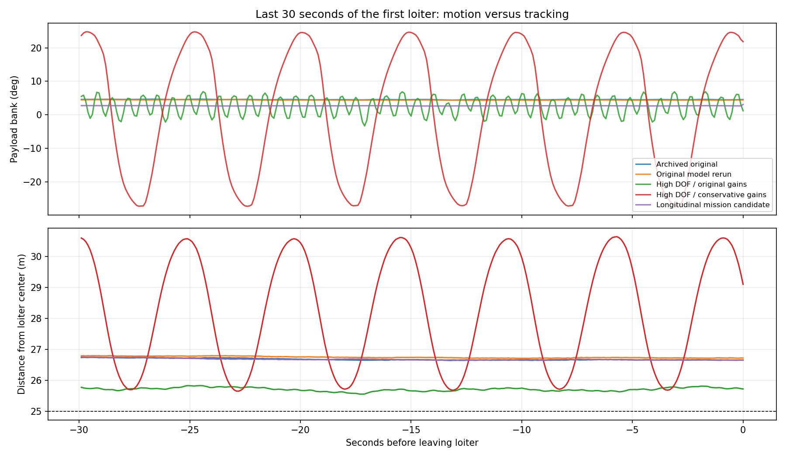

*The final 30 seconds of the first AUTO loiter. Purple is the current candidate; green is the 9-DOF model with original gains; red is an earlier conservative-gain trial. Older simple-model runs provide context, not a claim of equal model fidelity.*

First-loiter bank standard deviation fell from 2.60 degrees with the 9-DOF original gains to 0.039 degrees. Median radii were 26.74 and 26.68 m for the 25 m requests. Maximum corner overshoot was 0.66 m. The slightly wider circle and larger corner error were a worthwhile trade for much steadier motion. The same candidate remained well behaved with a softer roll model and at lower voltage; those checks did not include wind.

The progression is now clearer to me: the angle-controller workaround got the aircraft flying missions; direct heading-rate feedback separated steering from bank; the articulated model exposed how those corrections excited the payload. The latest gains are a simulator development candidate. The real Trout Lake flight still used the original angle workaround.

### What the linear analysis tells me

After getting the native mission controller to fly a much calmer route, I wanted to understand how much stability margin remained. I linearized the 9-DOF model at the Trout Lake straight, level trim: 1.758 kg, 4.383 m/s, 44.59% throttle, left brake released and right brake at 3.747 mm. That nonzero brake trim matters: small corrections stay on the right-brake branch rather than crossing the mixer’s change of side.

The local model keeps fourteen internal states after removing global position and heading. That is a state count, not fourteen mechanical degrees of freedom. Throttle and equilibrium rotor speed are held fixed for this lateral analysis. With differential brake command `u`, heading rate `ψ̇`, and body roll rate `p`, the plant is:

```text
Δẋ = A Δx + B Δu
Gψ(s) = Δψ̇/Δu = Cψ (sI − A)⁻¹ B
Gp(s) = Δp /Δu = Cp (sI − A)⁻¹ B

Gψ(0) = 98.00 deg/s per brake fraction
Gp(0) = −13.05 deg/s per brake fraction
```

A one-percent brake-command increment therefore produces about 0.98 deg/s of steady heading rate locally. Inverting that gain, including the speed multiplier, gives a feedforward gain of **0.00894**—almost exactly the 0.009 selected in the preceding nonlinear study.

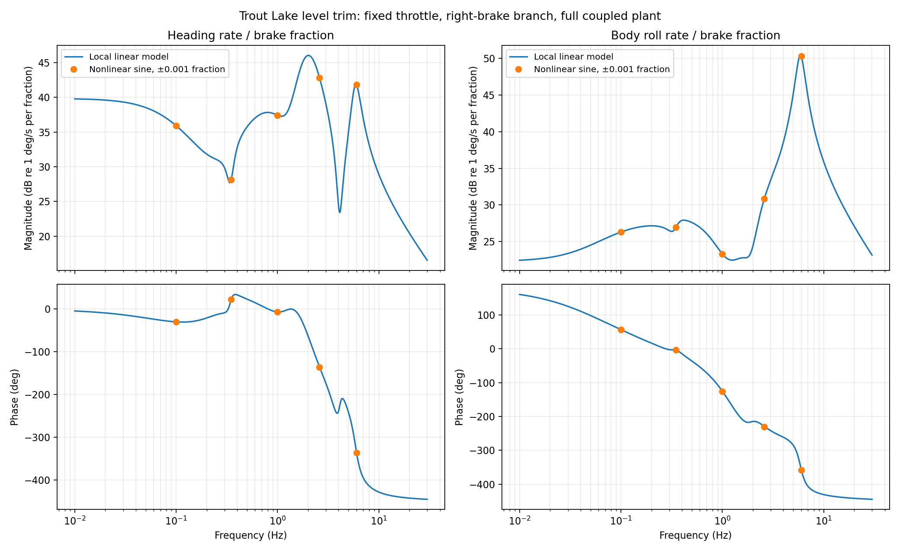

*The full plant has several coupled modes. Small-amplitude nonlinear sine tests match the sampled linear response within 0.005%; the slight difference from the continuous curve at high frequency is the input hold. This checks the linearization against the simulator.*

#### Writing the feedback loop explicitly

At fixed speed scaling, below the command and actuator limits, the implemented controller becomes:

```text
e(s) = r(s) − H(s) ψ̇(s)
u(s) = S K_FF r(s) + [S K_P + K_I/s] e(s) − S K_RD H(s) p(s)

K_FF = 0.009; K_P = 0.005; K_I = 0.002; K_RD = 0.003
S = 5 / 4.383 = 1.1408
H(s) = 25.133 / (s + 25.133)       [4 Hz measurement filter]
r(s) = r_requested(s) / (0.1s + 1) [when command limits are inactive]

L(s) = H(s){[S K_P + K_I/s] Gψ(s) + S K_RD Gp(s)}
ψ̇(s)/r_requested(s) = Gψ(s)[S(K_FF + K_P) + K_I/s]
                       / {(1 + L(s))(0.1s + 1)}
```

The integrator is not speed-scaled. Feedforward affects command response but does not move the feedback poles. Also, body roll rate is not zero in every steady banked turn: `p = φ̇ − ψ̇ sinθ`. Roll-rate damping therefore supplies a small steady-turn correction as well as opposing oscillation.

#### The poles explain why more P was not helping

The selected gains are locally stable, but the original larger feedback gains are unstable in this model. With the selected gains, a lightly damped pair sits at `−0.986 ± j15.969 s⁻¹`: about 2.54 Hz, with damping ratio 0.062. Scaling all feedback gains together reaches instability at **1.524 times nominal**, a gain margin of **3.66 dB**. Increasing heading-rate P alone reaches the boundary near 0.00791, with I and roll damping held fixed.

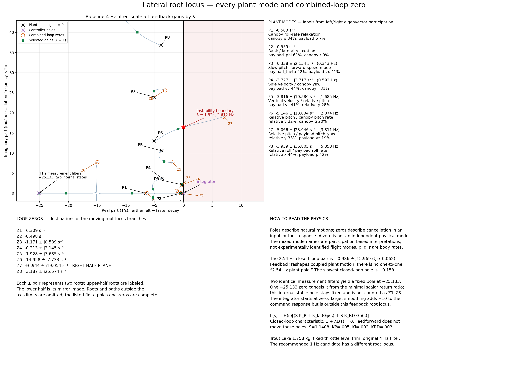

*Crosses are open-loop poles, circles are combined-loop zeros, and green squares are the selected closed-loop poles. The mode labels come from eigenvector participation: several motions mix pitch, yaw, and translation. The red star marks the gain-induced instability boundary. The lower-half-plane branches mirror the upper half.*

The slow oscillatory plant mode mixes pitch and forward speed at about 0.34 Hz. Another mixes sideways velocity and canopy yaw around 0.59 Hz; the fastest pair is predominantly relative canopy/payload roll at 5.86 Hz. Feedback changes these coupled motions rather than merely adding damping to a single isolated roll mode.

Zeros need a different interpretation: they describe cancellation in an input–output response, not another natural motion. The combined loop has a right-half-plane zero pair at `+6.944 ± j19.054 s⁻¹`. The individual heading-rate and roll-rate plants have different zeros, so those cannot be substituted as endpoints of this root locus. [The separate pole–zero maps](../research/flight-log-analysis/figures/turn-model-spike/classical-lateral/plant-zero-map.png) show all of them. These are properties of the modeled plant, not modes or zeros identified directly from flight.

### Less feedback at the troublesome frequencies

The next experiment kept every gain and model coefficient fixed and changed only measurement filtering. I compared six filters across level flight, climb and descent at ±0.5 m/s, and level turns at ±10 deg/s. Two candidates stood out: lowering the existing low-pass cutoff from 4 to 1 Hz, and adding a broad notch at 2.5 Hz.

```text
1 Hz candidate: H₁(s) = 6.283 / (s + 6.283)
Notch candidate: H_N(s) = H(s) (s² + 6.283s + 246.740)
                              / (s² + 21.991s + 246.740)
```

Both retain unity DC gain. Feedforward bypasses the measurement filters, so reducing feedback near the troublesome modes need not make every turn command sluggish.

| Measurement filter | Level-flight gain margin | Lowest margin across five trims |
|---|---:|---:|
| Existing 4 Hz low-pass | 3.66 dB | 2.31 dB |
| 1 Hz low-pass | 8.41 dB | 6.87 dB |
| Broad 2.5 Hz notch | 14.83 dB | 7.04 dB |

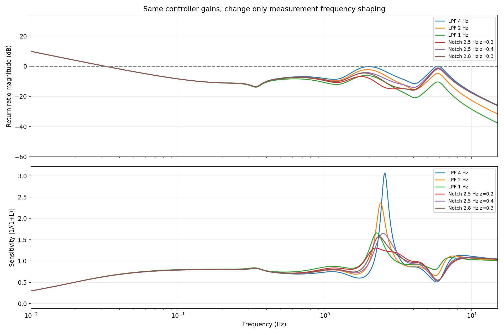

*Both candidates reduce the sensitivity peak near the troublesome mode. The notch has the strongest straight-flight margin, but its advantage over the simpler filter narrows in left turns.*

Local command tracking stayed similar. I then ran eighteen nonlinear tests: level flight and both turn directions, each with three filters and either zero or 80 ms of added sensing delay. These used the actual modeled brake travel limits, asymmetric PWM mapping, changing speed scaling, and integral limits. The requested increments were 2 deg/s, continuing in the existing turn direction.

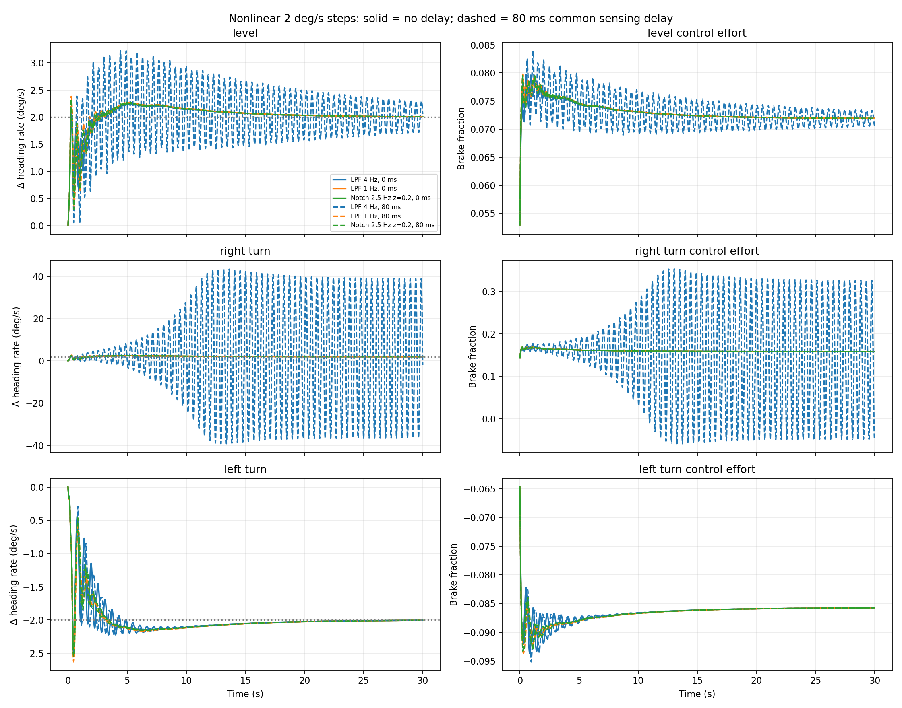

*Solid lines have no added delay; dashed lines have 80 ms. The existing filter develops a large oscillation in the right turn, while both candidates keep tracking. The left-turn baseline remains well behaved, consistent with the asymmetric plant.*

In the delayed right-turn case, final-ten-second heading-rate RMS error was 26.65 deg/s with the existing filter, versus about 0.016 deg/s with either candidate. Without added delay, the 1 Hz filter’s integrated right-turn tracking error changed from 5.10 to 5.12 degrees over the 30-second run. The benefit is more tolerance of feedback phase lag, with little tracking cost in these tests.

#### Taking the 1 Hz candidate through native SITL

I then ran the missing implementation trial: the full ArduPlane controller, estimator, navigation and altitude loops together. I compared `PG_TURN_FILT = 4` and `1` Hz in calm air, moderate repeatable gusts, and a steady 2 m/s eastward wind. All gains and model coefficients stayed fixed. The 1.758 kg Trout Lake model flew the same mission at 22.2 V, including altitude changes and clockwise and counterclockwise loiters. **All six native AUTO tests passed.**

| Condition | Right-turn heading-rate RMS error, 4 → 1 Hz | Left-turn heading-rate RMS error, 4 → 1 Hz |
|---|---:|---:|
| Calm | 0.36 → 0.26 deg/s | 0.39 → 0.31 deg/s |
| Moderate gusts | 9.93 → 9.66 deg/s | 9.43 → 10.44 deg/s |
| Steady crosswind | 2.39 → 1.93 deg/s | 3.75 → 3.25 deg/s |

These errors compare the requested rate with the unfiltered simulated payload heading rate, rather than rewarding the filter for making its own feedback signal smoother. Across the six settled-loiter comparisons, brake-command content above 1 Hz fell by **34–69%**. Radial tracking stayed essentially unchanged or improved slightly. In gusts, altitude RMS error remained around 0.41 m, and none of the settled loiters saturated the differential-brake command.

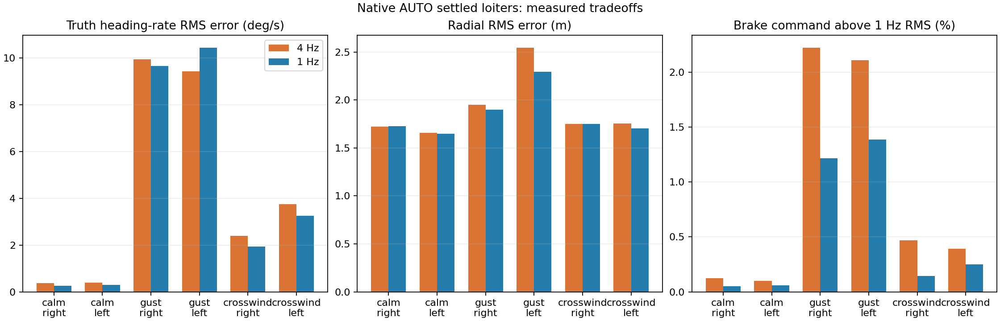

*Blue is 1 Hz. Quieter commands are a consistent benefit; better heading-rate tracking is not universal. In particular, the gusty left turn had higher rate error even though radial tracking improved.*

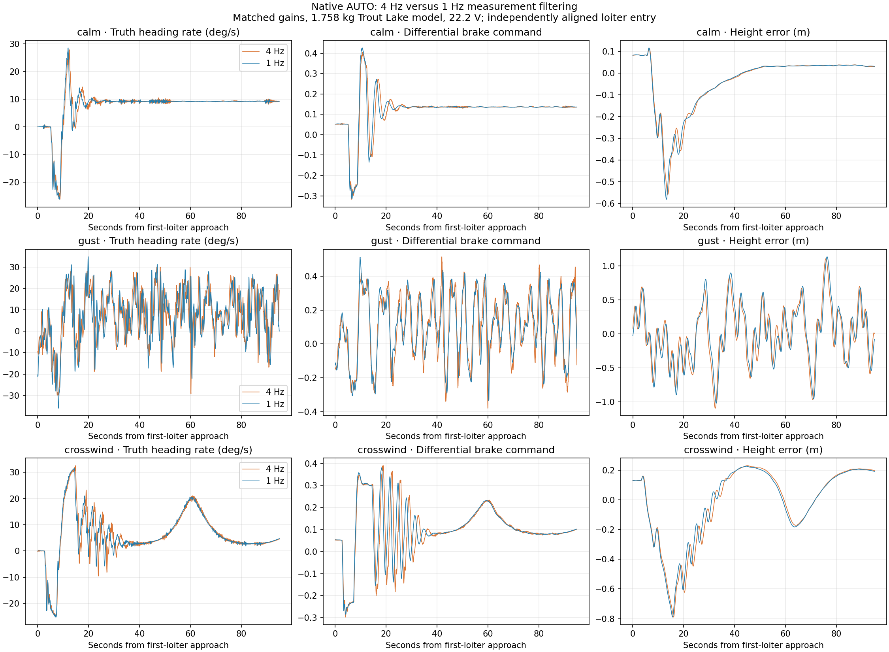

*Matched settings, with each first-loiter entry aligned independently. Most of the remaining gust-driven rate error is below 1 Hz. Reducing high-frequency feedback does not remove that slower motion.*

I would use **1 Hz for the next SITL configuration, with the gains unchanged**. This is an incremental improvement, not a cure for gust response. These are single paired runs; the repeatable gust field has a different arrival phase when the trajectory changes. They also do not reproduce the earlier artificial 80 ms delay test or remeasure a stability margin. The existing mission videos and published default parameters still use 4 Hz. [Data and methods](data-and-methods.md#native-lateral-filter-trial) records the exact configurations, analysis and scope.

### Watching the two bodies move

After working through the mode shapes and controller plots, I wanted to see what those motions actually looked like. I built a Three.js viewer around the simulator's internal state and brought in my SolidWorks payload assembly. The canopy and payload now move independently, the servo capstans rotate as the brakes pull in, with black-and-white quadrants and an orange index stripe to make their motion visible, and the pusher propeller spins with the modeled motor RPM.

<video autoplay muted loop playsinline controls preload="metadata" width="1280" height="852" poster="assets/viewer/reversing-turn-controls-plain.jpg" aria-label="Simulated powered right turn, left reversal and brake release, with an articulated SolidWorks payload close-up">
  <source src="assets/viewer/reversing-turn-controls-plain.mp4" type="video/mp4">
  <source src="assets/viewer/reversing-turn-controls-plain.webm" type="video/webm">
  Your browser does not support inline video.
</video>

*Thirty seconds at real speed: a powered right turn, a reversal to the left, then brake release. This is a scripted open-loop run of the 9-DOF model at the 1.758 kg Trout Lake mass and 22.2 V. Moderate synthetic gusts act on the physics throughout, with nominal RMS speeds of 0.5 m/s in each horizontal direction and 0.25 m/s vertically. Peak payload bank is 36.2°. The left view follows the aircraft; the right rides with the payload so the mechanisms stay visible. Joint motion is shown at its actual simulated amplitude. [Download the clip](https://raw.githubusercontent.com/DavidIngraham/ArduPilot-tinkering/main/docs/assets/viewer/reversing-turn-controls-plain.mp4).*

The reversal is the interesting part. The payload and canopy do not behave like one rigid airplane, and brake release does not instantly erase their relative motion. In this run the largest relative rotation-vector components are 4.5° in roll, 11.4° in pitch, and 7.2° in yaw. Seeing that motion alongside brake travel makes the connection between the coupled modes and the physical aircraft much easier to follow.

The viewer can replay recordings or receive a live truth-state stream from the Python simulator running behind ArduPilot SITL. I can pause, scrub through a transition, change camera angles, and inspect joint angles alongside actuator inputs. All the physics stays in the simulator; the browser draws its results. This clip demonstrates the model and viewer, rather than an autonomous-controller test or a recreation of a recorded flight.

The payload geometry comes from CAD; the canopy and suspension lines are schematic. The [viewer source and setup guide](../viewer/README.md) cover the live connection and CAD export, and [data and methods](data-and-methods.md#articulated-flight-viewer) records how this clip was generated.

#### The controller flies the mission

Next I connected the viewer to a full native ArduPlane SITL AUTO run. Here the mission supplies navigation targets, the heading-rate controller commands the brakes, and the longitudinal controller commands throttle. The aircraft's changing motion feeds back through the simulated sensors and estimator. I recorded the resulting state and actuator motion while the complete mission test ran.

The following three clips show the same mission segment and controller configuration: approach to mission item 3, a clockwise loiter requested at 25 m radius and 90 m altitude. Each runs for 55 seconds at real speed. Only the wind condition changes. The lower-left side profile unfolds the flight into distance travelled versus altitude, directly beneath the north-up ground track. All three use the same 85–95 m altitude scale, with a white dot marking the current position.

**Calm air**

<video muted loop playsinline controls preload="metadata" width="1280" height="852" poster="assets/viewer/auto-calm-profile-plain.jpg" aria-label="Calm-air native AUTO mission with ground track, altitude side profile, throttle history and brake pull">
  <source src="assets/viewer/auto-calm-profile-plain.mp4" type="video/mp4">
  <source src="assets/viewer/auto-calm-profile-plain.webm" type="video/webm">
  Your browser does not support inline video.
</video>

*With no wind, altitude stays between 89.45 and 90.11 m in the excerpt. Throttle ranges from 43.0% to 46.8%. [Download calm-air video](https://raw.githubusercontent.com/DavidIngraham/ArduPilot-tinkering/main/docs/assets/viewer/auto-calm-profile-plain.mp4).*

**Moderate synthetic gusts**

<video muted loop playsinline controls preload="metadata" width="1280" height="852" poster="assets/viewer/auto-gust-profile-plain.jpg" aria-label="Gusty native AUTO mission with ground track, altitude side profile, throttle history and brake pull">
  <source src="assets/viewer/auto-gust-profile-plain.mp4" type="video/mp4">
  <source src="assets/viewer/auto-gust-profile-plain.webm" type="video/webm">
  Your browser does not support inline video.
</video>

*The same controller now handles the repeatable gust field: nominal RMS 0.5 m/s north/east and 0.25 m/s vertically, with zero mean wind. Altitude ranges from 88.91 to 90.83 m and throttle from 39.9% to 52.9%. [Download gust video](https://raw.githubusercontent.com/DavidIngraham/ArduPilot-tinkering/main/docs/assets/viewer/auto-gust-profile-plain.mp4).*

**Steady crosswind**

<video muted loop playsinline controls preload="metadata" width="1280" height="852" poster="assets/viewer/auto-crosswind-profile-plain.jpg" aria-label="Native AUTO mission in steady 2 m/s eastward wind with ground track, altitude side profile, throttle history and brake pull">
  <source src="assets/viewer/auto-crosswind-profile-plain.mp4" type="video/mp4">
  <source src="assets/viewer/auto-crosswind-profile-plain.webm" type="video/webm">
  Your browser does not support inline video.
</video>

*A steady 2 m/s wind blows east, with no gusts. It is a crosswind on north/south legs; its headwind, tailwind and crosswind components change around the loiter. Altitude ranges from 89.22 to 90.22 m and throttle from 42.9% to 46.9%. The full native AUTO test also passed in this condition. [Download crosswind video](https://raw.githubusercontent.com/DavidIngraham/ArduPilot-tinkering/main/docs/assets/viewer/auto-crosswind-profile-plain.mp4).*

In the gust clip, the turn entry reaches 16.9° of payload bank. The controller continues correcting for the changing air velocity while the canopy and payload move relative to each other. Peak relative rotation-vector components in this excerpt are 3.4° in roll, 12.9° in pitch and 6.6° in yaw. The wind flag points downwind on a north-up compass, with horizontal speed and a separate up/down vertical-wind readout. It uses the same earth-frame wind vector that drives the physics, not aircraft-relative airflow. The articulation is not an added animation.

With the same synthetic gust settings as the scripted clip, the full gust run passed the existing AUTO regression, including its altitude changes, corner checks, opposing two-turn loiters, home loiter and controller handover. This excerpt uses the heading-rate controller throughout; it ends well before the handover test. The native log confirms AUTO mode throughout the clip. The model uses constant 22.2 V and the 1.758 kg Trout Lake configuration, with an airborne start. These are repeatable synthetic gusts with zero mean wind, not a recreation of measured weather. The earlier calm-air run also passed. [Reproduction and recording checks](data-and-methods.md#native-auto-mission-video) accompany the clip.

The earlier damper-off video exposed a weakness that the mission pass did not capture. Payload pitch swings from −11.7° to +26.3°, with a dominant frequency near 0.36 Hz (a 2.75-second period). Climb rate ranges from −1.41 to +1.34 m/s. Height error remains between −0.81 and +1.49 m, so the mission test passes while the aircraft visibly rocks. This is adequate route completion, but poor longitudinal disturbance rejection. The [longitudinal comparison](longitudinal-observer.md#what-the-gust-video-exposed) separates those two outcomes.

The [longitudinal chapter](longitudinal-observer.md) picks up the same experiment from the throttle side. [Data and methods](data-and-methods.md#lateral-controller-evidence) preserves the earlier tuning records. The [current plotting source](../research/flight-log-analysis/scripts/native-sitl/), [figure manifest](../research/flight-log-analysis/manifest.json), and [diagram generator](../tools/draw_control_loops.py) preserve this update. Native implementation and reproduction instructions are recorded at ArduPilot commit `2588ecc44a` on `paraglider-high-dof-control`.

All three clips use the improved controller from the [gust-control study](longitudinal-observer.md#shaping-the-damper-around-the-gust-response): pitch-rate throttle damping with two 1.5 Hz low-pass stages. During the gust excerpt, pitch standard deviation is 6.78°, climb-rate RMS is 0.44 m/s, and throttle ranges from 39.9% to 52.9%. The study compares complete native AUTO flights against the earlier damper-off baseline. All the videos include a ten-second throttle-command history on a fixed 0–100% scale and left/right actual brake-pull bars on the same 0–100 mm scale. Zero means released. The common scale preserves the real left/right asymmetry alongside the rotating capstans.

## Longitudinal experiments

### Returning to native mission control

The simulator eventually grew into a 9-DOF model with separate canopy and payload motion, representing the 1.758 kg Trout Lake configuration. Early experiments with direct access to joint state showed that relative-motion feedback could help, but estimating that state on the real aircraft introduced another problem. I kept the [joint-controller and observer experiments](data-and-methods.md#longitudinal-joint-control-and-observer-research) as a longer-term path and returned to the signals and control loops already available in ArduPilot.

Working with Codex, I bounded this study to two controller revisions with the model coefficients held fixed. Each candidate flew an airborne sequence of climb, altitude capture, descent, and sustained turns. We then repeated the selected settings with a softer roll model and lower voltage, and ran the existing full AUTO test. We kept useful tradeoffs instead of requiring every metric to improve.

The first surprise was lateral: the brakes were exciting payload motion. Reducing heading-rate feedback made straight flight much quieter; correcting excessive steering feedforward then made sustained turns predictable. The [lateral chapter](paraglider.md#tuning-the-dedicated-loop-with-separate-canopy-and-payload-motion) shows those changes and the evolving control loops. A pitch-rate signal alone could not tell me where the motion originated.

The later [linear lateral analysis](paraglider.md#what-the-linear-analysis-tells-me) put that coupling into frequency-domain terms. The 9-DOF plant contains mixed pitch, yaw and translational modes, and the selected steering feedback leaves a lightly damped closed-loop pair near 2.54 Hz. Lowering the lateral measurement filter to 1 Hz, or adding a broad notch, improved modeled stability margins without changing throttle control. The 1 Hz candidate subsequently passed six matched native AUTO trials in calm air, gusts and steady crosswind, reducing rapid brake activity with mixed gust-rate tracking results. The historical native longitudinal and AUTO results below still use the 4 Hz lateral filter. This reinforces the sequence: quiet the steering-driven motion before asking a throttle damper to suppress it.

#### Match throttle feedforward to the simulated aircraft

Model trim calculations required 44.6% throttle for level flight and 59.9% for a 1 m/s climb at 22.2 V. With a 60% throttle ceiling, I selected 45% cruise throttle and a 1 m/s climb calibration. Holding the brakes fixed isolated the vertical-feedforward benefit: climb height RMS error dropped from about 0.73 to 0.08 m.

The descent calibration became 2.5 m/s to fit the local descending-throttle slope. These settings calibrate feedforward to this simulator; they do not replace my flight-derived climb/sink estimates or establish a new full-glide sink limit.


*The same simulated aircraft, before and after controller changes. Across the matched climb phase, height RMS error improved from 0.92 to 0.14 m. The lateral changes remove much of the motion that otherwise feeds into the longitudinal problem.*

#### Smooth the altitude-capture kick

A sharp pitch transient remained when the climb command returned to neutral. Native FBWB captures current altitude at that point. The resulting demand change produced a brief derivative spike, which went into throttle feedforward.

I added a first-order smoother to that derivative:

```text
filtered_rate += dt / (dt + time_constant) × (raw_rate − filtered_rate)
```

The selected time constant is 0.5 seconds. Height feedback and trajectory slew limits stay unchanged. `TECS_PG_HR_TC` defaults to zero, preserving the previous behavior unless explicitly enabled.


*Only the smoothing setting changes in this comparison. Peak pitch rate during climb capture falls from 64.1 to 14.7 degrees per second—a 77% reduction.*

Climb height RMS error increases from about 0.10 to 0.14 m, and capture error from 0.06 to 0.08 m. I would take that small tracking penalty for a much gentler capture. The scoring reference remains the underlying height trajectory; filtering the feedforward does not silently smooth away the measured error.

#### Keep the existing voltage compensation connected

The same gains remained well behaved with a softer roll model. The first low-voltage test exposed a setup mistake: ArduPlane already had voltage compensation, but the simulation disabled the battery monitor, left compensation off, and did not send the motor model's voltage to the flight controller. Our initial standalone analysis omitted that output scaling too. We corrected the setup and reran both analyses.

With the existing compensation enabled, reducing supply voltage from 22.2 to 20.4 V now increases the throttle command automatically. We kept 22.2 V as the reference because that is where we calibrated these simulator throttle settings; it is not the full-charge voltage of a 6S pack. In matched native runs at 20.4 V, climb height RMS error fell from **0.486 to 0.250 m**, and level-phase error from **0.633 to 0.016 m**. At 22.2 V, compensation on/off gave essentially the same result.


There is a tradeoff: climb-capture height RMS error increased from **0.096 to 0.169 m**. Native compensation also raises the maximum throttle returned to TECS, changing its climb feedforward slope before the final output scaling. The corrected linear and nonlinear analysis includes that interaction. This fixes the missing battery path and improves low-voltage tracking; it does not eliminate every capture transient or justify enabling the pitch damper.

Both voltage settings passed the full AUTO regression with the original checks unchanged. Maximum waypoint altitude error was 1.67/1.68 m at 22.2/20.4 V, while corner overshoot was 0.95/2.89 m. The lower-voltage case still turns wider at the worst corner, despite its steady loiter motion.

At this stage I left the pitch damper off. Calibrated feedforward, quieter steering and smoother altitude capture produced a useful calm-air baseline, and that combination passed the existing full AUTO mission. Small reversed-sign damper candidates did not improve settled motion enough to keep.

To understand what the damper should add to that baseline, I separated two questions: what does it do to a brief disturbance, and what does it do when motion continues? The following matched comparisons make the distinction visible.

<a id="watching-the-sign-problem-in-the-current-model"></a>

### Why reversing the sign was not enough

This comparison uses the current 9-DOF plant, Trout Lake mass (1.758 kg), 22.2 V and the same asymmetric brake trim. At two seconds, each run receives the same +5°/s payload pitch-rate disturbance. The base throttle stays at its level-flight trim; only the pitch-feedback correction changes. Holding the brakes fixed removes steering excitation from this experiment.

<video controls muted loop playsinline preload="metadata" poster="assets/viewer/pitch-sign/pitch-sign-carriage.jpg" style="width:100%">
  <source src="assets/viewer/pitch-sign/pitch-sign-carriage.mp4" type="video/mp4">
</video>

*Matched standalone simulation, with truth-rate feedback rather than native AUTO. The SolidWorks carriage is shown from a fixed side-oblique angle, with the propeller animated from simulated RPM. The camera follows the nominal straight-flight path rather than the actual payload, preserving both translation and rotation against a 10 cm grid. An orange marker and short trail track the upper suspension attachment. The first 5.5 seconds play at real speed, followed by a quarter-speed replay of the oscillation onset. Angles and displacements are unamplified; the plots share scales.*

With gain 0.10 and a single 10 Hz filter, the original minus-sign feedback turns the small disturbance into a sustained, throttle-limited oscillation. Reversing that sign keeps this fast motion small. Turning the damper off also lets the disturbance decay. The fourth panel previews the solution developed below: it retains the minus sign but applies two 1.5 Hz filter stages, and this disturbance decays too. The plant therefore reproduces the sign-sensitive excitation, while also showing why the feedback's frequency response matters alongside its sign.

The large oscillation is a diagnostic result, not a prediction of the exact Hood River amplitude. This isolates the pitch-feedback path; the native mission and gust tests below establish how the selected filtering behaves with the rest of the controller running. The [generation script](../tools/pitch_sign_video.py), [CAD comparison renderer](../viewer/src/pitch-comparison.ts) and [configuration and results](assets/viewer/pitch-sign/pitch-sign.json) record the experiment, with raw trajectories retained in Mission Planner.

#### Commanding a climb with the four damper configurations

The small-disturbance comparison leaves a practical question: what happens when the controller deliberately asks the aircraft to climb? This experiment commands **100 → 105 m at five seconds**, with the same height loop and lateral controller in every run. There is no injected pitch kick. Each nonzero pitch damper is enabled with the altitude command, after the same initial settling period. The height loop converts altitude error to a limited climb-rate demand and uses the same 0.5-second feedforward smoothing; throttle is capped at 60%.

<video controls muted loop playsinline preload="metadata" poster="assets/viewer/altitude-comparison/altitude-comparison-smooth-camera.jpg" style="width:100%">
  <source src="assets/viewer/altitude-comparison/altitude-comparison-smooth-camera.mp4" type="video/mp4">
</video>

*Current 9-DOF plant, actual SolidWorks carriage and schematic canopy. Orange is payload pitch; green is canopy pitch. The angle indicator compares both attitudes against the horizon, not against the airflow. Altitude, pitch and throttle plots use common scales. The camera follows smoothed translation to keep the whole glider visible throughout the climb; the altitude trace shows its vertical progress. Playback is real time.*

This longer maneuver separates the outcomes more clearly than the short pitch kick. The original fast-filtered minus sign excites rapid motion and repeatedly reaches the throttle ceiling. Reversing the sign initially looks quieter, but subsequently develops a slower, large oscillation and loses much of the altitude it gained. Damper-off and the current two-stage filter both complete the climb and settle near the target.

| Configuration | Altitude at 50 s | Payload pitch-rate RMS, 40–50 s |
|---|---:|---:|
| Damper off | 104.98 m | 0.008°/s |
| Original sign, 10 Hz filter | 103.12 m | 136.0°/s |
| Reversed sign, 10 Hz filter | 101.84 m | 73.5°/s |
| Current sign, two 1.5 Hz stages | 104.98 m | 0.008°/s |

The reversed-sign case reaches 104.88 m before losing height. That is why suppressing the fast payload mode alone is not enough: the same feedback also acts on slower coupled motion. In this calm maneuver the current filter and damper-off cases have essentially the same settled altitude performance; the gust comparisons below establish the additional reason to retain the filtered damper. Large unstable excursions here illustrate the failure mechanism rather than predict precise flight amplitudes.

This is a **standalone, truth-sensed controller diagnostic**, using the height-loop algebra and the current plant, rather than a new native SITL regression. The [experiment script](../tools/altitude_comparison.py), [animation renderer](../viewer/src/altitude-comparison.ts) and [configuration and results](assets/viewer/altitude-comparison/altitude-comparison.json) preserve the setup. Raw trajectories remain in Mission Planner under `turn-model-spike/altitude-comparison`.

### What the gust video exposed

The calm climb explained why I could leave the damper off, but the [articulated AUTO video](paraglider.md#the-controller-flies-the-mission) exposed what that choice was missing: the aircraft keeps pitching in the synthetic gusts. The controller holds average height reasonably well, but the motion is not well suppressed.


*Two independent 55-second loiter-entry excerpts with the same controller, aligned by approach to mission item 3. Solid pitch lines are payload attitude; dashed lines are canopy attitude. These are simulated truth measurements, not flight data. The calm and gusty trajectories differ, so this is a descriptive comparison rather than an isolated controller ablation.*

| Quantity in the excerpt | Calm | Synthetic gusts |
|---|---:|---:|
| Height error RMS | 0.15 m | 0.52 m |
| Climb-rate RMS | 0.08 m/s | 0.70 m/s |
| Payload pitch standard deviation | 1.24° | 9.69° |
| Throttle range | 44.4–46.1% | 41.8–49.3% |

In gusts, payload pitch ranges from −11.7° to +26.3° and climb rate from −1.41 to +1.34 m/s. The dominant pitch/climb response is near 0.36 Hz, or one cycle every 2.75 seconds. Height error is much smaller, −0.81 to +1.49 m: an oscillating vertical velocity integrates into a comparatively modest altitude excursion. Both bodies pitch substantially; the visible movement is not solely rotation at their joint.

The gust generator includes a 0.34 Hz component, close to the modeled slow pitch/forward-speed mode. It continues supplying energy throughout this clip. The response is consistent with excitation near that mode, but this comparison does not establish whether throttle feedback amplifies it or merely responds to it. A passing AUTO mission is therefore evidence of route completion, not evidence of satisfactory longitudinal damping.

I next replayed the same gust history from the same initial state with normal throttle control, fixed trim throttle, and the near-mode gust component removed. The [original comparison script](../viewer/tools/analyze_auto_gusts.py) and [summary metrics](assets/viewer/auto-longitudinal-gusts.json) preserve the video diagnosis; the following experiments test the remedy.


### Shaping the damper around the gust response

Holding throttle fixed still produced **7.82° pitch standard deviation**, compared with **9.45°** with the original height controller. Most of the motion was the airframe responding to the gusts, with some amplification from the control loop. Removing the 0.34 Hz gust component reduced pitch variation to **4.16°**. That also reduced total gust energy, so it is evidence about the excitation mechanism rather than an equal-energy comparison.

A small pitch-rate feedback term helped when its frequency response was shaped around the slow mode. The first candidate used gain 0.1 and one 0.5 Hz low-pass stage. It improved the nonlinear response and passed a complete gusty AUTO mission, but a wider linear check exposed a roughly 2.4 Hz coupled mode becoming unstable in the softer-roll model at stronger lateral airspeed scaling. A second filter stage gave us another way to shape both phase and attenuation.

The selected configuration uses two cascaded **1.5 Hz** first-order stages and a pitch-rate gain of **0.1**:

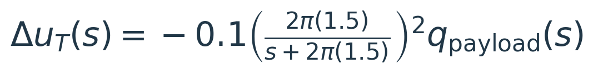

Here q is body pitch rate in rad/s and u<sub>T</sub> is throttle fraction. Each stage has a 1.5 Hz cutoff; the combined continuous-time filter reaches −3 dB at about 0.97 Hz. Native code applies the discrete first-order filters at the measured update interval, limits the correction to ±0.25, and retains the final throttle limits. Height feedforward, height feedback, integration, voltage compensation and lateral gains are unchanged. Washout is off.


At nominal level trim, the slow poles move from **−0.248 ± j2.254** to **−0.658 ± j2.186 s⁻¹**. Their damping ratio rises from **0.109 to 0.288**. The selected setting remains locally stable in seven saved plant cases—including climb, descent, lower voltage and softer roll—at lateral airspeed scaling 0.9, 1.15 and 1.4. These are local model checks; they do not include every estimator delay or establish flight robustness.

This does not reverse the conclusion from the original flight damper. The feedback path now has a different frequency response. A sign and a gain alone cannot describe how the throttle loop acts on both the slow motion and the faster canopy–payload modes.


In the matched nonlinear screen, pitch standard deviation fell from **9.45° to 6.17°**, climb-rate RMS from **0.71 to 0.46 m/s**, and height RMS error from **0.48 to 0.40 m**. Pitch-rate RMS also fell, from **21.57 to 18.03°/s**. The cost was more throttle activity: its standard deviation rose from **1.65 to 2.65 percentage points**, with no saturation. The gusts stop at 80 seconds in the plot; the filtered controller also damps the remaining motion more quickly.

A separate gust realization with 50% higher component amplitudes retained the improvement: pitch variation fell from **9.30° to 6.84°** and climb-rate RMS from **0.74 to 0.54 m/s**. Raising the damper gain to 0.15 or 0.2 with the earlier 0.75 Hz stages increased pitch-rate motion and throttle effort, so I kept the smaller gain and improved the filter shape instead.

#### Back in the native AUTO mission

The two-stage controller passed the full gusty AUTO mission with the original checks unchanged. That includes altitude changes, both two-turn loiters, corner checks, home loiter and controller handover. The native BIN confirms gain 0.1, both 1.5 Hz stages and washout disabled; the model backend recorded no errors or clipped input packets.


*The same route, model and gust generator, with excerpts aligned independently at the first loiter approach. The route timing changes, so the two excerpts sample different gust phases. The matched screen above isolates the controller change; this comparison checks its native implementation.*

The improvement persists beyond that excerpt. For each loiter I excluded the first 20 seconds after coming within 60 m of its center, then measured the remaining loiter:

| Quantity | CW: before → after | CCW: before → after |
|---|---:|---:|
| Payload pitch standard deviation | 9.90° → 6.62° | 11.13° → 6.59° |
| Pitch-rate RMS | 21.95 → 19.02°/s | 25.95 → 18.53°/s |
| Climb-rate RMS | 0.70 → 0.42 m/s | 0.78 → 0.43 m/s |
| Height error RMS | 0.50 → 0.41 m | 0.52 → 0.43 m |
| Throttle standard deviation | 1.69 → 2.90 percentage points | 1.80 → 2.81 percentage points |

Across the full gusty mission, maximum waypoint height error fell from **2.66 to 2.26 m**, and maximum corner overshoot from **3.50 to 1.39 m**. Those navigation improvements are observations from these runs, not a guarantee for every wind realization. The central result is that both turn directions show materially less longitudinal motion, with additional throttle effort.

The calm AUTO regression also passed. Settled pitch standard deviation fell from **0.21° to 0.10°** in the clockwise loiter and **0.33° to 0.07°** in the counterclockwise loiter. Height RMS error changed from **0.055 to 0.064 m** and **0.098 to 0.080 m**, respectively. Maximum waypoint altitude error changed slightly, **1.67 to 1.71 m**, while corner overshoot improved from **0.65 to 0.36 m**. The new controller therefore retains the calm mission behavior while damping the gust-driven motion.

The feature branch now includes the optional `TECS_PG_PR_FILT2` stage, defaulting to bypass, and the paired mission-development parameter files select the tested 0.1 gain and two 1.5 Hz stages. These are SITL development settings; appreciable forced motion remains in gusts, and the new tuning has not been flown. The low-voltage and softer-roll checks here are linear sensitivity tests, not additional native AUTO runs.

The [matched-screen script](../tools/gust_control_study.py), [linear check](../tools/gust_linear_check.py), [native mission runner](../tools/run_gust_native.sh), [mission summarizer](../tools/summarize_gust_mission.py), [comparison plotter](../tools/plot_gust_control.py) and [filter/pole plotter](../tools/plot_gust_filter.py) preserve the experiment. Raw state histories, BIN logs and the working HTML research log remain in Mission Planner under `turn-model-spike/gust-control`.

The implementation and tested mission settings are in [ArduPilot commit 2588ecc44a](https://github.com/DavidIngraham/ardupilot/commit/2588ecc44a) on the existing controller-development branch.

### Where that leaves the controller

The lesson was broader than reversing a sign. The ACRA model gave me a useful starting idea, but my payload gyro sees motion that its rigid-body model excludes. The flight logs exposed that difference. Reproducing it in simulation showed why a fast damper could excite the payload, while the climb comparison showed why simply reversing the sign could excite slower motion instead.

The current design combines calibrated throttle feedforward, smoother altitude capture, existing voltage compensation and a modest pitch-rate correction with two low-pass stages. It improves gust response in native SITL without sacrificing the calm mission behavior. Flight validation is the next step; a relative-motion observer remains a separate development path.

The [calm, gusty and crosswind AUTO videos](paraglider.md#the-controller-flies-the-mission) show the complete aircraft and control responses. The [methods appendix](data-and-methods.md#longitudinal-joint-control-and-observer-research) keeps the earlier joint-control experiments, observer equations and detailed calibration record together.
