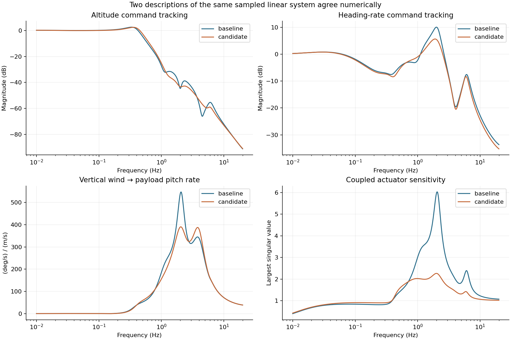
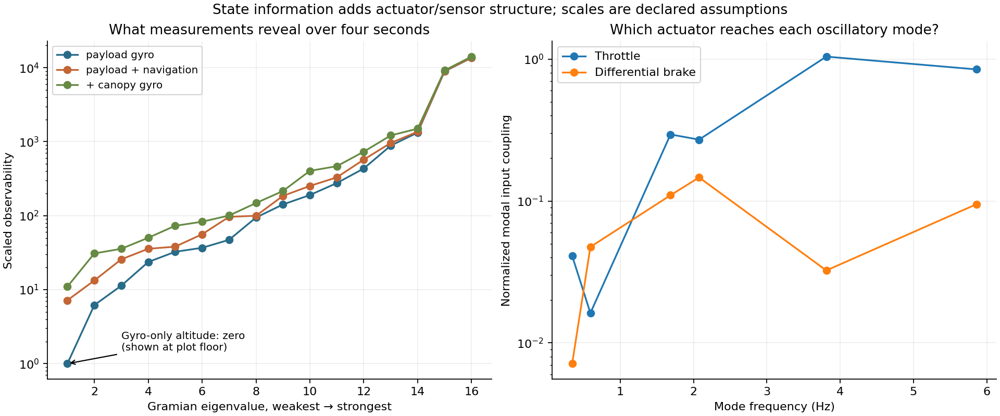
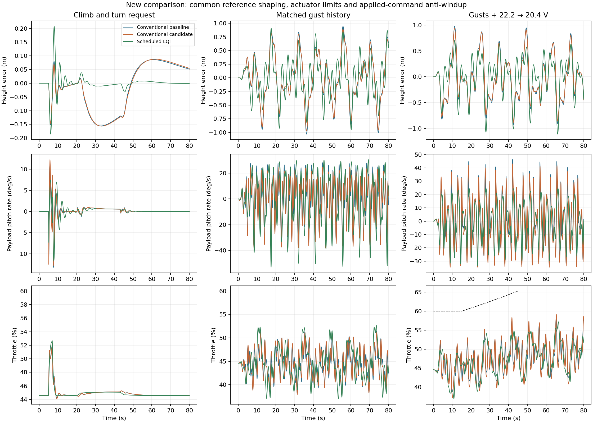
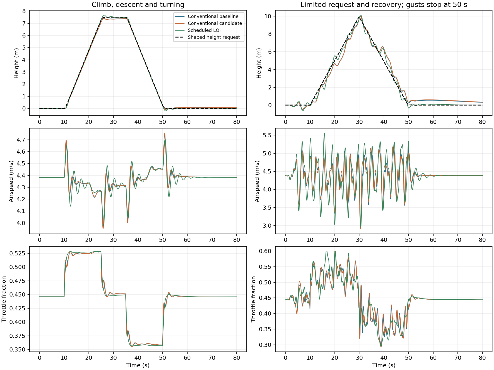
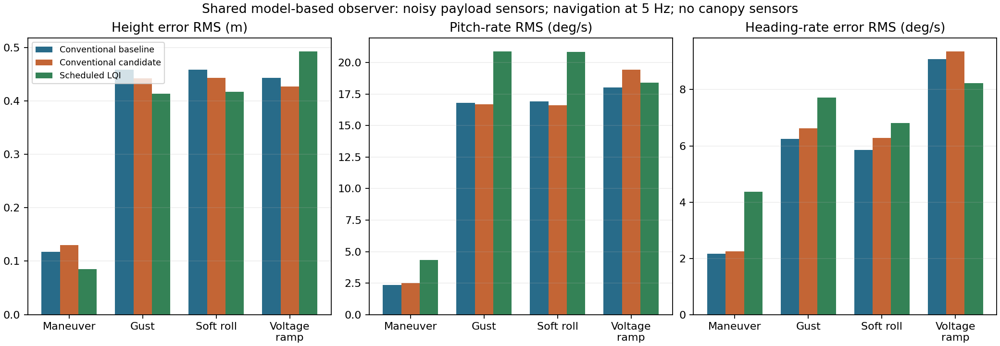
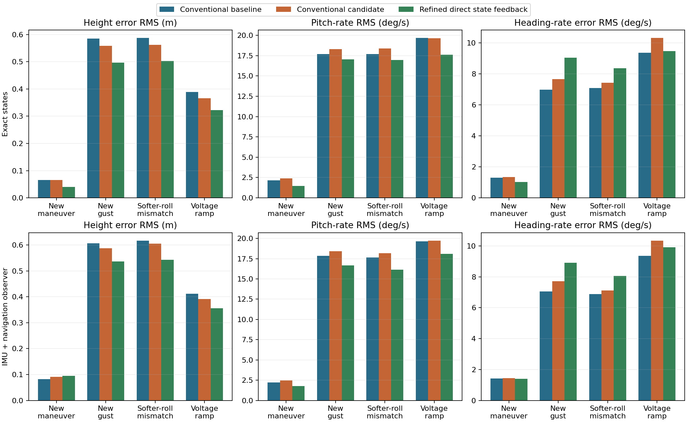
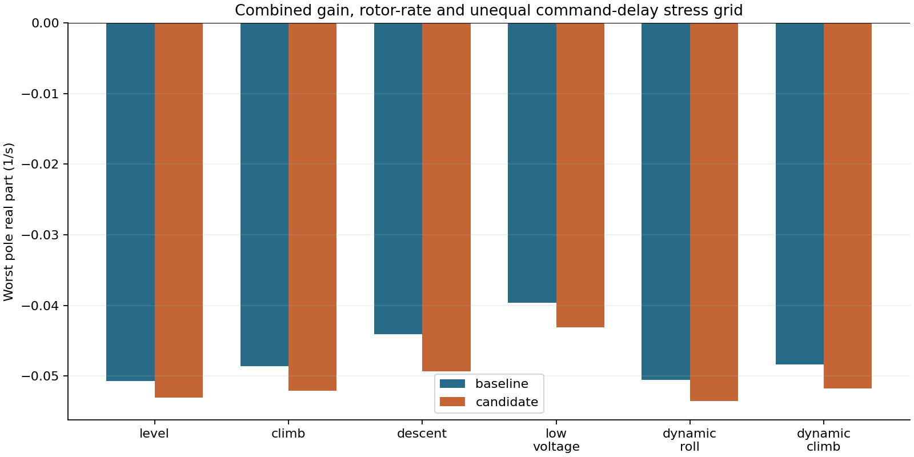
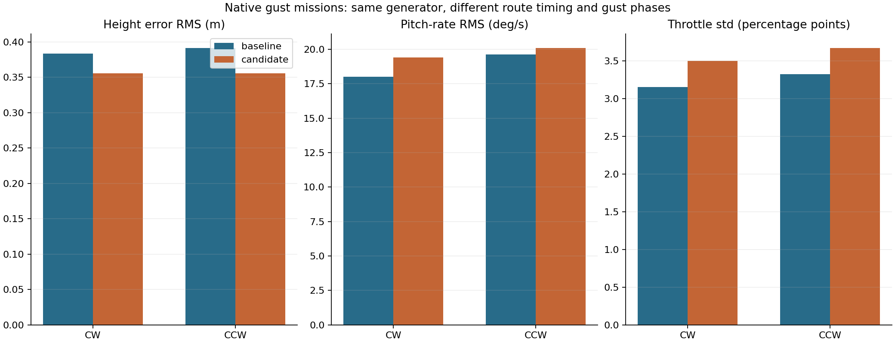

# What state-space analysis added to Micro-AGU’s controller design

*Micro-AGU · 14 October 2026 · Updated 15 October 2026 · [Controller design](controller-design.md) · [Data and methods](data-and-methods.md) · [Study files](../research/state-space-2026-10-14/README.md)*

Micro-AGU uses throttle to control altitude and damp pitch, and differential brake to steer and damp roll. Its canopy and suspended payload can move relative to one another, so an actuator command intended to correct one motion can also excite another. This study asks whether accounting for those interactions can reduce unwanted motion while preserving command tracking and gust rejection.

We tested two possible changes. The first hypothesis was that jointly tuning the existing steering and altitude loops could improve their combined behavior without changing the controller structure or measurements. The second was that a replacement controller with access to every simulated aircraft state could coordinate throttle and brake more effectively. To assess both, we measured command-tracking errors, payload motion and actuator effort separately in commanded maneuvers and gusts.

The comparisons start with **baseline**, the retained steering and altitude controller, and **candidate**, that same controller with eight gains and filter settings jointly retuned. We then test **scheduled LQI**, a replacement feedback law with operating-point feedforward and voltage/airspeed compensation, first with exact states and then with an observer. A second iteration diagnoses estimation errors, adds payload accelerometer measurements, and refines the direct state-feedback gains and pitch damping. These comparisons change feedback architecture and available information together, so they cannot isolate the benefit of additional measurements alone.

We first establish the aircraft model and baseline, then test joint retuning. Actuator and sensor diagnostics examine which internal motions can be controlled and observed before we evaluate full-state feedback. Finally, we compare the conventional tunes under model uncertainty and in native autopilot missions. The work uses the articulated simulator and separate native-controller checks, not new flight measurements; the observability diagnostics add no hardware, and the later observer is a separate simulation experiment.

## The model behind the study

The sampled perturbation model is

$$
\begin{aligned}
\delta x_{k+1} &= A_d\delta x_k+B_d\delta u_k+E_d\delta w_k,\\
\delta y_k &= C\delta x_k.
\end{aligned}
$$

Here the inputs are throttle and differential brake. The state includes payload attitude, relative canopy attitude, both bodies’ angular rates, velocity, rotor speed and altitude.

This study extends the earlier Jacobian, modal, LQI and observability work with joint tuning of the current loops, combined uncertainty testing, finite-horizon actuator/sensor diagnostics, and a new full-state benchmark on the current plant.

### Deriving the linearized matrices

The starting point is the nonlinear simulator's advance over one 20 ms sample, with commands and wind held during that interval:

$$
x_{k+1}=F(x_k,u_k,w_k),\qquad y_k=H(x_k).
$$

First solve for a trimmed flight condition. In straight level flight, attitude, velocity and rotor speed stay constant. For a steady climb or descent, height is measured relative to the nominal trajectory:

$$
\delta h_k=h_k-\bar h_k,\qquad
\bar h_{k+1}=\bar h_k+\bar v_{\mathrm{climb}}\Delta t.
$$

This makes steady climbing flight an equilibrium in the perturbation coordinates too. Bars denote nominal values; deviations are $\delta x=x-\bar x$, $\delta u=u-\bar u$ and $\delta w=w-\bar w$. For orientations, subtraction means the local angular coordinates described below, rather than subtracting quaternion components.

Expand the advance map about trim and keep its first-order terms:

$$
\begin{aligned}
F(\bar x+\delta x,\bar u+\delta u,\bar w+\delta w)
&\approx F(\bar x,\bar u,\bar w)\\
&\quad+F_x\delta x+F_u\delta u+F_w\delta w.
\end{aligned}
$$

Subtracting the nominal advance gives the sampled perturbation model above, with

$$
\begin{aligned}
A_d&=\left.\frac{\partial F}{\partial x}\right|_{\mathrm{trim}},&
B_d&=\left.\frac{\partial F}{\partial u}\right|_{\mathrm{trim}},\\
E_d&=\left.\frac{\partial F}{\partial w}\right|_{\mathrm{trim}},&
C&=\left.\frac{\partial H}{\partial x}\right|_{\mathrm{trim}}.
\end{aligned}
$$

The outputs depend on the current state, so this measurement model has no direct command-feedthrough term: $D=0$.

### Building one column at a time

The implementation evaluates these derivatives with central finite differences. Let $e_j$ select coordinate $j$, and let $\widetilde F$ denote the advance map expressed in local perturbation coordinates, with the nominal climb removed. Trim is then the origin:

$$
\begin{aligned}
A_d[:,j]&\approx\frac{\widetilde F(\epsilon e_j,0,0)-\widetilde F(-\epsilon e_j,0,0)}{2\epsilon},\\
B_d[:,j]&\approx\frac{\widetilde F(0,\epsilon e_j,0)-\widetilde F(0,-\epsilon e_j,0)}{2\epsilon},\\
E_d[:,j]&\approx\frac{\widetilde F(0,0,\epsilon e_j)-\widetilde F(0,0,-\epsilon e_j)}{2\epsilon},\\
C[:,j]&\approx\frac{\widetilde H(\epsilon e_j)-\widetilde H(-\epsilon e_j)}{2\epsilon}.
\end{aligned}
$$

For example, the payload pitch-rate column of $A_d$ comes from two runs: start at trim with pitch rate increased by $\epsilon$, advance 20 ms, then repeat with pitch rate decreased by $\epsilon$. Subtract the resulting state vectors and divide by $2\epsilon$. That column describes how the initial pitch-rate perturbation changes every state one sample later.

The actual 16-state ordering is

$$
\delta x=\begin{bmatrix}
\delta\phi_p\\ \delta\theta_p\\
\delta\alpha_{\mathrm{rel}}\\ \delta\beta_{\mathrm{rel}}\\ \delta\gamma_{\mathrm{rel}}\\
\delta\boldsymbol v_p\\
\delta\boldsymbol\omega_p\\
\delta\boldsymbol\omega_c\\
\delta\mathrm{RPM}/1000\\ \delta h
\end{bmatrix}.
$$

Here $p$ and $c$ identify payload and canopy. Each bold velocity or angular-rate entry contains three components. Relative attitude uses a local rotation vector; payload velocity is expressed in payload axes, and each body's angular velocity is expressed in its own axes. The code reconstructs canopy position and velocity to preserve the suspension-joint constraints. Independently perturbing every raw position or quaternion component would not preserve those constraints.

| Matrix | Dimensions | Meaning |
|---|---|---|
| $A_d$ | $16\times16$ | State-to-next-state response |
| $B_d$ | $16\times2$ | Throttle and differential-brake response |
| $E_d$ | $16\times3$ | Response to three wind components |
| $C$ | $6\times16$ | State-to-measurement response |

The six measurement outputs are climb rate, payload pitch rate, relative pitch rate, heading rate, payload roll rate and height. The output matrix includes coordinate transformations, not just state selection. For example, heading rate is

$$
\dot\psi=\frac{q\sin\phi+r\cos\phi}{\cos\theta}.
$$

Its row of $C$ therefore differentiates this expression at trim, including the implementation's conversion to degrees per second. It is not simply a selector for body yaw rate $r$.

### Why these are already discrete-time matrices

The differentiated map includes the full 20 ms advance, its 16 integration substeps and the rotor dynamics. No additional discretization is applied to these matrices. An alternative would be to linearize the continuous dynamics first,

$$
\delta\dot x=A_c\delta x+B_c\delta u+E_c\delta w,
$$

and then discretize the fixed linear model with held inputs:

$$
\begin{aligned}
A_d&=e^{A_c\Delta t},\\
B_d&=\int_0^{\Delta t}e^{A_c\tau}B_c\,d\tau,\\
E_d&=\int_0^{\Delta t}e^{A_c\tau}E_c\,d\tau.
\end{aligned}
$$

This study instead differentiates the integrated simulator directly. It uses $\epsilon=10^{-5}$ in each coordinate's units and repeats the calculation with $\epsilon/2$ to check sensitivity to the finite-difference step. The implementation is in `Chart`, `observations` and `prepare` in [study.py](../research/state-space-2026-10-14/study.py); the numerical and nonlinear checks follow below.

## Establishing the baseline and checking the local model

Before comparing controllers, we needed to check that the linear model represented the current simulator and controller near trim. The test was to hold the configuration fixed, vary the numerical perturbation size, and compare a very small commanded maneuver in the linear and nonlinear models. Agreement would support using the linear model for local tuning; it would not validate the underlying aircraft physics against flight data.

The baseline retains the present **1 Hz steering filter**, two **1.5 Hz pitch-filter stages**, pitch-damper gain **0.1**, and the stronger climb feedback selected through `TECS_VERT_ACC = 3.5`. Some historical analysis scripts predate those settings; using them unchanged would have compared against an obsolete baseline.

We regenerated six local plants: mission-profile level flight, climb and descent at ±0.5 m/s, level flight at 20.4 V, and the softer-roll profile in level flight and climb. The softer-roll climb was held out of tuning. All are straight-flight trims at the Trout Lake mass of 1.758 kg. Turning and landing equilibria are outside this conventional-controller tuning ensemble. The scheduled-controller extension below adds turning trims.

The plant has 16 states, including altitude. The existing controller adds eight filter and integrator states, making a 24-state closed loop. Controller updates and command holds are 20 ms; the nonlinear integration uses 1.25 ms substeps. Motor dynamics remain in the plant. Brake travel limits and rates become active in the subsequent nonlinear tests.

The equilibrium residuals were below 7 × 10⁻¹³. Halving the finite-difference perturbation changed the state Jacobians by less than 1.3 × 10⁻¹⁰ in relative matrix norm. More usefully, a 1 mm altitude ramp through nonlinear physics reproduced the sampled linear responses with a maximum relative time-history error of **0.021%** across height, climb, payload pitch rate, throttle and brake. This check holds the feedforward on its climb-side branch so it tests one smooth local system; normal nonlinear tests restore the climb/descent switch.

## Jointly retuning eight settings in the existing controller

The first question was whether we could improve the existing architecture without adding sensors or a new controller. Eight settings were varied together: steering P and I, roll damping, steering filter frequency, pitch damping and its two shared filter cutoffs, climb feedback, and height feedback. Feedforward stayed unchanged.

The working hypothesis was that tuning the steering and altitude loops together could reduce motion and actuator effort caused by their interaction while preserving tracking and gust rejection. The aircraft models, measurements and controller structure stayed fixed. Only the eight settings changed, and the same resulting settings were evaluated across the operating plants.

The objective combined normalized command-response error and motion/control effort with the response to the existing illustrative gust spectrum. It balanced average and worst operating-case scores. This is a declared engineering preference, not a uniquely correct definition of good flight.

The first optimization improved that score by about **17%**, but bought the improvement partly through weaker feedback, worse gust response and slower recovery. We retained it as a diagnostic rather than calling it a winner. A second search constrained altitude and heading tracking costs, aggregate gust cost, and the slowest decay rate so the optimizer could not make those trades freely.

The constrained search returned this candidate:

| Setting | Current baseline | Study candidate |
|---|---:|---:|
| Steering P | 0.00500 | 0.00278 |
| Steering I | 0.00200 | 0.00169 |
| Roll-rate damping | 0.00300 | 0.00106 |
| Steering filter | 1.00 Hz | 0.762 Hz |
| Pitch-rate damping | 0.100 | 0.0971 |
| Each pitch-filter stage | 1.50 Hz | 1.106 Hz |
| Climb P, nominal voltage | 0.0343 | 0.0435 |
| Height feedback | 0.100 s⁻¹ | 0.0787 s⁻¹ |

The combined objective improved by **7.4%**. Command-response cost fell by 12–20% across the training plants, while aggregate linear gust cost improved by only 0.3–2.1%. On the held-out softer-roll climb, those reductions were 19% and 2.6%. The search stopped at its 45-generation budget; this is a feasible candidate, not a claim of convergence to a global optimum.

There is an important qualification to that score. The step criterion deliberately stresses abrupt reference edges, whereas the later maneuver test ramps altitude over two seconds. About **115 of the baseline's 160 nominal step-cost units** come from heading-rate motion induced by the altitude step. This is largely a cross-axis transient criterion, not a percentage improvement in ordinary mission tracking. Its output-by-output decomposition is part of the retained evidence.

### Checking which frequencies improved after retuning

The aggregate score does not say where an improvement occurs. To interpret the candidate, we compared baseline and candidate frequency responses on the same nominal level-flight plant. We examined altitude and heading commands, vertical wind, and additive actuator disturbances. The question was whether the lower score represented reduced unwanted amplification, slower command response, or a mixture of both.

*Baseline versus the retuned candidate on the same nominal level-flight plant, sampled at 50 Hz. Controller structure is unchanged; gains and filter cutoffs differ. The plotted wind response is a small-signal gain, not a prediction that a finite 1 m/s high-frequency gust would remain linear.*

The most conspicuous improvement is around **2 Hz**. The peak singular value of the coupled actuator sensitivity falls from **6.03 to 2.27**. The altitude-command curves remain nearly unchanged. This is a useful example of reducing an unwanted response without slowing every command by the same amount.

This sensitivity considers throttle and brake together, with both inputs scaled by a 0.1 command fraction. It describes the largest amplification of an additive actuator disturbance in any input direction. It is not a disk margin or a measured stability margin. A general multiple-loop robustness analysis can also assess simultaneous gain and phase uncertainty; the [disk-margin formulation](https://www.mathworks.com/help/robust/ug/stability-analysis-using-disk-margins.html) is one example.

Looking only at the baseline sensitivity matrix's diagonal entries gives a peak of **2.18**, compared with **6.03** for the complete matrix. The off-axis responses matter. This is an insight from a multiple-input frequency analysis, made straightforward by retaining the coupled state model; it would be missed by treating the axes as independent scalar plants.

The frequency plot also explains why the large peak reduction does not produce an equally large improvement in our gust tests. Their imposed frequencies run from **0.08 to 0.89 Hz**. They do not directly excite the 2 Hz peak. Looking at a single maximum would have obscured that distinction.

## Diagnosing actuator authority and sensor information

The frequency plots show where a response is large, but leave practical design questions: can the actuators influence the troublesome motion, and can the sensors reveal it? The next two diagnostics use the same nominal level-flight aircraft model without closing either controller around it. We examine actuator coupling and vary the assumed measurement set; these results are not improvements produced by the retuned candidate.

### Testing whether throttle and brake control separate motions

The existing controller assigns altitude and pitch damping to throttle, and turning and roll damping to brake. We tested how well that division matches the aircraft's natural motions by computing each mode's state participation and its coupling to each actuator. We also calculated a four-second controllability Gramian to identify combinations of states that are difficult to move with the available inputs. The model and actuator mappings stayed fixed throughout this diagnostic.

We normalized angles, rates, velocities, rotor speed and height by declared engineering reference excursions before comparing them. Without that scaling, changing metres to millimetres could change an apparently impressive matrix condition number.

The slow **0.343 Hz** mode is dominated by payload pitch and forward velocity. Its normalized throttle coupling is about **5.8 times** its brake coupling. The **0.592 Hz** side-velocity/canopy-yaw mode is about **2.9 times** more strongly coupled to brake than throttle. Those pairings support the existing division of duties.

The faster modes are less neatly separated. In particular, the **5.86 Hz relative-roll mode** has appreciable throttle coupling in this model. Calling it a roll mode does not mean that only the steering actuator can excite it. This reinforces the reason to examine the loops together.

These are local modal couplings, not measurements of usable authority under saturation. They depend on the retained rotor, suspension and aerodynamic model.

The four-second controllability Gramian adds a related warning: its least reachable normalized state direction combines canopy roll rate, relative yaw and side velocity. Those motions cannot be treated as independent knobs that a full-state controller can adjust cheaply. This is a finite-horizon input-effort result, not a declaration that those states are uncontrollable.

*Left: four-second observability Gramians, using declared measurement scales. The gyro-only altitude eigenvalue is zero and is shown at the plot floor. Right: normalized input coupling to each oscillatory mode. Connecting lines guide the eye; there are no additional measured modes between the points.*

### Testing whether canopy gyros reveal otherwise hidden states

The sensor question was whether canopy motion is hidden from the existing payload and navigation measurements, making additional canopy sensors necessary for state feedback. Holding the aircraft dynamics fixed, we compared three hypothetical measurement sets: payload gyros alone; payload gyros plus attitude, navigation velocity and height; and that navigation-equipped set plus canopy gyros. No observer was implemented in this comparison.

A four-second finite-horizon observability calculation gives a more useful question than nominal rank alone: how unevenly do the measurements reveal different state combinations? Finite-horizon calculations also accommodate the altitude integrator, for which an ordinary infinite-horizon Gramian is inappropriate. [Gramians and their control/estimation uses](https://www.mathworks.com/help/control/ref/statespacemodel.gram.html) provide the general background.

With payload gyros alone, altitude is unobservable. Adding payload attitude, navigation velocity and height makes the nominal model observable over the chosen horizon. Adding hypothetical canopy gyros increases the weakest scaled observability eigenvalue from **7.18 to 10.98**, about 53%. That is useful additional information, but it does not unlock an otherwise completely hidden nominal plant.

These calculations assume a known model and illustrative independent measurement scales: 1° attitude, 1°/s gyro, 0.1 m/s navigation velocity and 0.2 m height. They are not predicted estimator accuracies. Adding three unknown constant-wind states leaves this nominal navigation-equipped model observable too; we did **not** include unknown force/moment biases or correlated AHRS errors. The ambiguities exposed by the [earlier observer study](data-and-methods.md#can-i-estimate-what-i-cannot-measure) therefore remain relevant. This study does not establish a flight-ready canopy observer.

### Testing whether retuning reduces motion after an initial displacement

The lower actuator-sensitivity peak suggested another question: would the candidate also reduce the aircraft's response to an initial displacement, such as relative canopy roll? This is a separate closed-loop test. We compared baseline and candidate on the same nominal plant, with no subsequent command or wind perturbation, identical state scaling, and controller memories initially at equilibrium. We searched initial physical-state directions for the largest transient amplification over ten seconds.

The largest normalized state excursion occurs about **40 ms** after release and is dominated by an initial relative-roll displacement. Its amplification is approximately **10** for both conventional tunes.

That number is not tenfold mechanical energy growth. It measures the conversion of normalized displacement into normalized motion under the declared state scales, and it can be rescaled to arbitrarily small perturbations. The useful finding is the comparison: substantially reducing the actuator-sensitivity peak did **not** remove this fast internal release response. Closed-loop pole locations, command tracking and initial-disturbance response describe different aspects of the same system.

## Testing scheduled state feedback with practical compensation

The next hypothesis was that a state-feedback controller could coordinate throttle and brake more effectively if it knew the aircraft's internal motion. A useful comparison also needs the practical features around the existing feedback loops: battery compensation, speed-dependent steering authority, maneuver feedforward, reference shaping and actuator handling. Otherwise an apparent benefit or failure could come from removing those features.

We therefore built a **scheduled LQI controller**, replacing the earlier fixed-gain benchmark in this article. The [earlier experiment remains in the research record](../research/state-space-2026-10-14/README.md#state-benchmark-and-measurement-diagnostics). The new controller still uses linear-quadratic integral feedback, but its gains and equilibrium references change with operating condition. The experiment changes feedback and feedforward together; it does not isolate the value of additional state information alone.

### What the new controller changes, and what the comparison shares

We solved eighteen equilibria: two battery voltages, 20.4 and 22.2 V; three climb rates, −0.5, 0 and +0.5 m/s; and three turn rates, −10, 0 and +10°/s. Each supplies a feasible steady-flight state, actuator command and local feedback design. During a run, the controller interpolates those quantities using measured voltage and the shaped climb and turn requests. It does not call a trim solver or reset its integrators when voltage changes.

The control law is

$$
u_{\mathrm{requested}}=u_{\mathrm{ref}}(\rho)
-S_u(\rho,V_a)K(\rho)
\begin{bmatrix}
S_x^{-1}(\hat x-x_{\mathrm{ref}})\\
\eta
\end{bmatrix}.
$$

Here $\rho$ contains voltage and the requested climb and turn rates, $\eta$ contains height and heading-rate error integrals, and $S_x$ contains the fixed engineering state scales. The input mapping $S_u$ incorporates the $22.2/V$ voltage correction and the bounded $5/V_a$ steering correction. That mapping is included when designing the gains; physical trim commands are not multiplied by it a second time. Airspeed adjusts actuator effectiveness and enters state feedback, but it is not a separate gain-grid axis or an independently controlled speed request.

| Feature | Scheduled LQI | Conventional comparison |
|---|---|---|
| Voltage and airspeed | Voltage-dependent trim/gains and live input scaling | Existing voltage and speed scaling |
| Maneuver feedforward | Interpolated steady climb/turn trim states and commands | Existing climb/descent and turn feedforward |
| Reference shaping | Shared height/turn shaping and rate limits | Same shaping and limits |
| Actuator handling | Shared throttle ceiling/slew, brake mixer and travel-rate model | Same physical output layer |
| Anti-windup | Tracks applied commands in LQI integral coordinates | Tracks applied commands in conventional integral coordinates |
| State information | Exact states first; inferred states in the observer tests below | Same sensor condition, retaining its own feedback filters |

The shared reference envelope limits climb/descent to ±0.5 m/s, turn rate to ±10°/s and turn acceleration to ±40°/s². Both families use total-throttle slew limiting and a 0.25 s applied-command tracking time for anti-windup. These details differ from native TECS's P-plus-feedforward slew handling and conditional integration. **The tables below are fresh comparisons in this shared harness; their baseline numbers are not interchangeable with the earlier study or the native missions.** No production controller settings changed.

We screened 45 LQI weight combinations using linear gust and recovery costs. The first, smaller search produced a nominally attractive controller that failed 8 of 288 combined actuator-authority/delay cases. The final selection required stability in all 288 cases and used a larger input-penalty range. The selected design also passed 375 frozen checks between scheduled nodes. These checks support the chosen operating envelope; they are not a proof of nonlinear stability during arbitrary scheduling. Independent numerical differentiation of four implemented closed loops agreed with their synthesized matrices to better than $6\times10^{-9}$ in relative norm.

### Does scheduled feedback improve a commanded climb and turn?

We gave all three controllers the same 1 m altitude request ramped over two seconds, followed by a 10°/s turn request and release. All passed through the shared reference shaper and actuator layer. The question was whether the new feedback and trim feedforward could improve tracking without increasing payload motion. The controllers received exact simulated states in this first comparison.

| Maneuver metric, 5–80 s | Conventional baseline | Conventional candidate | Scheduled LQI |
|---|---:|---:|---:|
| Height error RMS | 0.0884 m | 0.0890 m | 0.0336 m |
| Heading-rate error RMS | 1.16°/s | 1.20°/s | 1.07°/s |
| Payload pitch-rate RMS | 1.65°/s | 1.71°/s | 1.65°/s |
| Throttle standard deviation | 1.04 percentage points | 1.03 percentage points | 1.14 percentage points |

Errors here are relative to the shared **shaped** request. Scheduled LQI reduces height RMS by about 62% relative to the new baseline and modestly improves heading tracking, with essentially unchanged pitch-rate RMS. This result does not reproduce the earlier fixed-gain design's exceptionally gentle pitch response: the replacement makes a different tradeoff after adding feedforward, matching the surrounding control machinery and screening delay sensitivity.

### Does that improvement survive identical gusts?

For disturbance rejection, we removed the maneuver and applied the same held-out wind history to all controllers, without changing their selected gains. Component RMS values are 0.5, 0.5 and 0.25 m/s, using the same illustrative frequency spectrum as before but a new phase seed. Metrics cover 15–80 s; wind continues throughout the run.

| Nominal gust metric | Conventional baseline | Conventional candidate | Scheduled LQI |
|---|---:|---:|---:|
| Height error RMS | 0.450 m | 0.428 m | 0.381 m |
| Heading-rate error RMS | 5.68°/s | 5.94°/s | 5.91°/s |
| Payload pitch-rate RMS | 16.17°/s | 15.84°/s | 20.55°/s |
| Throttle standard deviation | 2.88 percentage points | 2.97 percentage points | 3.68 percentage points |

The scheduled controller reduces height RMS by about 15%, but increases pitch-rate RMS by about 27% and uses more throttle activity. None reaches the throttle ceiling in this nominal gust case. Better altitude regulation therefore still does not mean a quieter payload.

*All curves use the new shared reference and actuator harness. Left: commanded maneuver. Centre: identical nominal gusts. Right: gusts while voltage falls. Height error is relative to the shaped request; the dashed throttle line is the voltage-dependent ceiling.*

We also held the gains fixed while changing the physics to the softer-roll profile, starting at 20.4 V, and increasing gust amplitudes by 50% with a second phase seed. In those three cases, scheduled LQI again reduced height RMS relative to baseline. Pitch-rate RMS increased in the softer-roll and low-voltage cases, but decreased slightly in the stronger-gust case. The stronger-gust run reached the throttle ceiling for 1.38% of the metric window; the baseline did not. The tradeoff depends on the disturbance and available actuator headroom.

### Does compensation help while voltage and speed change?

A low-voltage equilibrium alone would not test battery adaptation. We therefore ramped voltage from 22.2 to 20.4 V over 30 seconds while gusts continued, without reinitializing the aircraft or controller. With exact state feedback, scheduled LQI reduced height RMS from the baseline's **0.425 to 0.378 m**, and pitch-rate RMS from **17.29 to 14.04°/s**.

To isolate the voltage machinery, we repeated that same run with the scheduled controller's voltage input frozen at 22.2 V. The simulator and physical output limits still used the falling voltage. Height RMS rose from **0.378 to 0.428 m**. This ablation supports the value of voltage-dependent trim, gains and scaling as a package; it does not distinguish their individual contributions.

For changing speed, we requested sustained climb followed by descent and an overlapping turn, rather than resetting the simulator to a different speed. The scheduled controller encountered about **3.98–4.71 m/s** airspeed. It reduced height RMS from **0.0864 to 0.0514 m**, heading-rate error from **1.67 to 1.14°/s**, and pitch-rate RMS from **2.32 to 2.06°/s**. Disabling only the live airspeed correction made almost no difference in this run or the voltage-ramp run. The implementation now includes that compensation, but these modest-speed tests do not demonstrate a substantial benefit from it.

Finally, we checked behavior after demands exceeded the reference envelope: a 10 m altitude request and a 25°/s turn request, followed by return to level hold. The shared shaper limited what reached the controllers, and gusts ended at 50 seconds to allow a calm recovery check. Scheduled LQI reached the throttle ceiling for 0.75% of the 5–80 s window and returned to **0.010 m** height RMS in the final ten seconds, compared with **0.368 m** for baseline. Its heading error over the full maneuver was slightly worse. This is a bounded recovery test, not proof of arbitrary saturation recovery or safe flight at these demands.

*The dashed line is the shared shaped height reference. The speed changes arise from the climb, descent, turning and wind dynamics; there is no independent airspeed command.*

### What changes when the internal states must be estimated?

The perfect-state comparison leaves an essential hypothesis untested: can available measurements support the feedback law well enough to preserve its benefit? We added a model-based observer with sixteen aircraft states and three wind states. It receives noisy payload attitude and gyro measurements at 50 Hz, and navigation velocity and height at 5 Hz. It receives **no canopy gyro, rotor-speed or true-wind measurement**. Small initial canopy-state errors make it infer those states rather than starting with every hidden quantity correct.

All three controllers receive the same observer outputs and estimated airspeed in this second comparison. The observer assumes known physics, ideal heading alignment and independent illustrative sensor noise; it does not include sensor biases, correlated AHRS errors or transport delay. These are estimation experiments, not native-EKF validation.

| Observer-based metric | Conventional baseline | Scheduled LQI |
|---|---:|---:|
| Maneuver height RMS | 0.118 m | 0.085 m |
| Maneuver heading-rate error RMS | 2.17°/s | 4.36°/s |
| Maneuver pitch-rate RMS | 2.34°/s | 4.35°/s |
| Nominal gust height RMS | 0.458 m | 0.414 m |
| Nominal gust pitch-rate RMS | 16.82°/s | 20.90°/s |
| Falling-voltage height RMS | 0.444 m | 0.493 m |

Some height-tracking benefit remains, but the clean maneuver result does not: heading error and pitch motion worsen substantially. During the voltage ramp, scheduled LQI loses even its height advantage. The replacement therefore needs observer/controller co-design before its perfect-state improvements can justify a flight implementation.

*Four scenarios repeated for all three controller families with the same noise realizations and sensor update schedule. Conventional curves also use this research observer, not the native autopilot estimator.*

The extension retains **40 nonlinear runs**: 24 with exact states, 12 with the observer and four compensation ablations. All produced finite trajectories within the enforced throttle limits. That execution check is separate from performance: several comparisons are worse, and the scheduled controller has not been installed in firmware or tested on the native AUTO mission. The [new reproduction guide](../research/scheduled-state-feedback-2026-10-15/README.md) records the controller, shared-harness changes, selection criteria, sensor assumptions and all results.

## Second iteration: improving estimation and damping before giving up direct feedback

The first scheduled controller improved exact-state tracking but increased gust pitch motion and lost its falling-voltage height advantage when it had to estimate the aircraft's motion. We tested whether those failures came from missing sensor information and poorly weighted feedback, rather than an inherent limitation of state feedback. Voltage compensation, reference shaping, actuator limits and anti-windup stayed in place throughout.

The acceptance criteria were fixed before this development search: height-error and pitch-rate RMS could be at most 5% worse than the matched conventional baseline in each development case; heading-rate-error RMS could be at most 10% worse. Development used the maneuver, gust and voltage-ramp cases, each with exact and estimated states. Stable candidates were ranked using height, pitch and heading weights of 0.4, 0.35 and 0.25, combining average and worst-case performance.

### Which estimation errors were actually moving the throttle?

Our first hypothesis was that feedback from uncertain canopy motion caused the regressions. Nine variants reduced those feedback terms and varied additional pitch damping. None met every development criterion. Fifteen further variants added a bounded, filtered state-feedback correction around the existing conventional loops. These reduced the regressions, but still missed the maneuver pitch limit and surrendered much of the direct controller's tracking benefit. The [research record](../research/scheduled-state-feedback-2026-10-15/README.md#second-iteration-bounded-state-feedback-correction) preserves that unsuccessful branch.

We then measured each state's estimation error and its contribution through the feedback gain to throttle-command error. **Vertical velocity was the largest contributor**, ahead of height and canopy-relative pitch. Attenuating only hidden canopy states had targeted the wrong dominant term. Changing process-noise weights alone also failed to meet all criteria.

The observer had another important omission: it used payload attitude and gyros, plus slower navigation measurements, but no accelerometer. We added payload specific-force measurements at 50 Hz, with illustrative independent noise of 0.2 m/s², to both the conventional and state-feedback comparisons. The observer predicts these measurements from its dynamics; it receives no true wind, canopy gyro or rotor-speed measurement. Navigation still updates at 5 Hz. Its predictor now uses nominal mission physics even when the simulated aircraft has softer roll dynamics, making that case an explicit model-mismatch test.

### Can better estimation and feedback weighting recover the direct controller?

The accelerometer helped, but adding it alone did not satisfy every limit. We therefore tested nine combinations of vertical-velocity and height feedback strength, followed by three steering feedback strengths. The selected controller retains all physical-state feedback, scales the vertical-velocity gain column to 0.7 and the height column to 0.25 of their original values, and multiplies the brake feedback row by 1.5. It also adds pitch damping of 0.05 through two 1.5 Hz low-pass stages, with voltage compensation. Integral action and scheduled feedforward remain active.

This is a **structured refinement of an LQI-derived controller**, not the untouched Riccati-optimal solution. Its observer process covariance uses normalized physical-state entries of 1e-6 and wind entries of 0.001 per prediction. Those are development choices, not flight-identified noise statistics.

The refined direct controller passed every development criterion and all 288 local actuator-authority/delay checks. Four independent finite-difference checks of the actual controller and nonlinear simulator reproduced the predicted closed-loop matrices with relative errors below 8e-9. Those checks establish consistency and stability at the tested local conditions; they do not guarantee arbitrary nonlinear behavior.

### Do the improvements survive fresh commands, gusts and sensor noise?

We froze the controller and observer before running 48 new simulations: three controller families across eight scenarios, each with exact states and with the accelerometer-equipped observer. Wind/noise seeds changed, gust amplitudes increased by 20%, and the maneuver changed from a 1 m / 10°/s request to 1.5 m / 8°/s. All controllers within a comparison received the same disturbances, sensor model and reference shaping. No parameters were selected from this validation set.

The table shows baseline → refined direct feedback using the observer. Height errors are in metres; pitch rates and heading-rate errors are in degrees per second. Metrics use the same windows and shaped references as the first pass.

| Fresh validation case | Height-error RMS | Pitch-rate RMS | Heading-rate-error RMS |
|---|---:|---:|---:|
| Changed maneuver | 0.0819 → 0.0955 | 2.225 → 1.780 | 1.415 → 1.409 |
| Gust | 0.6071 → 0.5368 | 17.838 → 16.659 | 7.056 → 8.905 |
| Strong gust | 0.5223 → 0.4491 | 26.216 → 21.332 | 10.220 → 8.130 |
| Softer-roll model mismatch | 0.6169 → 0.5434 | 17.639 → 16.138 | 6.889 → 8.062 |
| Low-voltage gust | 0.6047 → 0.5393 | 17.941 → 16.630 | 7.056 → 8.866 |
| Falling voltage | 0.4113 → 0.3561 | 19.654 → 18.073 | 9.355 → 9.905 |
| Climb/descent transition | 0.0900 → 0.1143 | 2.399 → 1.898 | 1.721 → 1.406 |
| Limited-demand recovery | 0.6154 → 0.4809 | 16.780 → 12.731 | 9.059 → 8.104 |

**Pitch motion decreased in all sixteen scenario/sensing combinations.** With estimated states, falling-voltage height RMS improved by 13.4%, recovering the benefit that disappeared in the first observer experiment. Strong-gust and limited-demand recovery performance improved in all three reported measures. These results show that the original shortcomings were actionable; retreating to a nearly conventional controller was premature.

*Top: exact states. Bottom: the shared accelerometer-equipped observer. These are fresh validation realizations, so compare controllers within this figure rather than against earlier plots.*

However, **only seven of sixteen comparisons met every acceptance limit**. Ordinary-gust heading-rate error increased by about 26% with the observer, and the changed maneuver's height error increased by about 17%. The climb/descent transition also lost height accuracy with both exact and estimated states. Those exact-state regressions show that remaining work includes feedback objectives and reference tracking, not just estimation.

The next hypotheses are therefore specific: can disturbance-aware steering tuning reduce the gust heading penalty, and can climb/height reference tracking be improved without restoring excess pitch motion? Testing those hypotheses requires a new development set and another untouched validation set. The present results justify further controller work, but not replacing flight defaults. Accelerometer bias, correlated attitude errors, transport delays and native AUTO integration are still untested. The [full refinement record](../research/scheduled-state-feedback-2026-10-15/README.md#direct-feedback-refinement-with-accelerometer-estimation) includes the rejected searches, frozen selection and all validation results.

### Explore the improvements and remaining tradeoffs

Start with **Falling voltage** and the **IMU + navigation observer** to see whether the recovered height benefit survives estimation. Then select **Gust** to inspect the heading penalty, or **Climb / descent transition** to see the height cost of the refined damping. Switching to exact states helps distinguish feedback tradeoffs from estimation effects. The plots show the frozen final validation runs, not new tuning runs.

[Open the controller comparison applet](https://davidingraham.github.io/assets/controller-comparison/index.html)

The two 3D views replay the baseline and refined controller at the same instant using the existing payload CAD model and schematic canopy. Play, pause or scrub the timeline; drag to orbit both views and scroll to zoom. The rendered motion is the simulated physical aircraft, including when the controller uses estimated states. Cameras follow each payload at the same physical scale.

The cards compare full-resolution RMS values against the unchanged acceptance limits. The synchronized plots show height error, pitch rate and heading-rate error; move across a plot to scrub both aircraft to that instant. The retuned conventional candidate is available as an optional third curve. Zero height and heading-rate error mean perfect tracking of the shared shaped reference.

## Checking the original conventional tunes against model uncertainty

Separately from the scheduled LQI checks above, the original conventional-controller tuning assumes known actuator effectiveness, motor response and timing. We tested whether the candidate's improvement was fragile when several of those assumptions were wrong together. Both conventional controllers retained their selected gains while the plant's actuator effectiveness, rotor response and added command delays varied. The criterion here was local closed-loop stability and decay rate, not tracking accuracy or nonlinear saturation performance.

For each conventional tune, we evaluated **648 combinations**: six plants, independent throttle and brake effectiveness at 0.75 or 1.25 nominal, independent extra command delays of 0, 40 or 80 ms, and rotor response rates at 0.7, 1.0 or 1.3 nominal. This is a stress grid, not a measured probability distribution or an exhaustive robustness certificate. It does not include estimator-delay models, changing mixer branches or finite-amplitude saturation.

Both tunes remained locally stable in every combination. The worst dominant-pole real part was **−0.0397 s⁻¹** for baseline and **−0.0431 s⁻¹** for the candidate. Thus the candidate’s lower nominal sensitivity peak is accompanied by acceptable behavior in this particular combined-uncertainty screen. It does not demonstrate a dramatic improvement in worst-case recovery.

*Negative values mean local perturbations decay. Each bar is the worst combination for that operating plant. Full-state LQI is not included in this grid.*

## Checking the conventional candidate in native AUTO missions

The original conventional-controller diagnostics used direct simulated state measurements and a study implementation of the controller. Their final check asked whether the conventional candidate remained usable through the native autopilot's estimator, navigation and control paths. These native tests retain their original controller handling; they do not use the new shared harness or scheduled LQI. We ran the same AUTO mission with baseline parameters and then with the candidate's eight settings, once in calm air and once with gusts. The mission route and pass/fail assertions stayed fixed. Full-state LQI was excluded because it had not been implemented in firmware.

The baseline and conventional candidate both passed the full native AUTO mission in calm air and gusts: **four passes**, with the existing assertions unchanged. These runs use the airborne preparation fixture and the native estimator, navigation, steering and TECS paths. They do not test launch, and the full-state LQI controller is not installed in firmware.

The settled-loiter measurements show a familiar tradeoff:

| Native gust mission metric | Baseline | Candidate |
|---|---:|---:|
| CW height error RMS | 0.384 m | 0.356 m |
| CCW height error RMS | 0.392 m | 0.356 m |
| CW pitch-rate RMS | 18.00°/s | 19.42°/s |
| CCW pitch-rate RMS | 19.62°/s | 20.10°/s |
| CW throttle standard deviation | 3.15 percentage points | 3.50 percentage points |
| CCW throttle standard deviation | 3.32 percentage points | 3.67 percentage points |
| Maximum waypoint height error | 1.51 m | 2.00 m |
| Maximum corner overshoot | 2.29 m | 1.41 m |

*Settled loiter windows start 20 seconds after entering a 60 m radius around the loiter centre. The route and assertions are unchanged.*

The runs share the same gust generator, but different route timing means their loiters sample different gust phases. This table verifies the candidate's native behavior; it does not isolate the controller change as cleanly as the matched diagnostic. The BIN parameter audit confirms the intended overrides, and all four backends report zero errors and zero clipped packets.

In calm air, maximum waypoint height error changes little, **1.677 → 1.662 m**, while maximum corner overshoot increases slightly, **0.379 → 0.412 m**. Settled height RMS also increases slightly in both loiters: **0.037 → 0.041 m** and **0.046 → 0.051 m**. The candidate preserves the passing calm mission, but does not offer a general improvement in its accuracy.

The native runs use the existing executable, whose embedded version is `51c8e130`; the current analysis checkout is `c44434dee6`. Those identities are recorded separately with the binary hash. The intervening controller-source changes inspected here concern flare allocation and landing suppression, outside these missions. The [build audit and reproduction notes](../research/state-space-2026-10-14/README.md) preserve that distinction rather than treating the checkout hash as proof of the executable's exact source tree.

The candidate therefore remains an experimental alternative. Lower settled height error and a smaller worst corner came with greater pitch-rate motion, more throttle activity, and a larger maximum waypoint height error in these gusty runs. A passing mission does not settle which tradeoff is preferable.

## Which hypotheses the results support

Joint retuning found a useful but mixed tradeoff. The initial scheduled controller exposed an estimation weakness; restoring accelerometer information and refining direct feedback reduced pitch motion in every fresh validation case and recovered falling-voltage height performance. Gust heading errors and some height-tracking cases still regressed. The table connects the design questions to the evidence.

| Question | Most useful view in this study | What we learned |
|---|---|---|
| Where does the controller amplify a disturbance? | Frequency response and coupled sensitivity | A large improvement near 2 Hz need not greatly improve gusts concentrated below 0.9 Hz. |
| Which motion is behind a response? | Modes and state participation | Slow pitch/velocity and faster relative-body motion need different treatment. |
| Which actuator can influence that motion? | Modal input coupling | Throttle can excite modes that would sound “lateral” from their names. |
| Would more sensors unlock useful information? | Finite-horizon observability | Navigation already reveals the nominal plant; canopy gyros improve conditioning, while model/bias uncertainty remains unresolved. |
| Can an initially disturbed aircraft move sharply despite stable poles? | Initial-state response | A fast relative-roll release remains even after the sensitivity peak is reduced. |
| Does scheduled state feedback improve flight behavior? | Matched nonlinear tests with feedforward and compensation | Exact-state tracking improves in several cases, but nominal gust pitch motion increases. |
| Do the first-pass gains survive estimation? | Initial shared observer with noisy, rate-limited measurements | Some height benefit remains; maneuver heading/pitch performance worsens and the voltage-ramp height advantage disappears. |
| Can estimation and direct-feedback refinement address those regressions? | Frozen controller with accelerometer-equipped estimation on fresh commands and disturbances | Pitch motion falls in all 16 comparisons and falling-voltage height benefit returns; only 7/16 meet every limit because heading and height tradeoffs remain. |

For Micro-AGU, I would keep the current defaults, retain the conventional candidate for further comparisons, and use the state analysis to focus the next experiments. The highest-value follow-up is to identify the coupled dynamics and delays that matter around the response peaks, then refine the tuning objective around the motion we actually want to reduce. The scheduled-controller results make estimation quality and disturbance weighting concrete next targets. Compensation and feedforward belong in the comparison, but including them does not establish that state feedback is ready to replace the existing controller.

The [reproduction guide](../research/state-space-2026-10-14/README.md) contains the exact configurations, normalization, search bounds, retained matrices, numerical results and scripts. Development and analysis were assisted by Codex.
