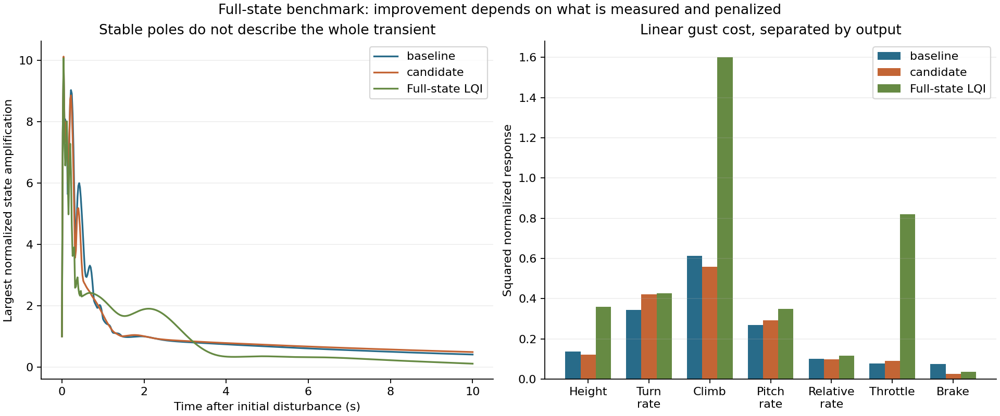
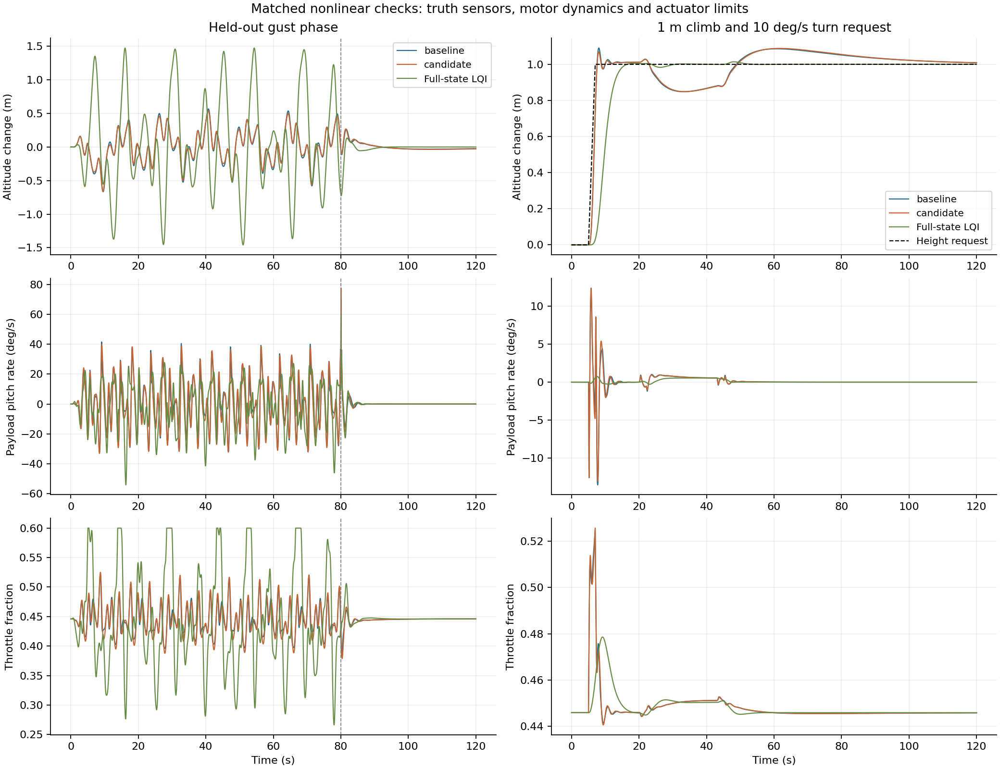

# What state-space analysis added to Micro-AGU’s controller design

*Micro-AGU · 14 October 2026 · [Controller design](controller-design.md) · [Data and methods](data-and-methods.md) · [Study files](../research/state-space-2026-10-14/README.md)*

The most useful result of this study was a clearer separation between three goals: following a command, rejecting a gust, and keeping the suspended aircraft quiet. A controller can improve one while making another worse. Even a controller that knows every simulated state has to make that tradeoff.

We jointly tuned the existing steering and altitude controller, examined how its actuators and measurements connect to the aircraft’s internal motion, and compared it with a full-state feedback controller. The revised conventional tune reduced a prominent coupled sensitivity peak, while preserving almost the same altitude-command response. Full-state feedback made a commanded climb much gentler, but the tested designs were substantially worse in gusts. Neither result justifies replacing the retained controller defaults.

These are results from the articulated simulator, followed by separate native-controller checks. They are not new flight measurements.

## Two views of the same linear aircraft

“Linear versus state space” is an easy shorthand, but it can suggest the wrong comparison. Both analyses here are linear. The distinction is between looking at input/output responses and looking explicitly at the internal states that produce them.

The sampled state model is

```text
x[k+1] = A x[k] + B u[k] + E wind[k]
y[k]   = C x[k]
```

Here the inputs are throttle and differential brake. The state includes payload attitude, relative canopy attitude, both bodies’ angular rates, velocity, rotor speed and altitude. The same model gives the transfer matrix

```text
G(z) = C (zI − A)⁻¹ B
```

A Bode plot and a state-space simulation therefore must agree when they describe the same plant, controller and sampling. We checked that directly: independently assembling the feedback return matrix and solving the augmented closed-loop states agreed to within **7 × 10⁻¹⁴** in the sampled frequency sweep. That is an algebra and implementation check, not validation of the aircraft model.

State space was already present in the earlier work. The original classical analysis used numerical Jacobians and modal participation; the earlier pitch-joint experiments also tried LQI and assessed observability. What is new here is the joint tuning of the current loops, combined uncertainty testing, finite-horizon actuator/sensor diagnostics, and a new full-state benchmark on the current plant.

## Make the comparison use the current controller

The baseline retains the present **1 Hz steering filter**, two **1.5 Hz pitch-filter stages**, pitch-damper gain **0.1**, and the stronger climb feedback selected through `TECS_VERT_ACC = 3.5`. Some historical analysis scripts predate those settings; using them unchanged would have compared against an obsolete baseline.

We regenerated six local plants: mission-profile level flight, climb and descent at ±0.5 m/s, level flight at 20.4 V, and the softer-roll profile in level flight and climb. The softer-roll climb was held out of tuning. All are straight-flight trims at the Trout Lake mass of 1.758 kg. Turning and landing equilibria are outside this new tuning ensemble.

The plant has 16 states, including altitude. The existing controller adds eight filter and integrator states, making a 24-state closed loop. Controller updates and command holds are 20 ms; the nonlinear integration uses 1.25 ms substeps. Motor dynamics remain in the plant. Brake travel limits and rates become active in the subsequent nonlinear tests.

The equilibrium residuals were below 7 × 10⁻¹³. Halving the finite-difference perturbation changed the state Jacobians by less than 1.3 × 10⁻¹⁰ in relative matrix norm. More usefully, a 1 mm altitude ramp through nonlinear physics reproduced the sampled linear responses with a maximum relative time-history error of **0.021%** across height, climb, payload pitch rate, throttle and brake. This check holds the feedforward on its climb-side branch so it tests one smooth local system; normal nonlinear tests restore the climb/descent switch.

## What the frequency-domain view made clear

The first question was whether we could improve the existing architecture without adding sensors or a new controller. Eight settings were varied together: steering P and I, roll damping, steering filter frequency, pitch damping and its two shared filter cutoffs, climb feedback, and height feedback. Feedforward stayed unchanged.

The objective combined normalized command-response error and motion/control effort with the response to the existing illustrative gust spectrum. It balanced average and worst operating-case scores. This is a declared engineering preference, not a uniquely correct definition of good flight.

The first optimization improved that score by about **17%**, but bought the improvement partly through weaker feedback, worse gust response and slower recovery. We retained it as a diagnostic rather than calling it a winner. A second search constrained altitude and heading tracking costs, aggregate gust cost, and the slowest decay rate so the optimizer could not make those trades freely.

The constrained search returned this candidate:

| Setting | Current baseline | Study candidate |
|---|---:|---:|
| Steering P | 0.00500 | 0.00278 |
| Steering I | 0.00200 | 0.00169 |
| Roll-rate damping | 0.00300 | 0.00106 |
| Steering filter | 1.00 Hz | 0.762 Hz |
| Pitch-rate damping | 0.100 | 0.0971 |
| Each pitch-filter stage | 1.50 Hz | 1.106 Hz |
| Climb P, nominal voltage | 0.0343 | 0.0435 |
| Height feedback | 0.100 s⁻¹ | 0.0787 s⁻¹ |

The combined objective improved by **7.4%**. Command-response cost fell by 12–20% across the training plants, while aggregate linear gust cost improved by only 0.3–2.1%. On the held-out softer-roll climb, those reductions were 19% and 2.6%. The search stopped at its 45-generation budget; this is a feasible candidate, not a claim of convergence to a global optimum.

There is an important qualification to that score. The step criterion deliberately stresses abrupt reference edges, whereas the later maneuver test ramps altitude over two seconds. About **115 of the baseline's 160 nominal step-cost units** come from heading-rate motion induced by the altitude step. This is largely a cross-axis transient criterion, not a percentage improvement in ordinary mission tracking. Its output-by-output decomposition is part of the retained evidence.


*Nominal level-flight plant, sampled at 50 Hz. Both analyses use the same physical states and controller. The plotted wind response is a small-signal gain, not a prediction that a finite 1 m/s high-frequency gust would remain linear.*

The most conspicuous improvement is around **2 Hz**. The peak singular value of the coupled actuator sensitivity falls from **6.03 to 2.27**. The altitude-command curves remain nearly unchanged. This is a useful example of reducing an unwanted response without slowing every command by the same amount.

This sensitivity considers throttle and brake together, with both inputs scaled by a 0.1 command fraction. It describes the largest amplification of an additive actuator disturbance in any input direction. It is not a disk margin or a measured stability margin. A general multiple-loop robustness analysis can also assess simultaneous gain and phase uncertainty; the [disk-margin formulation](https://www.mathworks.com/help/robust/ug/stability-analysis-using-disk-margins.html) is one example.

Looking only at the baseline sensitivity matrix's diagonal entries gives a peak of **2.18**, compared with **6.03** for the complete matrix. The off-axis responses matter. This is an insight from a multiple-input frequency analysis, made straightforward by retaining the coupled state model; it would be missed by treating the axes as independent scalar plants.

The frequency plot also explains why the large peak reduction does not produce an equally large improvement in our gust tests. Their imposed frequencies run from **0.08 to 0.89 Hz**. They do not directly excite the 2 Hz peak. Looking at a single maximum would have obscured that distinction.

## What the internal states added

The frequency plots show where a response is large. State-space diagnostics make it convenient to ask which physical motion creates it, which actuator can influence it, and what the available measurements reveal.

### Actuator authority depends on the mode

We normalized angles, rates, velocities, rotor speed and height by declared engineering reference excursions before comparing them. Without that scaling, changing metres to millimetres could change an apparently impressive matrix condition number.

The slow **0.343 Hz** mode is dominated by payload pitch and forward velocity. Its normalized throttle coupling is about **5.8 times** its brake coupling. The **0.592 Hz** side-velocity/canopy-yaw mode is about **2.9 times** more strongly coupled to brake than throttle. Those pairings support the existing division of duties.

The faster modes are less neatly separated. In particular, the **5.86 Hz relative-roll mode** has appreciable throttle coupling in this model. Calling it a roll mode does not mean that only the steering actuator can excite it. This reinforces the reason to examine the loops together.

These are local modal couplings, not measurements of usable authority under saturation. They depend on the retained rotor, suspension and aerodynamic model.

The four-second controllability Gramian adds a related warning: its least reachable normalized state direction combines canopy roll rate, relative yaw and side velocity. Those motions cannot be treated as independent knobs that a full-state controller can adjust cheaply. This is a finite-horizon input-effort result, not a declaration that those states are uncontrollable.


*Left: four-second observability Gramians, using declared measurement scales. The gyro-only altitude eigenvalue is zero and is shown at the plot floor. Right: normalized input coupling to each oscillatory mode. Connecting lines guide the eye; there are no additional measured modes between the points.*

### More state information is not automatically a reason for more sensors

A four-second finite-horizon observability calculation gives a more useful question than nominal rank alone: how unevenly do the measurements reveal different state combinations? Finite-horizon calculations also accommodate the altitude integrator, for which an ordinary infinite-horizon Gramian is inappropriate. [Gramians and their control/estimation uses](https://www.mathworks.com/help/control/ref/statespacemodel.gram.html) provide the general background.

With payload gyros alone, altitude is unobservable. Adding payload attitude, navigation velocity and height makes the nominal model observable over the chosen horizon. Adding hypothetical canopy gyros increases the weakest scaled observability eigenvalue from **7.18 to 10.98**, about 53%. That is useful additional information, but it does not unlock an otherwise completely hidden nominal plant.

These calculations assume a known model and illustrative independent measurement scales: 1° attitude, 1°/s gyro, 0.1 m/s navigation velocity and 0.2 m height. They are not predicted estimator accuracies. Adding three unknown constant-wind states leaves this nominal navigation-equipped model observable too; we did **not** include unknown force/moment biases or correlated AHRS errors. The ambiguities exposed by the [earlier observer study](data-and-methods.md#can-i-estimate-what-i-cannot-measure) therefore remain relevant. This study does not establish a flight-ready canopy observer.

### Decaying modes can still produce a sharp transient

We also searched over initial physical-state perturbations with the controller memories initially at equilibrium. The largest normalized state excursion occurs about **40 ms** after release and is dominated by an initial relative-roll displacement. Its amplification is approximately **10** for both conventional tunes.

That number is not tenfold mechanical energy growth. It measures the conversion of normalized displacement into normalized motion under the declared state scales, and it can be rescaled to arbitrarily small perturbations. The useful finding is the comparison: substantially reducing the actuator-sensitivity peak did **not** remove this fast internal release response. Closed-loop pole locations, command tracking and initial-disturbance response describe different aspects of the same system.

## Give a controller every simulated state

To test whether state information could buy better behavior, we built a discrete LQI controller with access to all 16 plant states. Two command-memory states penalize actuator increments; two error integrators support altitude and heading-rate tracking. The same nominal gain is used across operating cases, with their corresponding trim offsets.

We screened **72 weight combinations** across the same training plants and selected by the same normalized command/gust objective. This is a full-state reference design, not an optimal-performance bound. It has perfect state information, no observer delay, and a restricted LQI tuning family. Its nonlinear tests still enforce actuator limits, brake travel rates and a total-throttle slew bound. That last bound differs from the conventional controller’s P-plus-feedforward slew limiter.



*The selected LQI gains make a different tradeoff. Their linear gust costs already predict substantial additional vertical motion and throttle effort. State normalization and output weights are specified in the study scripts.*

In the nonlinear maneuver test, altitude rises by 1 m over two seconds, followed by a 10°/s turn request and release. The full-state controller substantially reduces the climb’s pitch kick:

| Nonlinear maneuver metric | Baseline | Retuned existing loops | Full-state LQI |
|---|---:|---:|---:|
| Integrated absolute height error | 5.95 m·s | 5.94 m·s | 4.17 m·s |
| Peak payload pitch rate | 13.54°/s | 13.04°/s | 0.73°/s |
| Payload pitch-rate RMS | 1.69°/s | 1.73°/s | 0.29°/s |
| Heading-rate error RMS | 1.15°/s | 1.23°/s | 2.77°/s |

Height and pitch metrics cover 5–80 seconds, including the climb and turn; heading error covers 20–60 seconds. The gentler response is real in this simulation, but comes with worse turn tracking. The LQI controller also builds altitude more gradually at the start of the climb.

This comparison changes both state access and controller architecture, including reference and command shaping. It therefore does not isolate the value of the otherwise unmeasured states. A matched-bandwidth comparison against a more gently shaped conventional altitude command would be needed before attributing the smaller pitch kick specifically to canopy-state feedback.

## The gust test changes the ranking

The held-out gust realization uses a new phase seed, with nominal component RMS values of 0.5, 0.5 and 0.25 m/s. All controllers start from the same trim and encounter the same prescribed wind history. The table covers 15–80 seconds, before the artificial gust cutoff.

| Matched nonlinear gust metric | Baseline | Retuned existing loops | Full-state LQI |
|---|---:|---:|---:|
| Height error RMS | 0.247 m | 0.236 m | 0.729 m |
| Climb-rate RMS | 0.345 m/s | 0.331 m/s | 0.760 m/s |
| Payload pitch-rate RMS | 15.80°/s | 16.79°/s | 16.34°/s |
| Throttle standard deviation | 2.58 percentage points | 2.86 percentage points | 8.54 percentage points |
| Differential-brake standard deviation | 3.56 percentage points | 1.93 percentage points | 2.82 percentage points |

The conventional candidate improves height and climb response by about 4–5% and reduces brake activity by about 46%, but its payload pitch-rate RMS increases about 6%. Those are separate outcomes; the aggregate score cannot decide whether that trade is desirable.

The full-state LQI controller is much worse at holding height in these gusts and repeatedly reaches the throttle ceiling. It saturates during about **5.3% of the complete 120-second run**. The problem was already visible in its linear disturbance responses; actuator constraints add another limitation rather than supplying the entire explanation.



*Truth-sensed nonlinear diagnostics, not native autopilot traces. The dashed vertical line at 80 seconds marks the abrupt end of the synthetic gusts; the resulting transient is excluded from the gust table. “Full-state LQI” is the selected weight-screen candidate.*

The retained experiment set also includes a second phase seed with 50% larger gust amplitudes, the softer-roll profile, its held-out climb condition, and low voltage. These broaden the comparison but do not turn this illustrative gust spectrum into a flight-identified atmospheric model. The stronger LQI cases include appreciable saturation and larger motion; the rigid-canopy model does not establish stall or collapse protection.

Across all eight paired gust cases, the conventional candidate reduces height RMS by **4.4–6.2%** and brake activity by **42–50%**, while increasing pitch-rate RMS by **5.2–7.9%**. The tradeoff is consistent across this tested set, rather than being confined to the nominal example.

The conclusion is narrower than “state feedback does not work.” This tested LQI family did not beat the existing controller's combined objective. The full-state design produced a gentler commanded maneuver, but did not automatically yield good disturbance rejection. A next state-feedback design should explicitly shape disturbance response and actuator headroom, and isolate the contribution of additional state information, before adding an observer.

## Check combined uncertainty, not just one changed gain

For each conventional tune, we evaluated **648 combinations**: six plants, independent throttle and brake effectiveness at 0.75 or 1.25 nominal, independent extra command delays of 0, 40 or 80 ms, and rotor response rates at 0.7, 1.0 or 1.3 nominal. This is a stress grid, not a measured probability distribution or an exhaustive robustness certificate. It does not include estimator-delay models, changing mixer branches or finite-amplitude saturation.

Both tunes remained locally stable in every combination. The worst dominant-pole real part was **−0.0397 s⁻¹** for baseline and **−0.0431 s⁻¹** for the candidate. Thus the candidate’s lower nominal sensitivity peak is accompanied by acceptable behavior in this particular combined-uncertainty screen. It does not demonstrate a dramatic improvement in worst-case recovery.


*Negative values mean local perturbations decay. Each bar is the worst combination for that operating plant. Full-state LQI is not included in this grid.*

## Back through the native autopilot

The baseline and conventional candidate both passed the full native AUTO mission in calm air and gusts: **four passes**, with the existing assertions unchanged. These runs use the airborne preparation fixture and the native estimator, navigation, steering and TECS paths. They do not test launch, and the full-state LQI controller is not installed in firmware.

The settled-loiter measurements show a familiar tradeoff:

| Native gust mission metric | Baseline | Candidate |
|---|---:|---:|
| CW height error RMS | 0.384 m | 0.356 m |
| CCW height error RMS | 0.392 m | 0.356 m |
| CW pitch-rate RMS | 18.00°/s | 19.42°/s |
| CCW pitch-rate RMS | 19.62°/s | 20.10°/s |
| CW throttle standard deviation | 3.15 percentage points | 3.50 percentage points |
| CCW throttle standard deviation | 3.32 percentage points | 3.67 percentage points |
| Maximum waypoint height error | 1.51 m | 2.00 m |
| Maximum corner overshoot | 2.29 m | 1.41 m |


*Settled loiter windows start 20 seconds after entering a 60 m radius around the loiter centre. The route and assertions are unchanged.*

The runs share the same gust generator, but different route timing means their loiters sample different gust phases. This table verifies the candidate's native behavior; it does not isolate the controller change as cleanly as the matched diagnostic. The BIN parameter audit confirms the intended overrides, and all four backends report zero errors and zero clipped packets.

In calm air, maximum waypoint height error changes little, **1.677 → 1.662 m**, while maximum corner overshoot increases slightly, **0.379 → 0.412 m**. Settled height RMS also increases slightly in both loiters: **0.037 → 0.041 m** and **0.046 → 0.051 m**. The candidate preserves the passing calm mission, but does not offer a general improvement in its accuracy.

The native runs use the existing executable, whose embedded version is `51c8e130`; the current analysis checkout is `c44434dee6`. Those identities are recorded separately with the binary hash. The intervening controller-source changes inspected here concern flare allocation and landing suppression, outside these missions. The [build audit and reproduction notes](../research/state-space-2026-10-14/README.md) preserve that distinction rather than treating the checkout hash as proof of the executable's exact source tree.

The candidate therefore remains an experimental alternative. Lower settled height error and a smaller worst corner came with greater pitch-rate motion, more throttle activity, and a larger maximum waypoint height error in these gusty runs. A passing mission does not settle which tradeoff is preferable.

## What each view contributed

| Question | Most useful view in this study | What we learned |
|---|---|---|
| Where does the controller amplify a disturbance? | Frequency response and coupled sensitivity | A large improvement near 2 Hz need not greatly improve gusts concentrated below 0.9 Hz. |
| Which motion is behind a response? | Modes and state participation | Slow pitch/velocity and faster relative-body motion need different treatment. |
| Which actuator can influence that motion? | Modal input coupling | Throttle can excite modes that would sound “lateral” from their names. |
| Would more sensors unlock useful information? | Finite-horizon observability | Navigation already reveals the nominal plant; canopy gyros improve conditioning, while model/bias uncertainty remains unresolved. |
| Can an initially disturbed aircraft move sharply despite stable poles? | Initial-state response | A fast relative-roll release remains even after the sensitivity peak is reduced. |
| Does more state feedback improve flight behavior? | Full-state synthesis plus nonlinear tests | It can soften the commanded climb while worsening gust response and turn tracking. |

These are complementary ways to interrogate the same equations. The state-space results do not contradict the transfer functions. Much of the extra information could also be expressed through a sufficiently complete set of transfer matrices; retaining explicit physical states makes the questions easier to formulate and interpret.

For Micro-AGU, I would keep the current defaults, retain the conventional candidate for further comparisons, and use the state analysis to focus the next experiments. The highest-value follow-up is to identify the coupled dynamics and delays that matter around the response peaks, then refine the tuning objective around the motion we actually want to reduce. The full-state results justify targeted work on gentler maneuver response, rather than assuming that a more elaborate controller will improve every aspect of flight.

The [reproduction guide](../research/state-space-2026-10-14/README.md) contains the exact configurations, normalization, search bounds, retained matrices, numerical results and scripts. Development and analysis were assisted by Codex.
