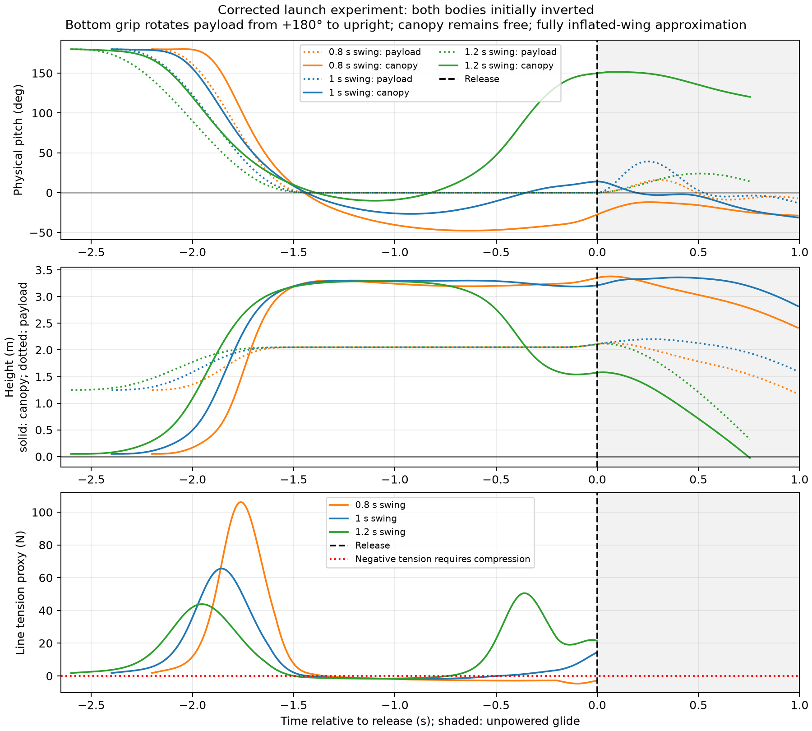

# Micro-AGU: Data and Methods

[Flight story](flight-testing.md) · [Design](micro-agu-design.md) · [Steering](paraglider.md) · [Throttle and pitch](longitudinal-observer.md)

This appendix supports the four project chapters. Flight measurements, the initial simulation tuning, and later controller/model experiments are separate evidence sets.

## Design record

The design record includes pages 1, 185, and 323 of `Paraglider.pdf`, SolidWorks files, build photographs, and flight logs. The [design evidence](assets/micro-agu/design-evidence.json) records assembly structure and source hashes. CAD previews were extracted with [SWFormat](https://github.com/KenM76/swformat).

## Flight measurements

The figures use the January 3 and February 15 onboard logs. Height is relative to home, and the ground track is relative to the plotted segment’s starting point. Energy is battery-side electrical energy, calculated from current and voltage and checked against the onboard counters. The AUTO endurance row is part of the full Trout Lake flight.

The force diagram explains the mechanism identified afterward in the articulated model; loaded CG and inertia remain to be measured. The February 15 firmware reports `3a2da6cf`, while its parameter names match later source changes. The inspected implementations agree on the damper sign, but the version string does not identify the exact compiled tree. Filter behavior also matters: the inspected code zeros the signal at zero cutoff, applies positive cutoff changes on reset, and updates at 50 Hz using the throttle-loop timestep.

I reviewed six onboard logs and 54 telemetry logs with their raw companions. A February 22 telemetry recording switches from hardware to SITL; that simulated section is excluded here. The [flight evidence](assets/flight-testing/flight-evidence.json) records source hashes and comparison windows. [Hood River](assets/flight-testing/hood-river-plot-data.csv.gz) and [Trout Lake](assets/flight-testing/trout-lake-plot-data.csv.gz) overview data are sampled at 5 Hz; pitch-rate comparisons use the 25 Hz analysis.

The simulation figures use the Mission Planner SITL recording beginning February 14 at 13:43:43 PST, which continues into February 15. It is kept separate from the aircraft flight data. Recorded parameter values and timestamps are preserved in the [simulation tuning history](assets/flight-testing/sitl-lateral-tuning-history.json).

The [endurance evidence](assets/flight-testing/endurance-evidence.json) specifies energy and capacity windows. The pilot confirmed 6 Ah total capacity, accurate Trout Lake capacity estimates, an unchanged configuration during the long flight, and landing because testing was complete.

### Longitudinal reconstruction

Local throttle–climb fits use non-overlapping 10 s windows, MANUAL or FBWA throughout, throttle standard deviation below 1.5 percentage points, and finite EKF climb data. Climb is negative EKF down velocity, checked against height slope. Turns and vertical air motion remain in the samples. Adjacent windows are not independent repetitions; these are local steady-response fits rather than dynamic transfer functions or extrapolations to idle/full throttle.

Hood River supplied 20 windows: climb ≈ 0.05097 × throttle[%] − 1.809 (R² 0.85). Early Trout Lake supplied 13: climb ≈ 0.06257 × throttle[%] − 2.673 (R² 0.88). The pilot confirmed that the 1.8 m/s climb and 3 m/s sink settings came from Hood River analysis. The selected steady windows do not reproduce those original limit measurements.

- [Longitudinal parameter ledger](assets/flight-testing/longitudinal-parameter-ledger.csv)
- [Hood River fit inputs](assets/flight-testing/2026-01-03-steady-fit.json)
- [Trout Lake fit inputs](assets/flight-testing/2026-02-15-steady-fit.json)

### Lateral flight measurements

The long Trout Lake log contains no roll-gain changes. Loiter radius changed 60 → 40 m at boot 828.69 s in LOITER, then 40 → 30 m at 2349.57 s in GUIDED. The pilot confirmed deliberate tighter-turn testing; the second parameter edit alone does not establish a completed 30 m circle.

Heading rate uses unwrapped ATT.Yaw with a symmetric 2 s difference, not body yaw gyro or ground-course rate. Bank tracking uses CTUN.NavRoll minus CTUN.Roll; cross-track error uses NTUN.XT. The plotted manual interval is shaded. Selected settled windows were 780–825 s (60 m), 850–900 s and 950–1045 s (40 m). These windows do not compare different controller gains.

- [Lateral parameter ledger](assets/flight-testing/lateral-parameter-ledger.csv)
- [Response windows and statistics](assets/flight-testing/lateral-response.json)

## Lateral-controller evidence

The controller sketch is from page 323 of my notebook. The Hood River parameter values come from the January 3 onboard log. The algebra follows [`AP_RollController::get_servo_out`](https://github.com/DavidIngraham/ardupilot/blob/0f1121f32035d218c624fa7e110a124fd7fc6263/libraries/APM_Control/AP_RollController.cpp), [`AP_FW_Controller::_get_rate_out`](https://github.com/DavidIngraham/ardupilot/blob/0f1121f32035d218c624fa7e110a124fd7fc6263/libraries/APM_Control/AP_FW_Controller.cpp), and [`AC_PID`](https://github.com/DavidIngraham/ardupilot/blob/0f1121f32035d218c624fa7e110a124fd7fc6263/libraries/AC_PID/AC_PID.cpp) at the revision reported by that log. The numerical example holds speed scaling constant and stays below output limits.

The gains we selected for this SITL model are `PG_TURN_RMAX=25`, `FF=0.051`, `P=0.04`, `I=0.002`, `IMAX=0.15`, `ACCEL=40`, `FILT=4`, `TC=0.1`, `ASPD=5`, `RDAMP=0.03`, `D_FF=0.02`. They accompany `NAVL1_PERIOD=8`, `NAVL1_DAMPING=1`, `WP_RADIUS=22` and `WP_LOITER_RAD=25`. These are model-specific engineering selections, not general flight recommendations.

### Recorded initial simulation tuning

The February 14 Mission Planner log extends into February 15. Wall-clock timestamps are PST; the overnight span is recording coverage, not continuous active tuning. Parameter histories are recorded values, which can include reloads or automated changes as well as manual edits.

The two AUTO close-ups start at 11:30:00 and 11:35:15 on February 15 and last 45 seconds. They use ATTITUDE.roll and NAV_CONTROLLER_OUTPUT.nav_roll/xtrack_error. They have different navigation demand histories. FF and D_FF differ, so the plots illustrate recorded behavior without isolating a single gain's causal effect. The overview retains mode changes and the surrounding runs.

- [Tuning history](assets/flight-testing/sitl-lateral-tuning-history.json)
- [Comparison windows](assets/flight-testing/sitl-tracking-windows.json)

### Later model assumptions

When the simulated yaw response oscillated, I wanted to understand whether additional damping could be explained by a higher-fidelity model. Without flight data to identify it, we chose a provisional damping term and added propeller torque reaction. The canopy model builds on [Umenberger and Göktogan, ACRA 2012](https://www.araa.asn.au/acra/acra2012/papers/pap151.pdf). Added yaw damping (`Cnr=-0.05`) is an effective provisional term, and propeller torque reaction uses a provisional −0.02 m torque/thrust ratio. Neither is identified from flight logs. Higher-fidelity canopy/payload coupling can contribute apparent damping, but does not establish these numerical values.

## Can the launch start in the right physical state?

My actual launch starts with both payload and canopy upside down. I hold the bottom of the payload, lay the canopy out in a crescent, swing it overhead in about a second, walk two steps once it is inflated, and give it a light toss. I let it glide for about a second before throttling up. I wanted that sequence represented because the release state could matter to the oscillations we were trying to control.

We explored that sequence with provisional geometry and timing. A 1.0 s swing looked more promising than 0.8 or 1.2 s for release orientation, but about 39% of the held trajectory required compression in the assumed suspension constraint. That invalidates a taut-line rigid interpretation of actual inflation. This is a design study, not a validated launch simulation.

The durable SITL throw guide is a synthetic initialization aid; it does not implement the overhead inflation sequence. The model assumes an inflated canopy and does not simulate slack lines, inflation or collapse. [Swing results](../scratch/paraglider-tests/pitch-joint/swing-launch/inverted-results.json) retain the checks and assumptions.

## Reproducing the figures

The [simulation extraction](assets/flight-testing/analysis/extract_sitl_nav.py), [tuning overview](assets/flight-testing/analysis/plot_sitl_tuning.py), [tracking comparison](assets/flight-testing/analysis/plot_sitl_tracking.py), [lateral flight analysis](assets/flight-testing/analysis/lateral_sysid.py), and [longitudinal fits](assets/flight-testing/analysis/system_id_fit.py) preserve the analysis behind the new figures. They expect the original local log tree and previously extracted JSON/NPZ data; paths need adjustment on another machine. Raw aircraft and telemetry logs are not bundled here. The repository [archive instructions](../README.md#archive-and-restore) describe the separately retained historical simulation scripts, compressed artifacts, hashes, and omitted files.

## Classical lateral analysis and frequency shaping

The current articulated model has **9 mechanical degrees of freedom**: two rigid bodies (12) joined by three positional constraints (−3). Its stored quaternion state, first-order velocities, rotor RPM, and actuator states must not be confused with that mechanical count. The lateral linearization removes global position and heading, leaving 14 internal mechanical states; rotor speed is fixed at equilibrium for this experiment.

The classical study uses the mission profile at Trout Lake mass 1.758 kg, model revision `af6b2ca963`. It computes a central-difference sampled Jacobian and its continuous equivalent, retains the full state order, and checks response against nonlinear sine tests. All feedback channels remain coupled. [Linearization and validation script](../tools/classical_lateral.py), [report generator](../tools/report_classical_lateral.py), and [modal/root-locus annotations](../tools/annotate_lateral_roots.py) reproduce the figures and coefficients.

The [frequency-shaping experiment](../tools/shape_lateral.py) compares six filters at five trims, followed by 18 nonlinear command/delay cases. [Its report generator](../tools/report_lateral_shaping.py) preserves the tables and interpretation. Native backward-Euler low-pass filters are used in nonlinear checks; the experimental notch uses a bilinear discretization. Linear analyses freeze speed scaling at trim. Nonlinear runs recompute it and include actuator travel-rate limits and integral anti-windup. Common delay is applied to both rate observations; estimator errors, wind and unequal sensor delays are not modeled.

The mission profile alone was used in this filter study. The retained dynamic-roll profile, full native SITL chain and real flight remain follow-up checks. The mathematical pure-delay boundaries of several seconds after filtering are not avionics latency requirements: removing high-frequency unity-gain crossings leaves a low-frequency stability boundary. The practical nonlinear comparison used 80 ms. No flight-controller filter default was changed by these experiments.

Raw matrices, traces and local HTML reports remain in Mission Planner. Final figures live under `research/flight-log-analysis/figures/turn-model-spike/classical-lateral/` and `lateral-shaping/`; scripts and the figure manifest provide reproduction and provenance without moving raw flight logs into Git.

## Articulated flight viewer

The [Three.js viewer](../viewer/README.md) consumes simulator truth state: NED position, separate payload and canopy quaternions, joint rotation vector and rate, actual brake travel, motor RPM, throttle and voltage. The 9 mechanical degrees of freedom are three shared translation coordinates, three payload attitude coordinates, and three canopy attitude coordinates. Actuator and motor dynamics add states without adding rigid-body degrees of freedom. A local Python bridge connects the optional UDP output to the browser over WebSocket; recordings use the same JSONL frame format.

The payload is a reduced GLB export of `microAGU.SLDASM`, aligned to the existing estimated Trout Lake CG. Named CAD components retain separate pivots: propeller and motor rotor, plus the two servo horns and capstans. Propeller phase integrates simulated RPM and turns clockwise viewed from behind. At video frame rates, the apparent blade direction can alias. Capstan angle changes by brake travel divided by the measured 27.5 mm drum radius. The first sample defines the visual reference; absolute servo zero and mirrored winding signs still need a physical check. The CAD prop is labeled APC 9x6, while the flown prop was 9x4.5; exporting this mesh does not alter propulsion physics. The canopy, lines and absence of a CAD ballast block are visualization approximations.

The [turn-and-reversal clip](paraglider.md#watching-the-two-bodies-move) uses the mission-profile model at 1.758 kg and 22.2 V. It starts from level-flight trim at 100 m, ramps right brake to 22 mm above trim, reverses to 20 mm of left brake above trim, then releases. Throttle rises by up to six percentage points during the maneuver. The physics runs at 50 Hz for 30 seconds; the browser records a silent 1280 × 720 WebM at a requested 30 fps and real-time playback. MP4 is provided for mobile compatibility. No joint-motion scale factor is applied.

Reproduction sources are [the maneuver generator](../viewer/tools/make_showcase.py), [the video renderer](../viewer/src/video.ts), and [the encoding script](../viewer/tools/encode_showcase.sh). The [clip metrics](assets/viewer/reversing-turn-turbulence.json) include the input schedule and SHA-256 of the source truth stream. Raw frames remain in Mission Planner under `analysis/longitudinal-2026-10-09/turn-model-spike/viewer-showcase-turbulence/`; Git contains the final video, poster, metrics and scripts. This is an open-loop visualization exercise, not another native AUTO acceptance result.

### Native AUTO mission video

The gust [viewer clip](paraglider.md#the-controller-flies-the-mission) comes from a fresh successful `test.Plane.ParagliderAutoMission` run on ArduPilot commit `2588ecc44a`, with `mission-controller-candidate.json`, the mission-profile 9-DOF model, 22.2 V and 1.758 kg. The heading-rate gains remain FF 0.009, P 0.005, I 0.002 and roll-rate damping 0.003, with the current native 4 Hz measurement filter. The earlier 1 Hz filter remains a research candidate. Native voltage compensation is enabled; pitch-rate throttle damping uses gain 0.1 and two 1.5 Hz low-pass stages.

[record_auto.py](../viewer/tools/record_auto.py) observes the backend response during the unchanged AUTO harness and writes the complete truth state at about 29 Hz. It does not replace any actuator command. The complete test passed, retaining its mission CSV, flight BIN and truth stream in Mission Planner under `analysis/longitudinal-2026-10-09/turn-model-spike/gust-control/two-pole-native-gust/`.

[extract_auto_clip.py](../viewer/tools/extract_auto_clip.py) selects the approach to the first clockwise loiter, beginning when mission item 3's target distance falls below 60 m. The published continuous interval is 237.518–292.503 simulation seconds. Native MODE records confirm AUTO throughout; native SIM roll/pitch versus interpolated truth have RMS differences of 0.0153°/0.0228°, checking timestamp alignment. The inset draws the excerpt's ground track, not a commanded path. [Metadata](assets/viewer/auto-gust-profile.json) preserves timestamps, trace hashes, controller parameters and joint-motion extrema. Video capture and encoding use the same scripts as the open-loop clip, at 1× playback with no motion scaling. The [viewer README](../viewer/README.md#native-auto-mission-recording) gives the full command sequence.

The scripted maneuver and gust AUTO clip use `--turbulence`: the shared [gust generator](../viewer/tools/turbulence.py) applies a uniform smooth multisine air velocity, with zero mean wind, nominal N/E/D RMS 0.5/0.5/0.25 m/s, frequencies 0.08–0.89 Hz, seed 20261011 and a five-second ramp after release. The AUTO excerpt has measured RMS 0.472/0.515/0.259 m/s. The native wrapper feeds the existing physics wind input and returns consistent wind and airspeed to SITL; it leaves controller outputs and test assertions unchanged. There are no spatial gust gradients, artificial joint torques or visual motion multipliers. “Moderate” describes the selected demonstration amplitude, not a validated atmospheric category. The prior calm-air metrics remain archived beside the new metrics. Both full native runs passed.

The capstan markings are procedural visual paint on the rotating CAD parts: black/white quadrants plus one orange radial index. They do not change brake travel, pivot geometry or the recorded physics. The scripted clip retains its original gust truth stream; the AUTO clip now uses the improved two-pole pitch damper. Both use a side-on mechanism camera and actuator overlays. [Longitudinal video diagnostics](../viewer/tools/analyze_auto_gusts.py) compare the archived damper-off calm and gusty AUTO excerpts; their frequency estimates use linearly detrended periodograms over the full 55-second windows (approximately 0.018 Hz bin spacing). These independently aligned runs do not isolate the feedback contribution.

The AUTO comparison now shows three conditions with the same two-pole pitch damper and heading-rate controller. The clips start at the same mission event (item 3, target distance below 60 m), rather than the same elapsed simulation time. Each preserves about 55 continuous seconds of native AUTO flight. Altitude in the side profile is minus the truth state's NED down coordinate; the horizontal coordinate is cumulative ground distance. All three excerpts fit the shared 85–95 m display range.

| Condition | Source run under `turn-model-spike/` | Simulation interval (s) | Altitude range (m) | Metadata |
|---|---|---|---|---|
| Calm | `gust-control/two-pole-native-calm` | 233.248–288.198 | 89.45–90.11 | [Calm](assets/viewer/auto-calm-profile.json) |
| Gust | `gust-control/two-pole-native-gust` | 237.518–292.503 | 88.91–90.83 | [Gust](assets/viewer/auto-gust-profile.json) |
| Steady wind | `viewer-auto-crosswind` | 219.353–274.303 | 89.22–90.22 | [Crosswind](assets/viewer/auto-crosswind-profile.json) |

The new steady-wind run uses `record_auto.py --wind-ned 0 2 0`: 2 m/s eastward, applied to the physics after release, with no gust component. It passed the unchanged complete `ParagliderAutoMission` test, including opposing loiters, altitude and corner checks, home loiter and handover. Native SIM/truth roll and pitch alignment RMS is 0.0072°/0.0071° for its excerpt. The wind flag uses the recorded physics vector. The model, mass (1.758 kg), voltage (22.2 V), and controller parameters match the calm and gust runs; the longer overall route time in steady wind is retained in the raw log.

[prepare_wind_clip.py](../viewer/tools/prepare_wind_clip.py) preserves states and timestamps, adds explicit zero-wind annotations to the legacy calm recording, and records both original and prepared clip hashes. Prepared clips and browser captures stay under `viewer-wind-comparison/{calm,gust,crosswind}` in Mission Planner. Only final videos, posters, metadata and their generating scripts are committed here. [run_gust_native.sh](../tools/run_gust_native.sh) reproduces the three conditions using `calm`, `gust`, or `crosswind`.
