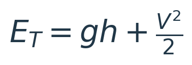

# Getting Micro-AGU to Autonomous Flight

*Micro-AGU · Controller design, part 1 · [Build](micro-agu-design.md) · [Flight tests](flight-testing.md) · [After Trout Lake](controller-design.md)*

Before the first flights, I worked through how to make an airplane autopilot control a powered parafoil. I wanted to keep ArduPlane’s navigation and mission machinery while changing how its demands reached the brakes and motor. Steering and altitude needed different adaptations, but they were parts of the same practical goal: get this aircraft flying autonomous missions.

This is the first phase of that work: my original control-law notes, the roll-controller workaround, the throttle-only TECS adaptation, and the measurements and tuning that carried the project through Trout Lake. The later animations help explain what happened; they are distinguished from the flight recordings. [Part 2](controller-design.md) covers the subsequent articulated simulation, damper-sign experiments and classical design of the replacement controller.

## Two adaptations before flight

For steering, I initially expected to write a yaw-rate controller. Working through the existing roll loop showed me that its feedforward path could become an angle controller, and under a steady-turn approximation give much of the turn-rate behavior I wanted. For altitude, I replaced TECS’s elevator-dependent energy balance with throttle-based climb control. I also adopted the ACRA paper’s pitch-rate damper—a plausible idea built around a throttle response that turned out to be wrong for my payload.

## Getting the first controller by changing the gains

I started by breaking ArduPlane's roll controller into its individual paths. It normally converts bank-angle error into a requested roll rate, then uses rate feedback and feed-forward to drive the ailerons. I crossed out the rate P, I, and D paths and followed what was left. The feed-forward path reduced to something much simpler: essentially a proportional gain on bank-angle error.


*January 30 control-law notes: keep the navigation and angle-error calculation, then use rate feed-forward to drive the brakes.*


*The starting architecture: bank-angle error generates a roll-rate target; rate feedback and feedforward drive the actuators. This diagram omits implementation details to show the two loops.*

A conventional airplane roll controller has two nested loops. Bank-angle error creates a requested roll rate, then a rate controller drives the ailerons. For my parafoil, the output instead goes through the brake mixer. Differential braking produces a turn and the associated bank, so I wanted a simple angular correction rather than an inner loop tuned around aileron-driven roll dynamics.

Let φ_cmd be commanded bank, φ be measured bank, τ be `RLL2SRV_TCONST`, and K_FF be `RLL_RATE_FF`. Ignoring the target filter and limits for the moment, ArduPlane's outer loop computes:

```text
e_φ   = φ_cmd − φ
p_cmd = e_φ / τ
```

The rate feed-forward term is proportional to that requested rate. With rate P, I, D, and derivative feed-forward set to zero, it is the only active rate-controller contribution:

```text
u = K_FF p_cmd
  = (K_FF / τ) (φ_cmd − φ)
  = K_φ e_φ

K_φ = K_FF / τ
```

**The rate feed-forward gain becomes a proportional bank-angle gain.** It is feed-forward with respect to the inner rate loop, but the complete loop still feeds back measured bank angle. There is no integration hidden in the cancellation: the requested rate is just angle error multiplied by 1/τ. Measured roll rate no longer contributes when its feedback gains are zero.


*The flight configuration removes the measured-roll-rate inner loop. Rate feedforward acts on bank-angle error through the outer angle gain. Trout Lake adds derivative feedforward to this same path.*

### Including ArduPilot's speed scaling

The implementation scales the PID inputs and rescales feed-forward on the way out. Let S be the supplied speed scaler, E be the true/equivalent airspeed ratio (`EAS2TAS`), and F be the feed-forward multiplier (`ff_scale`, normally 1). With angles expressed in degrees:

```text
PID target = radians(p_cmd) S²
PID FF     = K_FF radians(p_cmd) S²

u_FF = degrees(F × PID FF / (S E))
     = F K_FF (S / E) p_cmd
     = [F K_FF S / (E τ)] (φ_cmd − φ)

Effective angle gain: K_φ = F K_FF S / (E τ)
```

The radians/degrees conversions cancel, as does one factor of S. The nominal speed scaler is reference speed divided by estimated airspeed; the actual supplied scaler includes ArduPlane's bounds and fallback behavior. At fixed scaling, feed-forward is still simply an angle gain. The final controller output is converted to centidegrees, limited to ±4500, and passed to the mixer—these are controller units, not measured degrees of brake travel.

The Hood River log records the configuration that implements this idea:

| Parameter | Logged value | Role |
|---|---:|---|
| `RLL2SRV_TCONST` | 1.0 s | Converts bank error to rate demand |
| `RLL_RATE_FF` | 0.345 | Supplies the effective angle gain |
| `RLL_RATE_P`, `RLL_RATE_I`, `RLL_RATE_D` | 0 | Removes inner rate-error feedback |
| `RLL_RATE_D_FF` | 0 | No derivative feed-forward in this flight |
| `RLL2SRV_RMAX` | 0 | Disables the requested-rate limit |
| `RLL_RATE_FLTT` | 3 Hz | Filters the rate target before feed-forward |

For example, with S = E = F = 1, a 10° bank error produces a 10°/s rate request and a feed-forward output of 3.45 controller degrees, or 345 centidegrees. Changing FF changes the angular correction directly; halving τ doubles it.

The 3 Hz target filter means the dynamic implementation is a filtered angle controller. At constant speed scaling, with H_T(s) representing that filter:

```text
u_FF(s) = K_φ H_T(s) [φ_cmd(s) − φ(s)]
```

### Where damping fits

I also worked through how I could add damping using the derivative feed-forward path. If derivative feed-forward is enabled, it differentiates the requested rate—which already contains bank-angle error. At fixed scaling, its contribution reduces to:

```text
u_DFF = [F K_DFF S / (E τ)] d(φ_cmd − φ)/dt
```

For a steady bank command this becomes a negative bank-rate term, supplying damping. During a changing command it also reacts to the commanded bank rate. This is different from the inner rate-P term, which acts on requested minus measured body roll rate. I left D_FF at zero for the January flight, but this gave me a way to add damping to the same basic structure.

ArduPlane's navigation still supplies the bank command from desired lateral acceleration:

```text
φ_cmd = atan(a_lat_cmd / g)
```

### Why this was close to the yaw-rate controller I wanted

The other part of the idea was the relationship between bank and turn rate. For a steady coordinated turn at airspeed V, heading rate ω is:

```text
ω = (g / V) tan(φ)
```

At small bank angles, tan(φ) ≈ φ, with φ in radians. At fixed speed, the commanded and actual bank angles therefore give:

```text
ω_cmd ≈ (g / V) φ_cmd
ω     ≈ (g / V) φ

φ_cmd − φ ≈ (V / g) (ω_cmd − ω)
```

Substituting that into the angle controller gives:

```text
u ≈ K_φ (V / g) (ω_cmd − ω)
  = K_ω (ω_cmd − ω)

K_ω = K_φ V / g
```

That was the useful discovery: **under the steady-turn approximation, the angle loop is mathematically equivalent to a proportional turn-rate loop with a rescaled gain.** I could use the bank-angle demand already produced by navigation, adjust the existing gains, and get something close to the yaw-rate behavior I had set out to implement.

Here ω means heading rate, the rate of turning in the horizontal plane. It is the navigation quantity I wanted to control; it is not generally identical to the body-axis yaw gyro reading. The equivalence uses steady coordinated motion and fixed speed. Around a larger steady bank angle φ₀, the local conversion becomes K_ω = K_φ V cos²(φ₀) / g.

## What TECS normally controls

[TECS](https://ardupilot.org/plane/docs/tecs-total-energy-control-system-for-speed-height-tuning-guide.html) coordinates throttle and pitch demands to manage height and airspeed. The useful starting point is the aircraft's specific energy: potential energy per unit mass is gh, and kinetic energy per unit mass is V²/2.



Throttle controls the rate at which energy is added to the aircraft. Pitch helps determine how that energy is divided between speed and height. Climbing by pitching up alone can spend airspeed; adding power allows a sustained climb without that continuing loss of speed. TECS coordinates those demands, and the airplane's pitch controller uses the elevator to follow the requested attitude.


That second actuator was the mismatch for my aircraft. Symmetric brake pull was not a reliable substitute for elevator-based pitch control. Using it continuously that way would compromise efficiency and wing stability. I wanted to reserve symmetric braking primarily for a landing flare, which I still intend to add. Landing was outside the scope of the initial project phases.

## Adapting TECS to throttle-only altitude control

In my [original paraglider TECS implementation](https://github.com/DavidIngraham/ardupilot/commit/8ed5b0689e31aa9a27fa2cf78057dce15f9b0d16), I replaced the kinetic-energy and energy-balance control with a vertical-speed controller. Pitch demand stayed at trim. Approximately constant airspeed was the operating assumption for this first version, not a claim that brakes, turns or gusts could never change it.

I retained TECS's altitude and climb-rate estimates, throttle limits and connection to the flight modes. The control path became:

1. Shape the requested altitude into a climb/sink-limited trajectory.
2. Convert altitude error into a vertical-speed demand, adding the trajectory's own rate of change.
3. Estimate the required throttle from trim and the configured climb/sink performance.
4. Correct vertical-speed error with proportional and integral feedback.
5. Add a separate pitch-rate damping correction.


Let h<sub>c</sub> be the shaped altitude demand, h measured altitude, and v<sub>z</sub> measured upward velocity. Before the climb/sink limits, the outer loop requests


The first term anticipates a moving altitude target; the second closes the remaining height error over the height-demand time constant T<sub>h</sub>. With e<sub>v</sub> = v<sub>z,c</sub> − v<sub>z</sub>, the inner control law can be summarized as


Here u<sub>T</sub> is throttle fraction, u<sub>FF</sub> is the climb/descent feedforward map, and F<sub>q</sub> filters the payload gyro's pitch rate. This equation shows the signal paths; the implementation also applies throttle limits, slew limiting to the proportional-plus-feedforward path, integrator bounds and a bounded damper correction.

The feedforward map was an important part of the design. I did not want the integrator to discover the throttle required for every sustained climb. Trim throttle supplied the level-flight baseline, while the configured climb and sink rates set the slopes toward the throttle limits. The flight measurements below let me calibrate that relationship.

The pitch-rate path had a different job: suppress oscillation while preserving a responsive altitude change. The ACRA paper describes stabilizing pitch during altitude control and reports reduced altitude oscillations without degrading transient response. That was the behavior I wanted. It was also where the difference between a rigid aircraft model and my suspended payload became important.

## Hood River → simulation → Trout Lake

The first sustained flight at the Barrett Park RC field in Hood River used FF = 0.345 and no derivative feed-forward. Before Trout Lake, I tuned the workaround in our simple initial simulation model. Mission Planner recorded the experiments on February 14 and the morning of February 15, including trials with rate feedback, different angle time constants, and a wide range of feed-forward gains.


*These are recorded simulation runs. The mode trace identifies changes between GUIDED, AUTO and MANUAL while I adjusted the controller.*

The close-up below shows two AUTO runs from that morning. At FF = 2.0 and D_FF = 0.10, the simulated bank swings much more widely than in the selected FF = 1.0, D_FF = 0.05 run. Both traces also show that measured bank does not simply follow the navigation bank demand. The initial model was useful for exploring this behavior and choosing gains; flight testing was the next step.


*Two 45-second excerpts on February 15: 11:30:00 and 11:35:15 PST. The axes use the same scale. These are different portions of AUTO navigation, with different command histories, rather than identical repeated step inputs.*

By 11:37 a.m. I had returned to FF = 1.0 and D_FF = 0.05. I also used a one-second angle time constant, a 1 Hz target filter and a 30 deg/s requested roll-rate limit. Rate P, I and D were zero again. Compared with Hood River, the nominal angle gain was 2.9 times larger, with derivative damping added.

At my friend Collin’s house in Trout Lake that afternoon, I flew those settings without changing the lateral gains during the long flight. I deliberately reduced the loiter-radius setting from 60 to 40 metres, then to 30 metres, to explore tighter turns. The [flight-test article](flight-testing.md) shows the measured response to the first reduction. That sequence—first flight measurements, simulation tuning, then another flight—gave me a practical controller and evidence for what to improve next.


## The damper that could make things worse

I had added a pitch-rate damper to throttle. My initial intuition was that more throttle would pitch the model up, so adding throttle during a nose-down rotation should oppose that motion.

That idea came from Umenberger and Göktogan’s [ACRA 2012 paramotor paper](https://www.araa.asn.au/acra/acra2012/papers/pap151.pdf). Figure 6 feeds pitch rate back into throttle, and Figures 8–9 show a simulated nose-up throttle-step response and improved damping. But §2.1 treats canopy and fuselage as one rigid body, while §2.2 holds their relative pitch fixed. That removes the independent payload-pitch mode that matters here.

The distinction is in the model and the response being controlled. Their §5 pitch transfer function was fitted to their six-DOF simulation; the paper’s flight-data identification concerns lateral dynamics. I did not find evidence establishing that a physically locked suspension made that damper sign valid on their real aircraft. The feedback makes sense for their modeled nose-up response; importing that sign into my payload-gyro loop was the mistake.

The throttle damper used:

```cpp
throttle_correction = -pitch_damping_gain * filtered_payload_pitch_rate;
```

With positive pitch rate defined as nose-up, a nose-down rotation produces a positive throttle correction. That only gives the intended damping if the relevant throttle-to-pitch response has the sign I expected.

The articulated model showed why that assumption could fail. The thrust line is below the suspension point, but above the payload CG. Forward thrust therefore produces a nose-down moment about the payload CG. The suspension point moves with the system; treating it as a fixed pivot leaves out an important part of the dynamics.


*The pusher thrust acts above the payload CG, creating a nose-down moment. The canopy and payload react through the suspension. Schematic, not to scale.*

[Explore the pitch mechanics](https://davidingraham.github.io/assets/microagu-viewer/pitch-fbd.html)

*Left: my original whole-aircraft picture, with relative pitch locked and thrust below an assumed combined CG. Right: the payload can pitch independently; thrust acts above its CG, and its initial response is nose-down while the upper attachment moves forward. The side view uses the carriage CAD with schematic suspension and canopy. Geometry, angles and timing illustrate the mechanism rather than reproducing a simulation trace. The arrows isolate the incremental thrust moment; suspension reactions and aerodynamic forces also enter the full dynamics. The locked connection illustrates my assumption, not the ACRA aircraft’s construction.*

The later analysis explained the reinforcing loop:

**Payload pitches down → controller adds throttle → payload pitches down harder.**

I did not work this out at the field. Fortunately, I decided to disable the damper while testing, and the aircraft immediately became quieter. The logs and simulation later explained why: I had designed the feedback around the wrong initial pitch response. A throttle increase can rotate the payload nose-down even while the aircraft’s longer-term response is to climb. The moving suspension and the canopy’s aerodynamic forces determine how that motion develops.

The flight data contains a particularly useful comparison. In CRUISE, I had already set the throttle P and I gains to zero. At 655.79 seconds after boot, I set the pitch damper to zero too. In the tightly bounded windows below, that was the only control setting changed.


| February 15 comparison | Boot-time window | Payload pitch-rate RMS |
|---|---:|---:|
| Damper gain 0.10; throttle P = I = 0 | 635–654 s | 76.4 degrees/s |
| Damper gain 0; throttle P = I = 0 | 659–681 s | 22.7 degrees/s |

The fast oscillation reduced sharply. Later in the same flight, reintroducing the damper at 0.05 coincided with a stronger component around 1.5 Hz; reducing it to 0.02 brought the rate RMS back down. Those observations support the self-excitation concern.

The logs gave me two tasks: understand that coupled motion, and establish a sound throttle baseline before asking feedback to improve it.

## Measuring what throttle could do

I used live telemetry and later Hood River log analysis to choose climb and sink settings. At the beginning of Trout Lake, I repeated the throttle tests with the heavier configuration and used level-flight testing to settle on 43% trim throttle.


*Local fits to steady 10-second MANUAL/FBWA windows put level throttle near 35.5% at Hood River and 42.7% at Trout Lake. The Hood River result includes the brake trim and false power limiting present that day.*

| Setting | Sustained Hood River flight | Trout Lake start | Trout Lake final |
|---|---:|---:|---:|
| Maximum throttle | 40% | 40% | 60% |
| Trim throttle | 30% | 30% | 43% |
| Climb limit | 2 m/s | 1.8 m/s | 1.8 m/s |
| Maximum sink | 2 m/s | 3 m/s | 3 m/s |

Early at Trout Lake I raised maximum throttle to 65% and trim to 50%, then brought them back to 60% and 43%. The climb and sink limits were already set before takeoff. I derived those limits from Hood River logs; the local steady-response fits above reconstruct the trim relationship, rather than those original limit-selection intervals.

In the paraglider TECS implementation, trim is the zero-climb baseline. Requested climb or descent interpolates throttle toward its upper or lower bound:

```text
Climbing:   throttle_ff = trim + (climb_demand / climb_limit) × (max − trim)
Descending: throttle_ff = trim + (climb_demand / sink_limit) × (trim − min)
```

The limits therefore set feed-forward slopes as well as bounding the requested vertical speed. P and I correct the remaining climb-rate error. That baseline tuning was separate from the pitch damper, which responded to angular motion.


## What reached Trout Lake

The first phase ended with autonomous missions using the adapted roll loop and throttle-only altitude controller. The lateral gains came from my initial simulation work; flight measurements supplied the climb, sink and trim settings. Disabling the pitch damper in the field helped even before I understood the sign problem.

[Explore the recorded Trout Lake flight](https://davidingraham.github.io/assets/microagu-viewer/flight-replay.html?recording=flight-replays/trout-lake.json)

*Trout Lake flight-log replay with control responses. Payload attitude comes from the log; canopy attitude is not measured truth. The [flight-test article](flight-testing.md) contains the full field story and Hood River replay.*

The next question was why the original damper failed, and what should replace the approximations that had been good enough to get airborne. Reversing the damper sign addressed the fast response in the later simulation but exposed slower instability. That led to frequency-shaped damping rather than a simple sign swap, alongside a dedicated steering controller.

[Continue to part 2: Designing the Micro-AGU Flight Controller](controller-design.md).
