# Throttle, Pitch, and the Controller That Pushed the Wrong Way

*Micro-AGU, chapter 4 of 4 · [Start with the flight story](flight-testing.md) · [Design](micro-agu-design.md) · [Steering](paraglider.md) · [Throttle and pitch](longitudinal-observer.md) · [Data and methods](data-and-methods.md)*

I expected a throttle increase to pitch the aircraft up. That expectation went into a pitch-rate damper—and the flight exposed the mistake. Disabling it helped before I understood why. Working through the logs and the canopy–payload dynamics afterward changed how I wanted to design longitudinal control.

## Measuring what throttle could do

I used live telemetry and later Hood River log analysis to choose climb and sink settings. At the beginning of Trout Lake, I repeated the throttle tests with the heavier configuration and used level-flight testing to settle on 43% trim throttle.

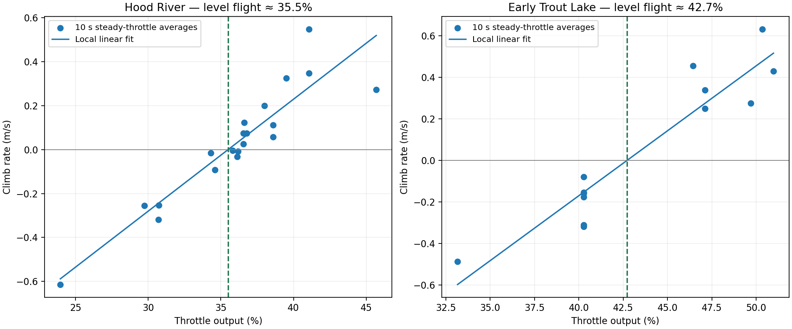

*Local fits to steady 10-second MANUAL/FBWA windows put level throttle near 35.5% at Hood River and 42.7% at Trout Lake. The Hood River result includes the brake trim and false power limiting present that day.*

| Setting | Sustained Hood River flight | Trout Lake start | Trout Lake final |
|---|---:|---:|---:|
| Maximum throttle | 40% | 40% | 60% |
| Trim throttle | 30% | 30% | 43% |
| Climb limit | 2 m/s | 1.8 m/s | 1.8 m/s |
| Maximum sink | 2 m/s | 3 m/s | 3 m/s |

Early at Trout Lake I raised maximum throttle to 65% and trim to 50%, then brought them back to 60% and 43%. The climb and sink limits were already set before takeoff. I derived those limits from Hood River logs; the local steady-response fits above reconstruct the trim relationship, rather than those original limit-selection intervals.

In the paraglider TECS implementation, trim is the zero-climb baseline. Requested climb or descent interpolates throttle toward its upper or lower bound:

```text
Climbing:   throttle_ff = trim + (climb_demand / climb_limit) × (max − trim)
Descending: throttle_ff = trim + (climb_demand / sink_limit) × (trim − min)
```

The limits therefore set feed-forward slopes as well as bounding the requested vertical speed. P and I correct the remaining climb-rate error. That baseline tuning was separate from the pitch damper, which responded to angular motion.

## The damper that could make things worse

I had added a pitch-rate damper to throttle. My initial intuition was that more throttle would pitch the model up, so adding throttle during a nose-down rotation should oppose that motion.

The throttle damper used:

```cpp
throttle_correction = -pitch_damping_gain * filtered_payload_pitch_rate;
```

With positive pitch rate defined as nose-up, a nose-down rotation produces a positive throttle correction. That only gives the intended damping if the relevant throttle-to-pitch response has the sign I expected.

The articulated model showed why that assumption could fail. The thrust line is below the suspension point, but above the payload CG. Forward thrust therefore produces a nose-down moment about the payload CG. The suspension point moves with the system; treating it as a fixed pivot leaves out an important part of the dynamics.

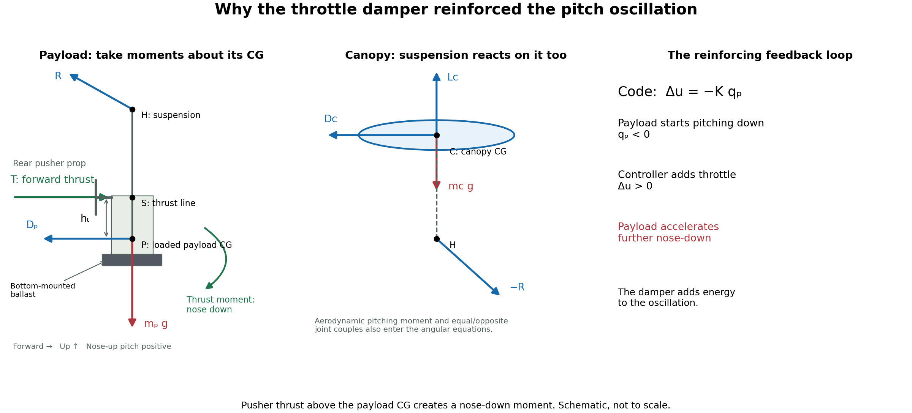

*The pusher thrust acts above the payload CG, creating a nose-down moment. The canopy and payload react through the suspension. Schematic, not to scale.*

The later analysis explained the reinforcing loop:

**Payload pitches down → controller adds throttle → payload pitches down harder.**

I did not work this out at the field. Fortunately, I decided to disable the damper while testing, and the aircraft immediately became quieter. The logs and simulation later explained why: I had designed the feedback around the wrong initial pitch response. A throttle increase can rotate the payload nose-down even while the aircraft’s longer-term response is to climb. The moving suspension and the canopy’s aerodynamic forces determine how that motion develops.

The flight data contains a particularly useful comparison. In CRUISE, I had already set the throttle P and I gains to zero. At 655.79 seconds after boot, I set the pitch damper to zero too. In the tightly bounded windows below, that was the only control setting changed.

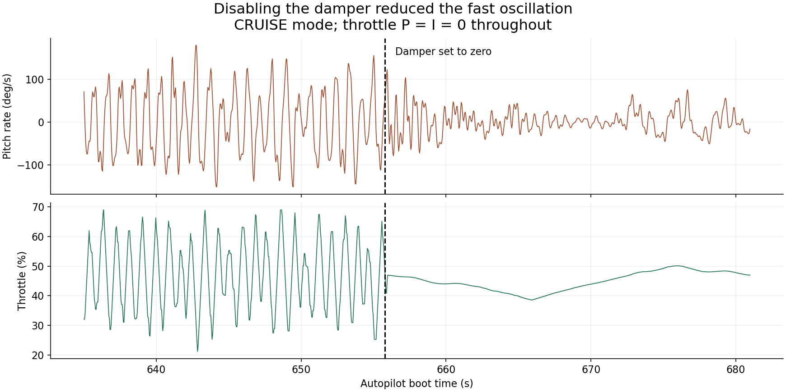

| February 15 comparison | Boot-time window | Payload pitch-rate RMS |
|---|---:|---:|
| Damper gain 0.10; throttle P = I = 0 | 635–654 s | 76.4 degrees/s |
| Damper gain 0; throttle P = I = 0 | 659–681 s | 22.7 degrees/s |

The fast oscillation reduced sharply. Later in the same flight, reintroducing the damper at 0.05 coincided with a stronger component around 1.5 Hz; reducing it to 0.02 brought the rate RMS back down. Those observations support the self-excitation concern.

That experience made relative canopy–payload motion the next control question, along with motor response and the different oscillation modes.

## Modeling the moving suspension

The damper problem made canopy–payload coupling central: the longitudinal canopy/payload hinge was tricky, and my throttle pitch damper caused enough self-excitation that I zeroed it out. My thrust line is below the hinge, with the CG below that. I asked us to add the joint to SITL and investigate the coupling before the flight logs were available.

The first optional pitch joint we implemented separates canopy and payload pitch, with coupled inertias, translation and thrust moment. The payload IMU acceleration includes the moving lever-arm contribution. In that early model, roll/yaw remain shared; it predates the 9-DOF model used in the later native mission study below. Representative settings are total mass 1.55 kg, canopy 0.19 kg, payload 1.36 kg, inertias 0.025/0.03 kg m² and joint damping 0.015 N m per rad/s. The payload CG is 0.35 m below the hinge. The modeled thrust line is 0.10 m above that CG, hence still 0.25 m below the hinge.

Pitch-sign conventions and aerodynamic blending were corrected during the experiments. Earlier directories explicitly marked before the aero-sign correction are historical results. The 15-degree linear-aerodynamic boundary and high-angle blend are numerical approximations, not a validated stall or collapse envelope.

The native `ParagliderPitchJoint` test and 20 model unit tests passed; the rigid-model extended AUTO test remains part of normal coverage. Local articulated AUTO runs completed, but those use different configurations and should not be pooled with lateral comparisons. [Physics review](../scratch/paraglider-tests/pitch-joint/physics-review/summary.json) records the model assumptions and trim analysis.

## From damping to relative-motion control

The longitudinal problem I want to solve is how to use as much control bandwidth as possible without stalling the canopy or driving the canopy and payload into large oscillations. After the flight evidence and articulated-model analysis, I was not convinced that motion-profile limiting alone would get me the performance I wanted. I suspected the controller needed some awareness of the relative angles and rates.

Before taking on an observer, I asked us to try controllers that could read the simulated joint state directly. That gave us a way to ask whether the information was useful at all, and what remained difficult even with perfect access to it. These local truth-state prototypes are research; they are not included in the durable ArduPilot branch.

## First, test whether joint-state feedback helps

We first kept TECS and added canopy/payload rate feedback ahead of motor lag, working through 44 trials. A useful correction was approximately `Δthrottle = -0.56 q_canopy + 0.16 q_payload`, with rates in rad/s. In a matched faster-TECS case, payload pitch-rate RMS fell from 4.69 to 2.95 deg/s. Relative-rate information supplied most of the benefit; matched payload-only feedback achieved 5.02 deg/s. This reduced oscillation but did not demonstrate a large usable bandwidth increase.

I then asked us to try a controller update that treated the longitudinal system more directly. We tested integrated longitudinal control in a subsequent 21-trial study. Strong direct-throttle LQI gains became unstable with actuator timing/slew. The final conservative prototype commands throttle rate at 50 Hz, including motor lag, command state, saturation and conditional integral antiwindup. Its states include payload pitch, relative angle/rate, payload rate, air-relative velocity, motor throttle, previous command and climb-error integral.

| Matched step case | Climb tracking RMS | Payload rate RMS | Settling time |
|---|---:|---:|---:|
| Faster TECS baseline | 0.12851 m/s | 4.6922 deg/s | 12.04 s |
| Prior joint feedback | 0.09708 m/s | 2.9541 deg/s | 5.46 s |
| Conservative integrated | 0.07978 m/s | 2.3915 deg/s | 2.70 s |
| Faster integrated | 0.07123 m/s | 3.5172 deg/s | 2.20 s |

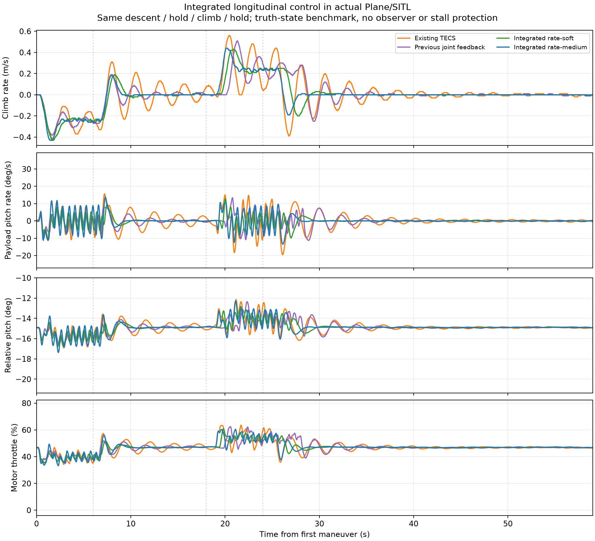

The conservative setting was encouraging: it also improved rate RMS in zero-joint-damping, slower-motor and shifted-thrust-line checks. The severe gust cases showed how much work remained: about 38 deg/s rate RMS and angles of attack outside the calibrated model. At 0.32 Hz the whole-loop gain peak fell from 3.35 to 2.11, with more phase lag; the height outer loop still amplified the inner response. This is not proof of a safe high-bandwidth controller.

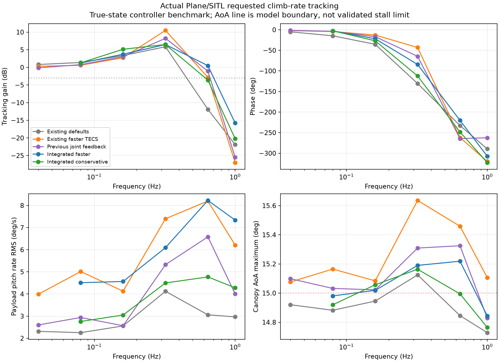

A local native AUTO course completed in 1103.6 s with maximum corner overshoot 1.079 m. It used an **airborne preparation fixture**, not a normal launch, and reached 20.16 degrees modeled angle of attack. Course assertions passing therefore do not establish stall protection.

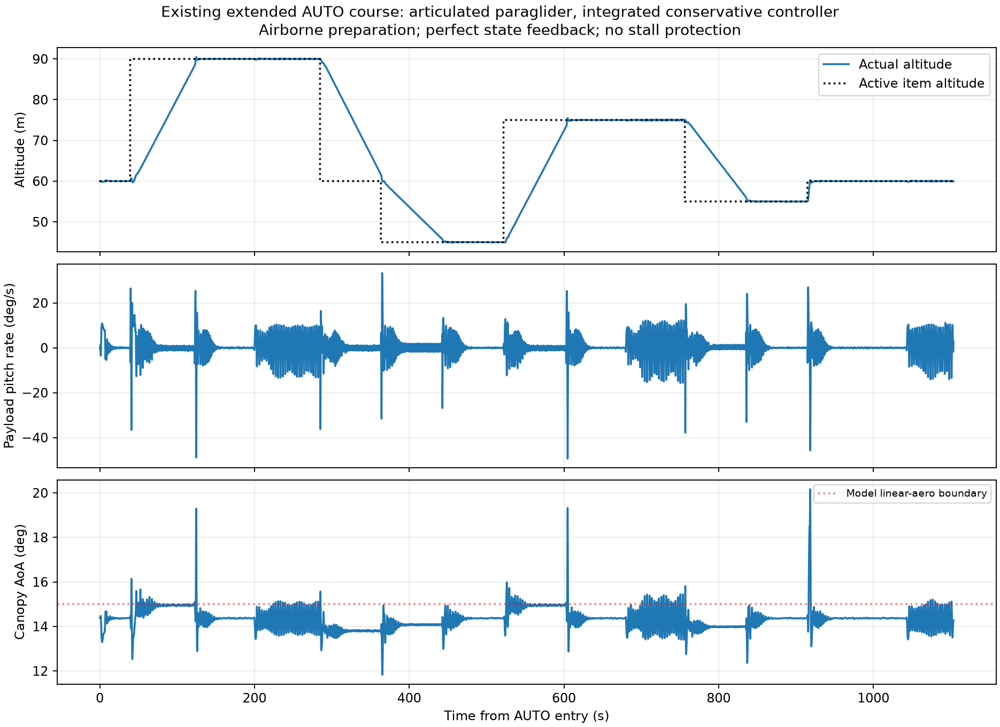

[Integrated summary](../scratch/paraglider-tests/pitch-joint/integrated-control/summary.json), [validation](../scratch/paraglider-tests/pitch-joint/integrated-control/validation.json), [oracle study](../scratch/paraglider-tests/pitch-joint/oracle-control/summary.json) and archived scripts provide provenance. Production sources/binaries were restored after these local trials. A payload-pitch transfer had a right-half-plane zero, while the CG climb transfer did not; inverse pitch response alone does not prove a fundamental climb-bandwidth limit.

## Can I estimate what I cannot measure?

The next question was how to get relative pitch information without a hinge-angle sensor. I asked us to assess observability with and without airspeed, rather than assuming an observer would work.

The nominal nine-state linearization we assessed uses payload pitch, relative pitch, payload/relative rates, two air-relative velocity components, motor state and horizontal/vertical wind. With a known model and constant wind, the local PBH assessment gives rank nine with attitude/gyro/GNSS measurements, with or without a pitot sensor. This nominal result is weaker than it sounds: modeling unknown constant force/moment biases adds ambiguous modes.

With four independent constant acceleration/angular disturbances, the thirteen-state assessment gives zero-frequency PBH rank ten without airspeed and eleven with scalar airspeed: respectively three and two unobservable constant directions. This deliberately permissive bias model exposes ambiguity rather than asserting those biases are a physical plant. Relative rate appears more useful than absolute relative angle; a scalar pitot does not measure airflow direction or vertical wind.

I also questioned whether we needed raw IMU data when ArduPilot already has an AHRS interface. Checking those interfaces clarified what is available and where the lever-arm correction still belongs. AHRS gyro is corrected payload angular rate. AHRS earth-frame acceleration is bias-corrected specific force at the IMU, not automatically translated to the payload CG. The corrected delta-velocity interface includes gravity but likewise does not supply that moving-origin correction. EKF navigation position/velocity handle configured rigid-body IMU lever arms; canopy articulation still requires its own geometry. A practical observer should predict specific force at the actual sensor position and use AHRS correction rather than duplicating calibration or differentiating noisy gyro. AHRS/IMU-derived measurements also have correlated errors.

[Assessment script](../scratch/paraglider-tests/pitch-joint/observer-design/assess.py) and [ranks/results](../scratch/paraglider-tests/pitch-joint/observer-design/assessment.json) are archived. No flight-ready observer or reliable absolute-angle limiter has been implemented.

## How much model identification can we avoid?

Finally, I wanted to revisit the free-body diagram. If this eventually needs to work on a variety of platforms, every inertia, mass and aerodynamic coefficient we ask a user to identify is a practical obstacle. We looked for terms that cancel and ratios that can replace absolute values.

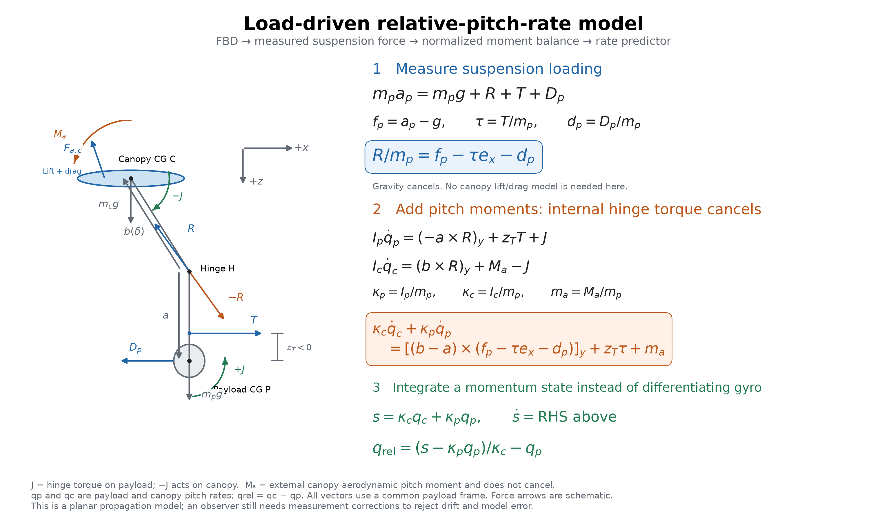

Let `R` be suspension force on the payload, `T` forward thrust, `Dp` payload aerodynamic force, and `fp = ap - g` payload-CG specific force. Define `τ = T/mp`, `dp = Dp/mp`, `κp = Ip/mp`, `κc = Ic/mp`, and `ma = Ma/mp`. Vectors `a` and `b(δ)` run from the hinge to payload and canopy CG in one frame; `zT` is the signed thrust moment arm using the diagram convention.

The payload force balance yields:

```text
R/mp = fp - τ ex - dp
```

Adding payload and canopy pitch equations cancels their equal-and-opposite internal hinge torque:

```text
κc q̇c + κp q̇p = [(b-a) × (fp-τ ex-dp)]y + zT τ + ma
s = κc qc + κp qp
ṡ = [(b-a) × (fp-τ ex-dp)]y + zT τ + ma
qrel = (s-κp qp)/κc - qp
```

This removes the explicit joint stiffness/damping law from the summed momentum propagation and replaces canopy lift/drag force modeling with measured suspension loading. Uniform gravity cancels when translation is eliminated. Absolute mass can be reduced to inertia/mass ratios; `κc = (mc/mp) kc²` if `kc` is canopy radius of gyration. Scaling lengths by a reference suspension length and time by `sqrt(L/g)` improves numerical conditioning.

**The external canopy pitching moment `Ma` does not cancel.** Geometry, inertia ratios, thrust-per-mass/moment arm, payload drag and residual canopy moment still require modeling. Integrating the summed momentum without measurement correction drifts; this cancellation is not a complete observer and does not solve initial-state identifiability. That suggested benchmarking an uncertainty-aware relative-rate observer against simulation truth, then test control with confidence-dependent limits and recorded flight data. Those experiments gave me a reason to pursue relative-rate feedback, but left open how reliably I could estimate absolute canopy angle or protect the wing at the bandwidth I wanted. Before adding that complexity to native control, I returned to the existing loops in the improved simulator.

## Returning to native mission control

I came back to the practical question: could I reproduce the bad damper behavior, reverse its sign, and get a better aircraft response? By this point the simulator represented the heavier Trout Lake configuration at 1.758 kg with separate canopy and payload motion. I wanted a useful up-and-away controller before committing to an observer.

Working with Codex, I bounded this study to two controller revisions with the model coefficients held fixed. Each candidate flew an airborne sequence of climb, altitude capture, descent, and sustained turns. We then repeated the selected settings with a softer roll model and lower voltage, and ran the existing full AUTO test. We kept useful tradeoffs instead of requiring every metric to improve.

The first surprise was lateral: the brakes were exciting payload motion. Reducing heading-rate feedback made straight flight much quieter; correcting excessive steering feedforward then made sustained turns predictable. The [lateral chapter](paraglider.md#tuning-the-dedicated-loop-with-separate-canopy-and-payload-motion) shows those changes and the evolving control loops. A pitch-rate signal alone could not tell me where the motion originated.

The later [linear lateral analysis](paraglider.md#what-the-linear-analysis-tells-me) put that coupling into frequency-domain terms. The 9-DOF plant contains mixed pitch, yaw and translational modes, and the selected steering feedback leaves a lightly damped closed-loop pair near 2.54 Hz. Lowering the lateral measurement filter to 1 Hz, or adding a broad notch, improved modeled stability margins without changing throttle control. Those filter candidates have passed standalone nonlinear delay tests; the native longitudinal and AUTO results below still use the 4 Hz lateral filter. This reinforces the sequence: quiet the steering-driven motion before asking a throttle damper to suppress it.

### Match throttle feedforward to the simulated aircraft

Model trim calculations required 44.6% throttle for level flight and 59.9% for a 1 m/s climb at 22.2 V. With a 60% throttle ceiling, I selected 45% cruise throttle and a 1 m/s climb calibration. Holding the brakes fixed isolated the vertical-feedforward benefit: climb height RMS error dropped from about 0.73 to 0.08 m.

The descent calibration became 2.5 m/s to fit the local descending-throttle slope. These settings calibrate feedforward to this simulator; they do not replace my flight-derived climb/sink estimates or establish a new full-glide sink limit.

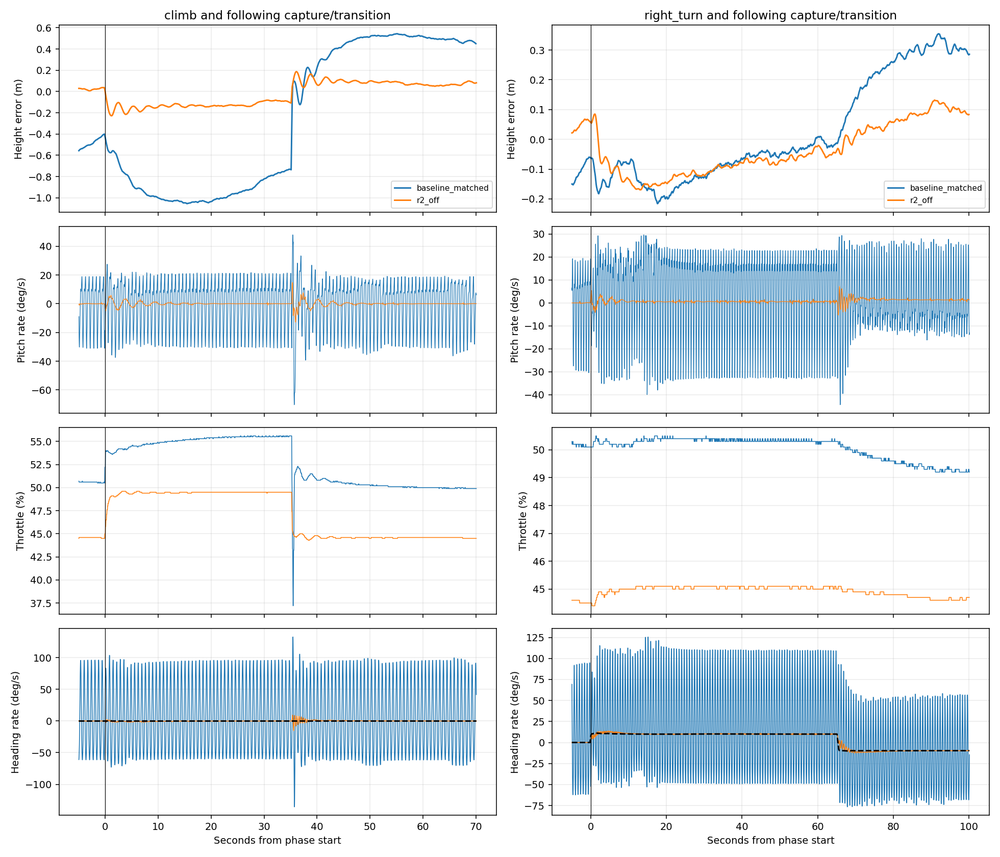

*The same simulated aircraft, before and after controller changes. Across the matched climb phase, height RMS error improved from 0.92 to 0.14 m. The lateral changes remove much of the motion that otherwise feeds into the longitudinal problem.*

### Smooth the altitude-capture kick

A sharp pitch transient remained when the climb command returned to neutral. Native FBWB captures current altitude at that point. The resulting demand change produced a brief derivative spike, which went into throttle feedforward.

I added a first-order smoother to that derivative:

```text
filtered_rate += dt / (dt + time_constant) × (raw_rate − filtered_rate)
```

The selected time constant is 0.5 seconds. Height feedback and trajectory slew limits stay unchanged. `TECS_PG_HR_TC` defaults to zero, preserving the previous behavior unless explicitly enabled.

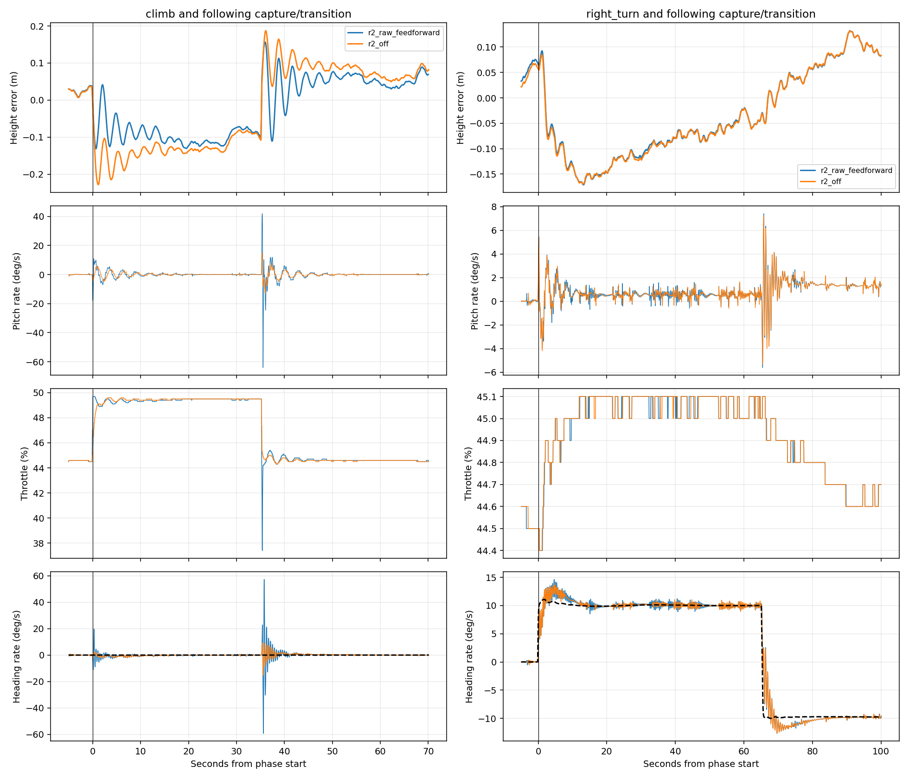

*Only the smoothing setting changes in this comparison. Peak pitch rate during climb capture falls from 64.1 to 14.7 degrees per second—a 77% reduction.*

Climb height RMS error increases from about 0.10 to 0.14 m, and capture error from 0.06 to 0.08 m. I would take that small tracking penalty for a much gentler capture. The scoring reference remains the underlying height trajectory; filtering the feedforward does not silently smooth away the measured error.

### Why I still left the pitch damper off

Each revision compared damping off, a small reversed-sign gain, and a reversed-sign gain with filtering that rejects slow motion. Reversing the sign did not fix the excessive turn command in the first revision. Once steering was calibrated, all three tracked similarly, but damping off generally produced less settled pitch-rate variation. The filtered alternative reduced a few transient peaks without enough mission-level benefit to select it.

The wrong-sign flight damper and this result are compatible. Correcting a sign is necessary for the intended feedback action, but it does not establish a useful gain or account for the phase of a coupled canopy–payload system. For this candidate, the larger gains came from removing brake-driven excitation and improving feedforward.

### The selected candidate and the next limitation

The combined controller passed the existing native AUTO test, including opposing multi-turn loiters, altitude and corner checks, home loiter, and controller handover. Over its roughly 20-minute mission record, maximum waypoint altitude error was 1.67 m and corner overshoot was 0.66 m. The [lateral results](paraglider.md#a-mission-that-tracks-without-the-repeated-rocking) show how much steadier the loiters became.

The same gains remained well behaved with a softer roll model. The first low-voltage test exposed a setup mistake: ArduPlane already had voltage compensation, but the simulation disabled the battery monitor, left compensation off, and did not send the motor model's voltage to the flight controller. Our initial standalone analysis omitted that output scaling too. We corrected the setup and reran both analyses.

With the existing compensation enabled, reducing supply voltage from 22.2 to 20.4 V now increases the throttle command automatically. We kept 22.2 V as the reference because that is where we calibrated these simulator throttle settings; it is not the full-charge voltage of a 6S pack. In matched native runs at 20.4 V, climb height RMS error fell from **0.486 to 0.250 m**, and level-phase error from **0.633 to 0.016 m**. At 22.2 V, compensation on/off gave essentially the same result.

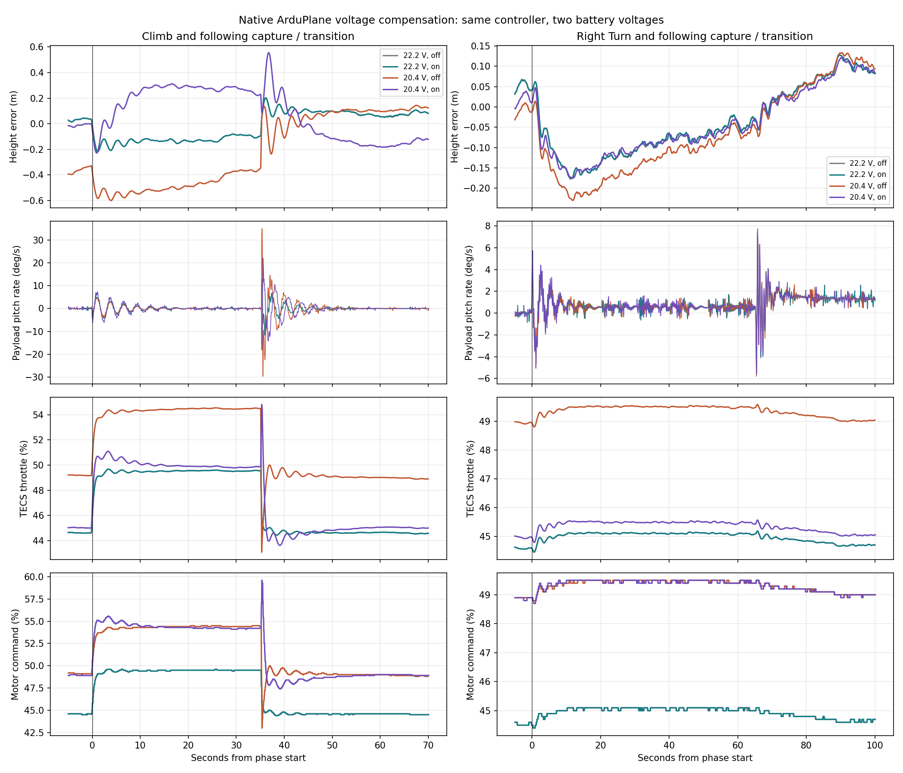

There is a tradeoff: climb-capture height RMS error increased from **0.096 to 0.169 m**. Native compensation also raises the maximum throttle returned to TECS, changing its climb feedforward slope before the final output scaling. The corrected linear and nonlinear analysis includes that interaction. This fixes the missing battery path and improves low-voltage tracking; it does not eliminate every capture transient or justify enabling the pitch damper.

Both voltage settings passed the full AUTO regression with the original checks unchanged. Maximum waypoint altitude error was 1.67/1.68 m at 22.2/20.4 V, while corner overshoot was 0.95/2.89 m. The lower-voltage case still turns wider at the worst corner, despite its steady loiter motion.

That calm-flight candidate used calibrated feedforward, reduced lateral feedback, smoother altitude capture, and no pitch-rate throttle damping. The gust study below adds frequency-shaped damping to that starting point. Relative-motion feedback remains a longer-term avenue. These are powered, up-and-away SITL results; wind, launch, landing and flight validation remain separate work.

The new [articulated flight viewer](paraglider.md#watching-the-two-bodies-move) puts these relative motions back into a picture of the aircraft. Its looping turn-and-reversal clip shows the SolidWorks payload, moving brake capstans, and RPM-driven pusher propeller alongside the canopy. During controller development I can replay the same internal state used in the plots and inspect how payload pitch differs from canopy attitude. A second [AUTO mission clip](paraglider.md#the-controller-flies-the-mission) now shows native steering and throttle control working together as the aircraft enters a loiter at 90 m, taken from a passing mission test with moderate synthetic gusts. Both viewer clips now apply those gusts through the physics model, with nominal horizontal/vertical RMS speeds of 0.5/0.25 m/s.

The [data and methods appendix](data-and-methods.md) collects flight chronology and earlier simulation provenance. The [current plotting scripts](../research/flight-log-analysis/scripts/native-sitl/) and [figure manifest](../research/flight-log-analysis/manifest.json) preserve this study. Native implementation and updated test instructions are recorded at [ArduPilot commit `c441b937bd`](https://github.com/DavidIngraham/ardupilot/commit/c441b937bd) on `paraglider-high-dof-control`; raw research logs remain in Mission Planner and the original SITL experiment folders.

## What the gust video exposed

Watching the articulated AUTO video made a problem obvious that route-completion checks had missed: the aircraft keeps pitching in the synthetic gusts. The controller holds average height reasonably well, but the motion is not well suppressed.

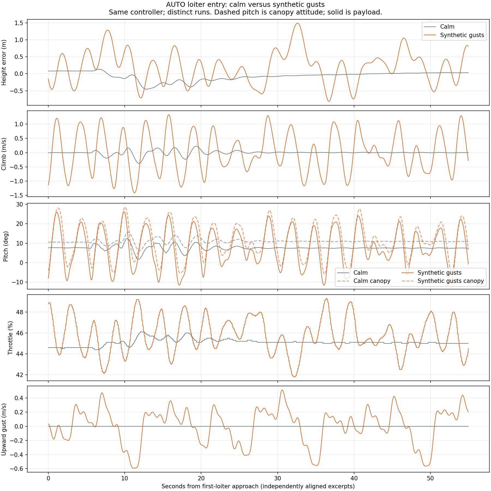

*Two independent 55-second loiter-entry excerpts with the same controller, aligned by approach to mission item 3. Solid pitch lines are payload attitude; dashed lines are canopy attitude. These are simulated truth measurements, not flight data. The calm and gusty trajectories differ, so this is a descriptive comparison rather than an isolated controller ablation.*

| Quantity in the excerpt | Calm | Synthetic gusts |
|---|---:|---:|
| Height error RMS | 0.15 m | 0.52 m |
| Climb-rate RMS | 0.08 m/s | 0.70 m/s |
| Payload pitch standard deviation | 1.24° | 9.69° |
| Throttle range | 44.4–46.1% | 41.8–49.3% |

In gusts, payload pitch ranges from −11.7° to +26.3° and climb rate from −1.41 to +1.34 m/s. The dominant pitch/climb response is near 0.36 Hz, or one cycle every 2.75 seconds. Height error is much smaller, −0.81 to +1.49 m: an oscillating vertical velocity integrates into a comparatively modest altitude excursion. Both bodies pitch substantially; the visible movement is not solely rotation at their joint.

The gust generator includes a 0.34 Hz component, close to the modeled slow pitch/forward-speed mode. It continues supplying energy throughout this clip. The response is consistent with excitation near that mode, but this comparison does not establish whether throttle feedback amplifies it or merely responds to it. A passing AUTO mission is therefore evidence of route completion, not evidence of satisfactory longitudinal damping.

I next replayed the same gust history from the same initial state with normal throttle control, fixed trim throttle, and the near-mode gust component removed. The [original comparison script](../viewer/tools/analyze_auto_gusts.py) and [summary metrics](assets/viewer/auto-longitudinal-gusts.json) preserve the video diagnosis; the following experiments test the remedy.


### Shaping the damper around the gust response

Holding throttle fixed still produced **7.82° pitch standard deviation**, compared with **9.45°** with the original height controller. Most of the motion was the airframe responding to the gusts, with some amplification from the control loop. Removing the 0.34 Hz gust component reduced pitch variation to **4.16°**. That also reduced total gust energy, so it is evidence about the excitation mechanism rather than an equal-energy comparison.

A small pitch-rate feedback term helped when its frequency response was shaped around the slow mode. The first candidate used gain 0.1 and one 0.5 Hz low-pass stage. It improved the nonlinear response and passed a complete gusty AUTO mission, but a wider linear check exposed a roughly 2.4 Hz coupled mode becoming unstable in the softer-roll model at stronger lateral airspeed scaling. A second filter stage gave us another way to shape both phase and attenuation.

The selected configuration uses two cascaded **1.5 Hz** first-order stages and a pitch-rate gain of **0.1**:

$$
\Delta u_T(s)=-0.1\left(\frac{2\pi(1.5)}{s+2\pi(1.5)}\right)^2q_{\mathrm{payload}}(s).
$$

Here $q$ is body pitch rate in rad/s and $u_T$ is throttle fraction. Each stage has a 1.5 Hz cutoff; the combined continuous-time filter reaches −3 dB at about 0.97 Hz. Native code applies the discrete first-order filters at the measured update interval, limits the correction to ±0.25, and retains the final throttle limits. Height feedforward, height feedback, integration, voltage compensation and lateral gains are unchanged. Washout is off.

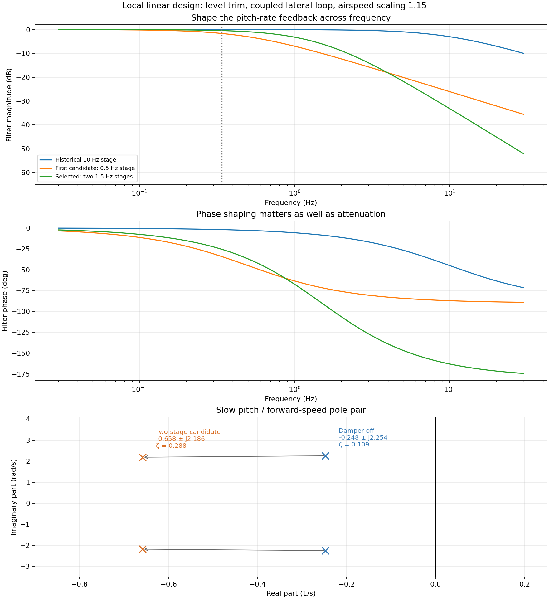

At nominal level trim, the slow poles move from **−0.248 ± j2.254** to **−0.658 ± j2.186 s⁻¹**. Their damping ratio rises from **0.109 to 0.288**. The selected setting remains locally stable in seven saved plant cases—including climb, descent, lower voltage and softer roll—at lateral airspeed scaling 0.9, 1.15 and 1.4. These are local model checks; they do not include every estimator delay or establish flight robustness.

This does not reverse the conclusion from the original flight damper. The feedback path now has a different frequency response. A sign and a gain alone cannot describe how the throttle loop acts on both the slow motion and the faster canopy–payload modes.

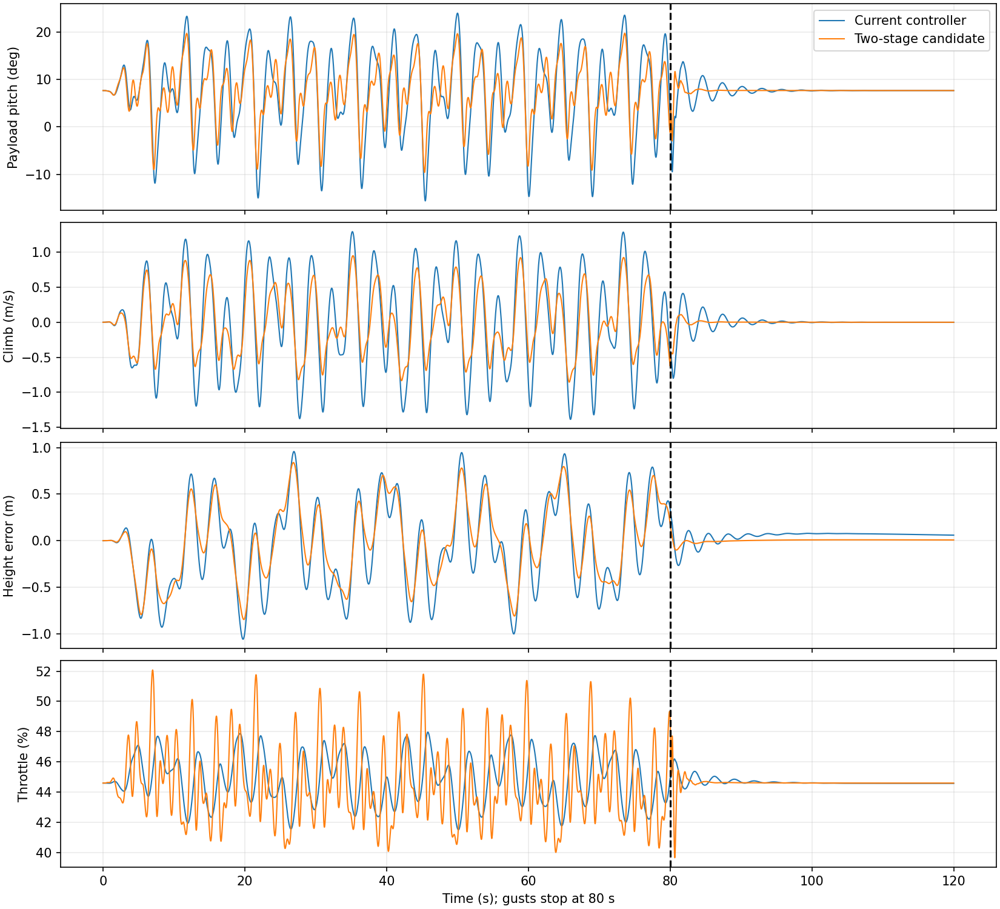

In the matched nonlinear screen, pitch standard deviation fell from **9.45° to 6.17°**, climb-rate RMS from **0.71 to 0.46 m/s**, and height RMS error from **0.48 to 0.40 m**. Pitch-rate RMS also fell, from **21.57 to 18.03°/s**. The cost was more throttle activity: its standard deviation rose from **1.65 to 2.65 percentage points**, with no saturation. The gusts stop at 80 seconds in the plot; the filtered controller also damps the remaining motion more quickly.

A separate gust realization with 50% higher component amplitudes retained the improvement: pitch variation fell from **9.30° to 6.84°** and climb-rate RMS from **0.74 to 0.54 m/s**. Raising the damper gain to 0.15 or 0.2 with the earlier 0.75 Hz stages increased pitch-rate motion and throttle effort, so I kept the smaller gain and improved the filter shape instead.

### Watching the sign problem in the current model

This comparison uses the current 9-DOF plant, Trout Lake mass (1.758 kg), 22.2 V and the same asymmetric brake trim. At two seconds, each run receives the same +5°/s payload pitch-rate disturbance. The base throttle stays at its level-flight trim; only the pitch-feedback correction changes. Holding the brakes fixed removes steering excitation from this experiment.

<video controls muted loop playsinline preload="metadata" poster="assets/viewer/pitch-sign/pitch-sign-carriage.jpg" style="width:100%">
  <source src="assets/viewer/pitch-sign/pitch-sign-carriage.mp4" type="video/mp4">
</video>

*Matched standalone simulation, with truth-rate feedback rather than native AUTO. The SolidWorks carriage is shown from a fixed side-oblique angle, with the propeller animated from simulated RPM. The camera follows the nominal straight-flight path rather than the actual payload, preserving both translation and rotation against a 10 cm grid. An orange marker and short trail track the upper suspension attachment. The first 5.5 seconds play at real speed, followed by a quarter-speed replay of the oscillation onset. Angles and displacements are unamplified; the plots share scales.*

With gain 0.10 and a single 10 Hz filter, the original minus-sign feedback turns the small disturbance into a sustained, throttle-limited oscillation. Reversing that sign keeps this fast motion small. Turning the damper off also lets the disturbance decay. The fourth panel is the useful bridge to the current controller: it retains the minus sign but applies two 1.5 Hz filter stages, and this disturbance decays too. The plant therefore reproduces the sign-sensitive excitation, while also showing why the feedback's frequency response matters alongside its sign.

The large oscillation is a diagnostic result, not a prediction of the exact Hood River amplitude. This isolates the pitch-feedback path; the native mission and gust tests below establish how the selected filtering behaves with the rest of the controller running. The [generation script](../tools/pitch_sign_video.py), [CAD comparison renderer](../viewer/src/pitch-comparison.ts) and [configuration and results](assets/viewer/pitch-sign/pitch-sign.json) record the experiment, with raw trajectories retained in Mission Planner.

### Commanding a climb with the four damper configurations

The small-disturbance comparison leaves a practical question: what happens when the controller deliberately asks the aircraft to climb? This experiment commands **100 → 105 m at five seconds**, with the same height loop and lateral controller in every run. There is no injected pitch kick. Each nonzero pitch damper is enabled with the altitude command, after the same initial settling period. The height loop converts altitude error to a limited climb-rate demand and uses the same 0.5-second feedforward smoothing; throttle is capped at 60%.

<video controls muted loop playsinline preload="metadata" poster="assets/viewer/altitude-comparison/altitude-comparison-smooth-camera.jpg" style="width:100%">
  <source src="assets/viewer/altitude-comparison/altitude-comparison-smooth-camera.mp4" type="video/mp4">
</video>

*Current 9-DOF plant, actual SolidWorks carriage and schematic canopy. Orange is payload pitch; green is canopy pitch. The angle indicator compares both attitudes against the horizon, not against the airflow. Altitude, pitch and throttle plots use common scales. The camera follows smoothed translation to keep the whole glider visible throughout the climb; the altitude trace shows its vertical progress. Playback is real time.*

This longer maneuver separates the outcomes more clearly than the short pitch kick. The original fast-filtered minus sign excites rapid motion and repeatedly reaches the throttle ceiling. Reversing the sign initially looks quieter, but subsequently develops a slower, large oscillation and loses much of the altitude it gained. Damper-off and the current two-stage filter both complete the climb and settle near the target.

| Configuration | Altitude at 50 s | Payload pitch-rate RMS, 40–50 s |
|---|---:|---:|
| Damper off | 104.98 m | 0.008°/s |
| Original sign, 10 Hz filter | 103.12 m | 136.0°/s |
| Reversed sign, 10 Hz filter | 101.84 m | 73.5°/s |
| Current sign, two 1.5 Hz stages | 104.98 m | 0.008°/s |

The reversed-sign case reaches 104.88 m before losing height. That is why suppressing the fast payload mode alone is not enough: the same feedback also acts on slower coupled motion. In this calm maneuver the current filter and damper-off cases have essentially the same settled altitude performance; the gust comparisons establish the additional reason to retain the filtered damper. Large unstable excursions here illustrate the failure mechanism rather than predict precise flight amplitudes.

This is a **standalone, truth-sensed controller diagnostic**, using the height-loop algebra and the current plant, rather than a new native SITL regression. The [experiment script](../tools/altitude_comparison.py), [animation renderer](../viewer/src/altitude-comparison.ts) and [configuration and results](assets/viewer/altitude-comparison/altitude-comparison.json) preserve the setup. Raw trajectories remain in Mission Planner under `turn-model-spike/altitude-comparison`.

### Back in the native AUTO mission

The two-stage controller passed the full gusty AUTO mission with the original checks unchanged. That includes altitude changes, both two-turn loiters, corner checks, home loiter and controller handover. The native BIN confirms gain 0.1, both 1.5 Hz stages and washout disabled; the model backend recorded no errors or clipped input packets.

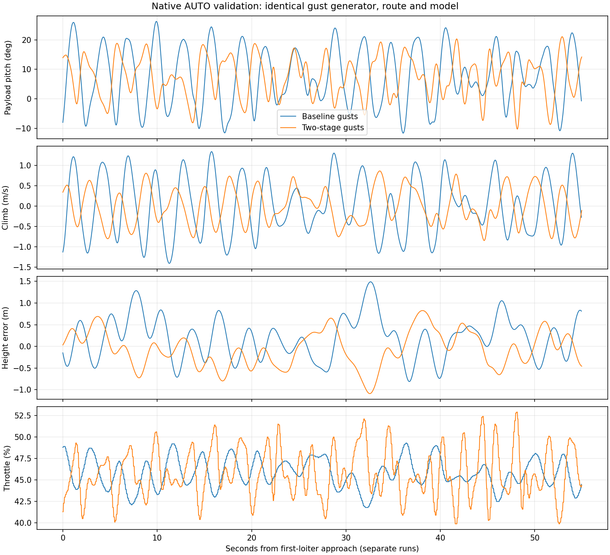

*The same route, model and gust generator, with excerpts aligned independently at the first loiter approach. The route timing changes, so the two excerpts sample different gust phases. The matched screen above isolates the controller change; this comparison checks its native implementation.*

The improvement persists beyond that excerpt. For each loiter I excluded the first 20 seconds after coming within 60 m of its center, then measured the remaining loiter:

| Quantity | CW: before → after | CCW: before → after |
|---|---:|---:|
| Payload pitch standard deviation | 9.90° → 6.62° | 11.13° → 6.59° |
| Pitch-rate RMS | 21.95 → 19.02°/s | 25.95 → 18.53°/s |
| Climb-rate RMS | 0.70 → 0.42 m/s | 0.78 → 0.43 m/s |
| Height error RMS | 0.50 → 0.41 m | 0.52 → 0.43 m |
| Throttle standard deviation | 1.69 → 2.90 percentage points | 1.80 → 2.81 percentage points |

Across the full gusty mission, maximum waypoint height error fell from **2.66 to 2.26 m**, and maximum corner overshoot from **3.50 to 1.39 m**. Those navigation improvements are observations from these runs, not a guarantee for every wind realization. The central result is that both turn directions show materially less longitudinal motion, with additional throttle effort.

The calm AUTO regression also passed. Settled pitch standard deviation fell from **0.21° to 0.10°** in the clockwise loiter and **0.33° to 0.07°** in the counterclockwise loiter. Height RMS error changed from **0.055 to 0.064 m** and **0.098 to 0.080 m**, respectively. Maximum waypoint altitude error changed slightly, **1.67 to 1.71 m**, while corner overshoot improved from **0.65 to 0.36 m**. The new controller therefore retains the calm mission behavior while damping the gust-driven motion.

The feature branch now includes the optional `TECS_PG_PR_FILT2` stage, defaulting to bypass, and the paired mission-development parameter files select the tested 0.1 gain and two 1.5 Hz stages. These are SITL development settings; appreciable forced motion remains in gusts, and the new tuning has not been flown. The low-voltage and softer-roll checks here are linear sensitivity tests, not additional native AUTO runs.

The [matched-screen script](../tools/gust_control_study.py), [linear check](../tools/gust_linear_check.py), [native mission runner](../tools/run_gust_native.sh), [mission summarizer](../tools/summarize_gust_mission.py), [comparison plotter](../tools/plot_gust_control.py) and [filter/pole plotter](../tools/plot_gust_filter.py) preserve the experiment. Raw state histories, BIN logs and the working HTML research log remain in Mission Planner under `turn-model-spike/gust-control`.

The implementation and tested mission settings are in [ArduPilot commit 2588ecc44a](https://github.com/DavidIngraham/ardupilot/commit/2588ecc44a) on the existing controller-development branch.
