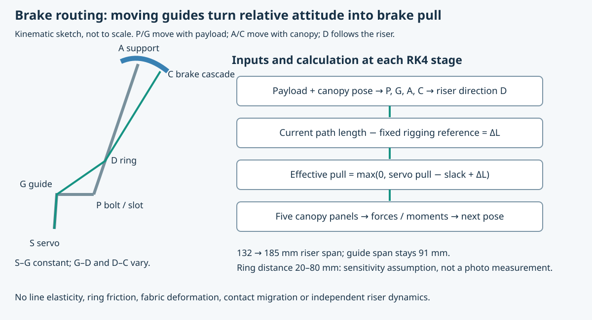
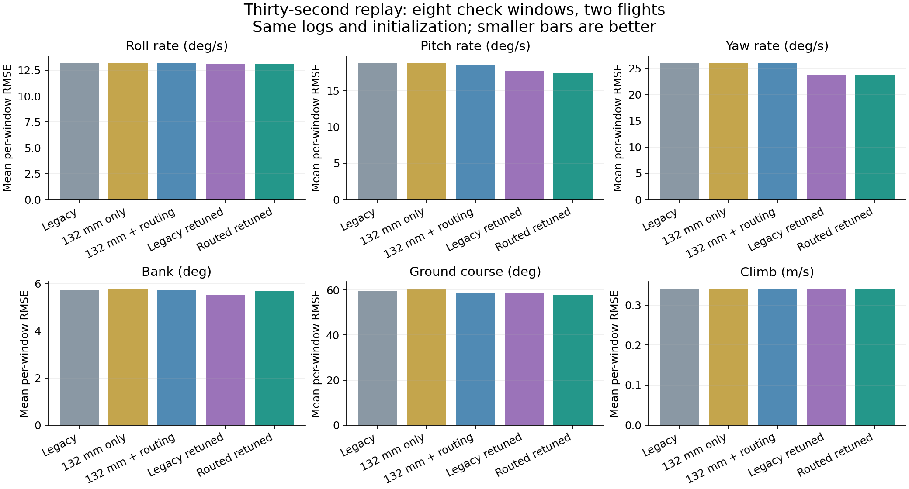
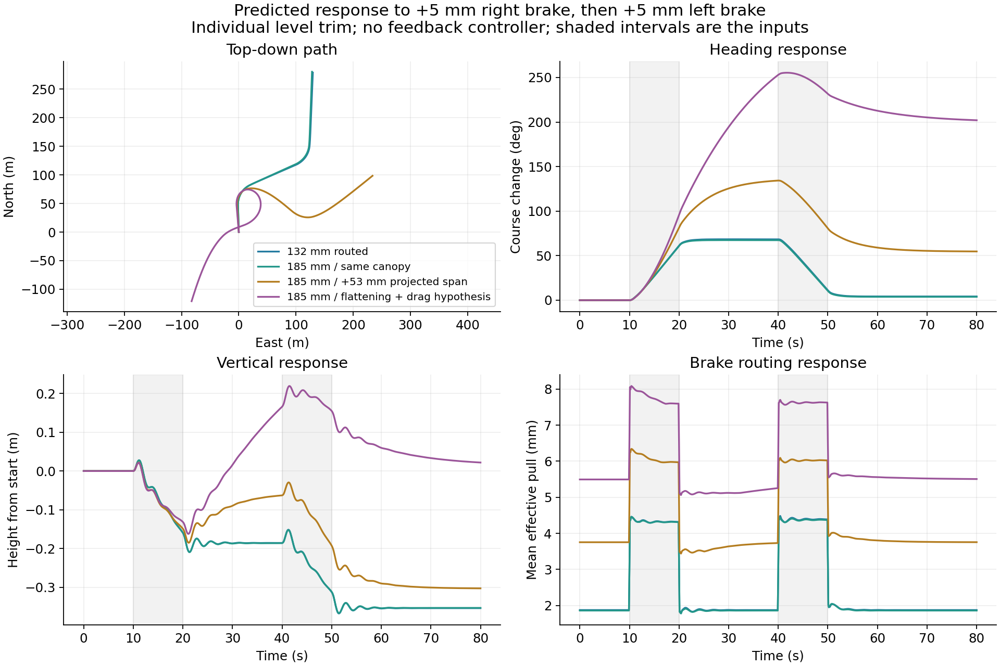

# Following the Brake Line: Rigging, Model Refinement, and the Wider Spreader

Micro-AGU's brake lines pass through a D-ring on each white nylon riser after leaving the spreader guides. Our simulator previously treated servo travel as brake pull without accounting for that route. We tested whether relative motion between the payload and canopy could therefore change the brakes enough to explain some of the disagreement with flight logs. We also corrected the riser attachment spacing and modeled the planned wider spreader, separating its mechanical effects from possible changes in canopy shape.

The study finds a small improvement in replay agreement from routing, alongside a larger improvement available by retuning damping in either model. It does **not** establish that the wider spreader will improve flight performance. Its most useful prediction is that canopy shape and neutral brake trim could matter more than the direct change in suspension stiffness. Those are now explicit measurements on the [next-flight card](next-flight-test-card.md).

## Establishing which dimensions the photographs actually support

The first hypothesis was geometric: our custom spreader might place the loaded risers substantially closer together than the stock HobbyKing flybar. The comparison must use the bolts carrying the white straps, rather than the outer curved shroud supports or CAD fastener origins.

The straps ride the bolts near the centers of the end slots. The user estimated approximately ±65 mm; the CAD slot centers are ±66 mm. We therefore use **132 mm** for the existing rig. The old simulator used **148.6 mm**, matching two cached fastener reference origins rather than the loaded slot centers.

*The CAD dimension is a slot-center dimension. The HobbyKing value is a photograph-based estimate: roughly 175–200 mm, with 185 mm as the working target. Neither a CAD center nor an unloaded photo establishes the exact contact point of a tensioned strap.*

The manufacturer's manual documents a 2.4 m canopy span but does not explicitly label it flat or projected. Interpreting it as the flat span, a traced inflated arch gives approximately 1.98 m projected span and 184 mm stock bar spacing. An independent kit photograph, scaled from the 254 mm propeller, gives approximately 174–184 mm depending on a rough perspective correction. This agreement supports the interpretation; it does not turn the photographs into calibrated metrology.

*The 266 mm upper-junction spacing is a different dimension from the flybar attachment spacing. Crown-to-bar distance is also different from canopy-center-of-mass-to-joint distance. The model's fitted 647 mm effective support span and 850 mm joint offset cannot simply be replaced by those photograph measurements.*

The [photo audit and pixel landmarks](../research/tension-stiffness-2026-10-15/photo-analysis/README.md) preserve the original images, scale assumptions and alternate interpretation. If 2.4 m meant projected span, the same flight photo would imply about 222 mm stock spacing. That possibility remains part of the uncertainty.

## Adding the D-ring route before calculating aerodynamic brake forces

The hypothesis here is specific: even with the servo stationary, payload motion changes the distance between the spreader guide and the riser-mounted ring. With a taut, effectively inextensible line, a longer route consumes free line and increases brake pull. With slack present, it can first take up slack without moving the trailing edge.

The complete route is servo **S → guide G → D-ring D → canopy brake cascade C**. The servo and guide move together, so their constant separation is absorbed in the neutral setting. The new model computes the other two segments from both bodies' instantaneous attitudes at every Runge–Kutta integration stage.

Let \(R_p\) and \(R_c\) rotate payload and canopy coordinates into the world frame, with the common suspension joint as origin. For side \(s=-1,+1\), define

$$
P_s=R_p\begin{bmatrix}0\sa\0\end{bmatrix},\qquad
G_s=R_p\begin{bmatrix}x_g\sg\0\end{bmatrix},\qquad
A_s=R_c\begin{bmatrix}0\sb\-H\end{bmatrix}.
$$

The riser is approximated as straight from its bolt \(P_s\) toward effective canopy support \(A_s\). A ring a distance \(h\) along that riser and a brake cascade offset aft by \(x_c\) become

$$
D_s=P_s+h\frac{A_s-P_s}{\lVert A_s-P_s\rVert},\qquad
C_s=A_s+R_c\begin{bmatrix}x_c\0\0\end{bmatrix}.
$$

The changing part of the route and resulting effective brake pull are

$$
L_s=\lVert G_s-D_s\rVert+\lVert D_s-C_s\rVert,\qquad
\delta_s=\max\left(0,\ u_s-o_s+L_s-L_{s,\mathrm{ref}}\right).
$$

Here \(u_s\) is servo line travel, \(o_s\) is the existing slack/zero offset, and \(L_{s,\mathrm{ref}}\) is fixed at one reference attitude for that rigging. It is never reset during a replay. This order matters: clipping negative pull before adding the route correction would incorrectly discard slack.

The CAD-based inputs are \(a=66\) mm, \(g=45.5\) mm and \(x_g=-22.5\) mm: the guides are aft of the bolt axis under the existing CAD-to-body convention. The nominal ring distance is **60 mm along the riser**, tested against 20, 40 and 80 mm. Effective support halfspacing remains 323.6 mm, support height 850 mm, and the illustrative brake-cascade offset is 100 mm aft. These last quantities are model assumptions, not dimensions recovered from the ring photograph.

[The assembly-manual photograph](assets/rigging-refinement/manual-22.png) shows the strap/ring construction, but does not establish a loaded metric ring height or contact motion. The straight-riser approximation lets the ring move with the riser instead of fixing it rigidly to the spreader. It still excludes friction, contact migration, line stretch, fabric deformation and independent riser dynamics. The guide and ring forces are not resolved as a separate load-bearing cable network; this addition changes the brake kinematics feeding the existing aerodynamic model.

## Testing whether routing explains the old flight-log mismatch

We replayed the recorded throttle and brake commands from Hood River and Trout Lake through five principal comparisons: the unchanged model; a 132 mm spacing correction alone; corrected spacing plus routing; a retuned old model; and a retuned routed model. Routing alone is also retained as an ablation in the data. Every comparison uses the same logged inputs and initialization procedure.

Sixteen existing 30-second windows were split into alternating fit and check windows, four of each per flight. Tuning used only the first 10 seconds of the fit windows. The check windows test transfer within this dataset; they have been used in earlier research and are **not independent flight validation**. Initial canopy angle of attack is unobserved, so evaluation repeats at 0.25, 0.35 and 0.45 rad.

Both models received the same search budget: common pitch/yaw joint-damping multiplier, brake aerodynamic-derivative multiplier, and yaw-stiffness multiplier. The initial fit hit the damping bound of 1.4, so we extended both searches to 1.8 and 2.5, recording that development step. Both selected **2.5**, again at the upper bound. The old model selected a 1.15 brake multiplier; the routed model selected 1.0. We stopped there rather than describing a boundary solution as an identified physical damping value.

At the nominal 0.35 rad initialization, mean per-window errors on the eight 30-second check windows were:

| Model | Pitch-rate RMSE, °/s | Yaw-rate RMSE, °/s | Bank RMSE, ° | Ground-course RMSE, ° |
|---|---:|---:|---:|---:|
| Old model | 18.78 | 25.96 | 5.73 | 59.65 |
| 132 mm spacing only | 18.73 | 26.01 | 5.79 | 60.64 |
| 132 mm plus routing | 18.57 | 25.93 | 5.73 | 58.80 |
| Old model, retuned | 17.64 | 23.81 | 5.54 | 58.47 |
| Routed model, retuned | 17.33 | 23.79 | 5.67 | 57.92 |

The routed refit reduces pitch-rate error about **7.7%** and yaw-rate error about **8.4%** relative to the original model. Against the equally retuned old model, its pitch-rate advantage is only **1.8%**, while bank error is about **2.4% worse**. Climb error stays near 0.34 m/s. Routing represents a real missing mechanism, but these data do not show a broad performance breakthrough from adding it.

Initialization uncertainty is larger than that incremental advantage: the routed refit's pitch-rate error ranges from **15.44 to 20.70°/s** across the tested initial canopy angles. In the additional ring-height checks, changing the assumed ring distance from 20 to 80 mm barely changes aggregate pitch error. That does not prove the ring is irrelevant; it shows these replay scores do not identify its height. Ground-course errors near 58° remain large, so an 80-second trajectory prediction should be read as a model sensitivity demonstration.

Correcting the old support width alone also does not necessarily improve the dynamics. The reduced yaw law contains the product

$$
k_\psi\simeq m_p g_0\frac{a b}{H}.
$$

The fitted effective canopy spacing can compensate for an incorrect payload spacing. The routed fit selected a yaw multiplier of \(74.3/66\), undoing the direct stiffness reduction from correcting 148.6 to 132 mm. We corrected the physical coordinate while retaining that fitted stiffness product. These logs have not independently identified every factor in it.

All 936 development/evaluation/sensitivity replays remained finite, with valid input data throughout the selected windows. Disabled routing reproduces the previous derivative bit-for-bit. Geometry invariance, symmetry and slack engagement checks pass. Doubling integration substeps changes the checked replay metrics by less than 0.000024%. Those are implementation checks, not evidence that the uncertain geometry is correct.

## Predicting the 185 mm spreader with the canopy held unchanged

The hardware comparison asks what changes when the loaded slots move from 132 to 185 mm while the canopy aerodynamic model stays fixed. The saved SolidWorks configuration `HK-estimate-185mm` changes `D2@Sketch1` from 120 to 173 mm; adding the 12 mm slot width gives 185 mm between slot centers. It rebuilt as one valid solid without feature errors. This is a saved design configuration, not confirmation that a new part has been printed or installed.

The brake guides remain 91 mm apart. Each riser moves outward 26.5 mm, increasing its lateral separation from its guide from 20.5 to 47 mm. We assume the brake lines are re-tied at the same reference attitude; copying the old knot positions would mix a neutral-trim change into the width experiment. The exact adjustment cannot be inferred from the lower guide-to-ring segment alone because the upper route also changes.

For the prediction, yaw stiffness scales by \(185/132\), about **40%**. Roll stiffness, payload mass/inertia and aerodynamics are held fixed to isolate this mechanism. The new CAD solid has about 13.5% more volume, but we have not converted that into an aircraft mass/inertia update without a printed-part mass and material distribution. The reweighed aircraft will need those inputs before a final flight-specific simulation.

Each model starts from its own solved straight-level trim at Trout Lake's 1.758 kg and 22.2 V. We then apply the same command increments with the existing actuator-rate limit and no trajectory controller. A 5 mm right-brake pulse for 10 seconds, followed later by the corresponding left pulse, produces maximum ground-course excursions of **68.4° at 132 mm and 67.4° at 185 mm**. That is a small change in this test despite the large change in the reduced stiffness coefficient. It is not a prediction of a 40% improvement in steering.

## Extrapolating canopy flattening without inventing extra wing area

A wider attachment base may change line directions, canopy arch, incidence and brake authority. The photos do not tell us how much. We therefore test explicit shape hypotheses rather than infer a new polar directly from the spreader dimension. Parafoil research shows that curvature, incidence and brake deflection can alter steering behavior substantially; it does not supply a calibration for this particular wing. See [Slegers and Costello's control study](https://digitalcommons.georgefox.edu/mece_fac/3/) and their [measured-versus-simulated motion study](https://digitalcommons.georgefox.edu/mece_fac/49/).

The existing five-panel model uses an effective arc span \(b_a=2.15\) m and half-arc angle \(\phi=0.946\) rad. Its projected span is

$$
b_p=b_a\frac{\sin\phi}{\phi}.
$$

We keep arc length and the 1.16 m² panel area fixed, then allow zero, half or all of the **53 mm** riser widening to appear as added projected span. These are assumed transfer factors, not confidence bounds or a solved fabric/line equilibrium. The full-transfer case changes projected span from 1.843 to 1.896 m and half-arc angle to 0.857 rad. The effective 2.15 m arc remains different from the documented 2.4 m canopy: changing that calibrated baseline as well would be another experiment.

Flattening rotates the panel force directions and changes moment arms. We do not also increase panel area or add an arbitrary lift bonus. A separate, more speculative case scales the induced-drag factor as \(k' = k(b_p/b'_p)^2\), a fixed-area, unchanged-efficiency aspect-ratio hypothesis. That changes \(k\) from 0.1448 to 0.1368; it is not a measured drag reduction.

| Predicted level-trim case | Airspeed, m/s | Throttle, % | Right servo pull, mm |
|---|---:|---:|---:|
| Current 132 mm, routed | 4.383 | 44.59 | 3.75 |
| 185 mm, unchanged canopy | 4.383 | 44.59 | 3.71 |
| 185 mm, half flattening | 4.329 | 44.43 | 5.01 |
| 185 mm, full flattening | 4.266 | 44.41 | 7.21 |
| Full flattening plus drag hypothesis | 4.290 | 43.75 | 10.35 |

All rows solve level flight; the right-brake bias balances the model's propulsion and steering asymmetry. These servo trim values are **not settings to copy onto the aircraft**. In particular, a lower drag coefficient does not guarantee a better handling result: the changed trim and weak open-loop directional response interact.

With the same right/left brake pulses, maximum course excursion rises to **83°** for half flattening, **134°** for full flattening and **255°** with the added drag hypothesis. These large changes expose model sensitivity; they do not establish that the real canopy will follow any of those paths. They also explain why we should observe the inflated arch and re-establish neutral trim before combining a hardware change with new controller gains.

## Comparing the predicted motion in 3D

The applet compares the 132 and 185 mm rigs, the canopy hypotheses, and the old versus routed retuned models. Choose brake pulses, a three-percentage-point throttle pulse, or a 3 mm common-brake pulse. Every pair receives the same input increments from its own level trim, in still air. There is no controller trying to hold the displayed trajectory.

[Open the rigging comparison applet](https://davidingraham.github.io/assets/microagu-viewer/rigging-comparison.html)

Playback starts automatically. Both views share orbit and scale, with trajectories in 3D, equal-scale top-down paths and a side overview. Synchronized plots show height, pitch rate, ground-course change and effective brake pull. The canopy arch follows each model's geometry; the CAD payload remains the existing part in both views, and the suspension lines are schematic. These are recorded simulation states, not flight video.

## Turning the uncertainty into next-flight measurements

The updated simulator exposes `routed_research` and `wide_research` profiles. The existing mission and dynamic-roll defaults remain available. The damping fit and wider-spreader extrapolation are explicitly research settings; this study has not installed an LQI controller, changed flight firmware, or validated new gains on the aircraft.

The hardware plan is the 185 mm configuration with the existing guide holes, followed by a loaded rigging and brake-zero check. With the propeller removed and servos fixed, photograph the tensioned ring contact and measure common/differential pull through a gentle pitch/roll sweep. Record the loaded slot spacing, ring position, line lengths, all-up mass and neutral settings. A front view of the inflated canopy with a scale reference can distinguish negligible flattening from a meaningful arch change.

The first sortie should establish trim and small throttle/turn responses with one frozen controller configuration. Repeat both turn directions and preserve the actual servo outputs, voltage, rates and navigation records. Compare software candidates only in a later matched sortie after the wider hardware has a stable baseline. The [revised flight card](next-flight-test-card.md) incorporates this sequence and replaces the obsolete software comparison table.

[Reproduction package and complete results](../research/rigging-refinement-2026-10-15/README.md) include the frozen simulator sources, protocol and extension, all replay metrics, prediction inputs, checks and applet data. The analysis and implementation were developed with AI assistance; the new flight measurements remain the test of the model.
