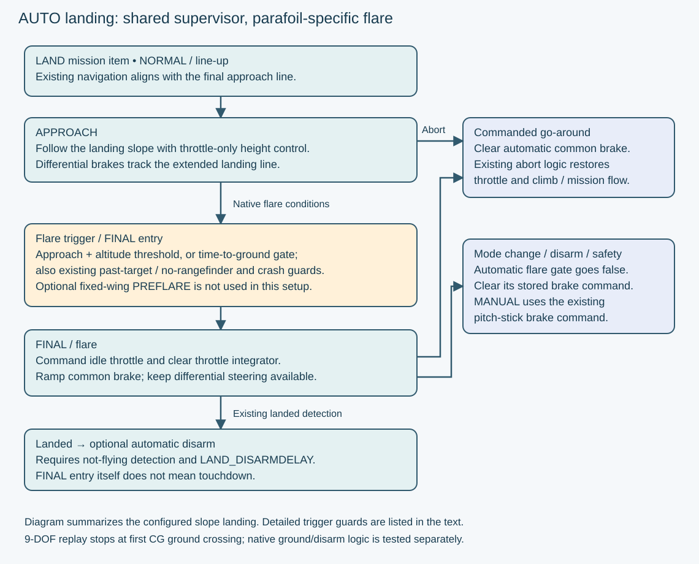
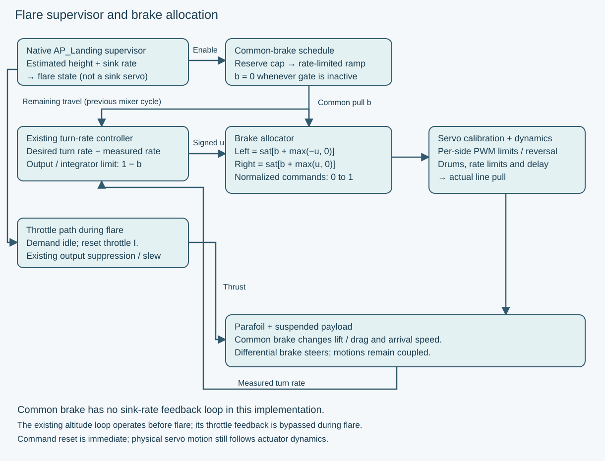
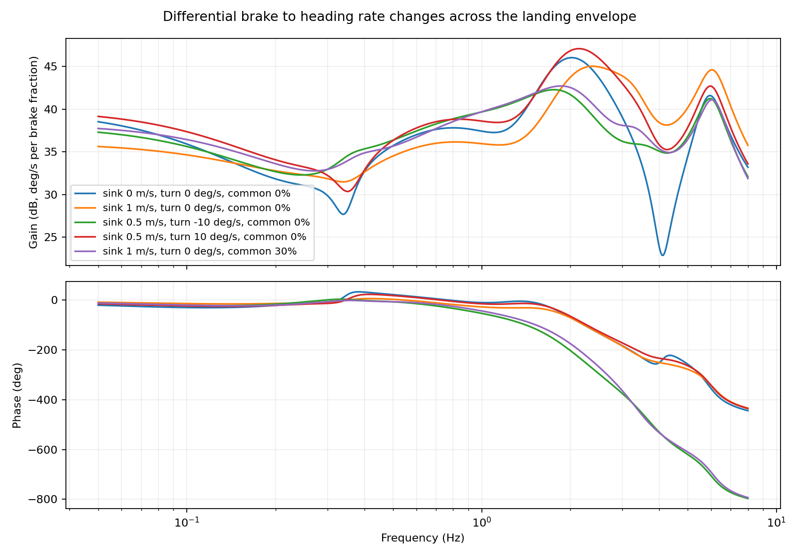
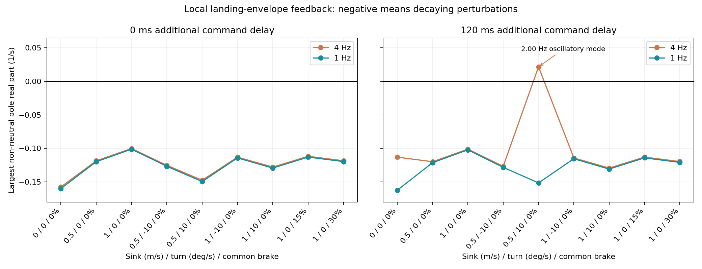
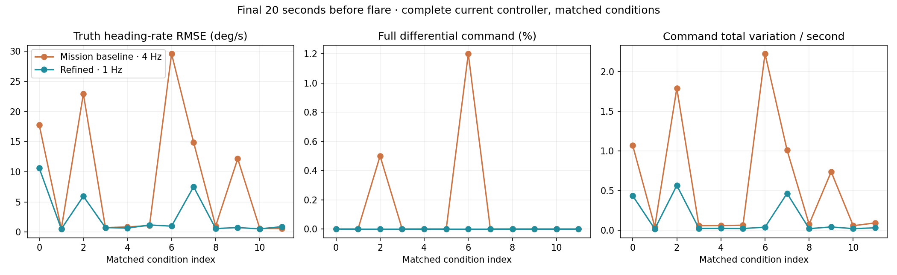
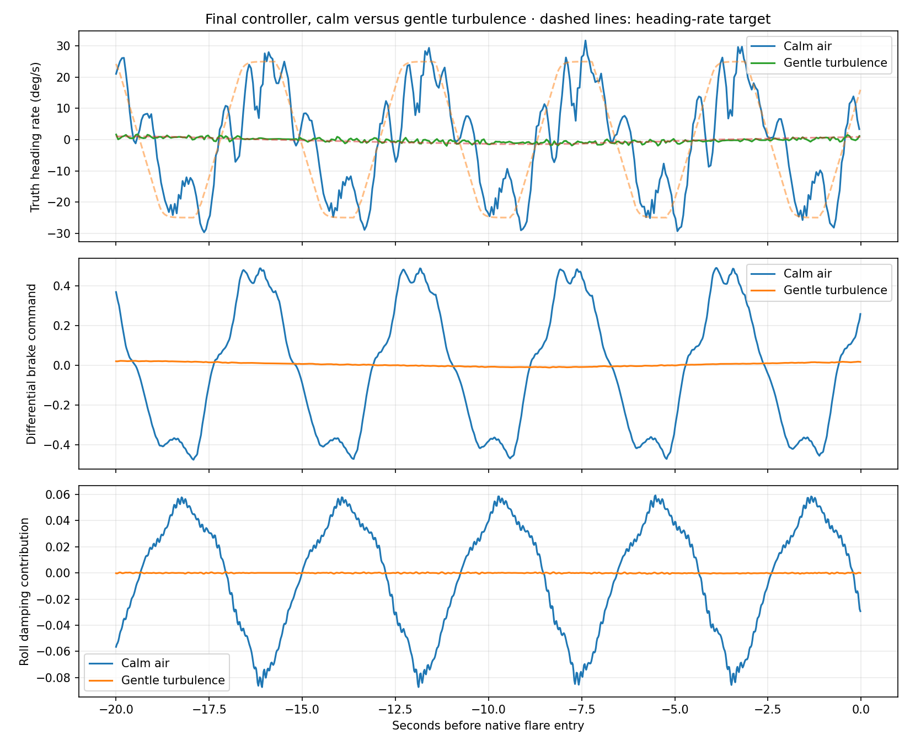
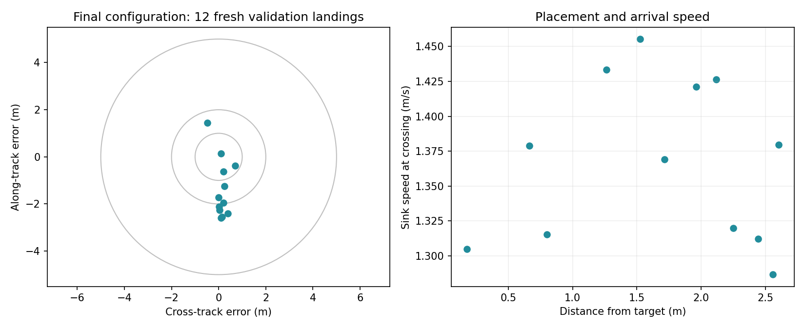

# Landing Micro-AGU: From TECS Approach to Brake Flare

Landing needs a different use of the controls than ordinary flight. I left symmetric braking out of the up-and-away pitch controller because it costs efficiency and can compromise wing stability. Near the ground, slowing the aircraft becomes the objective, and a controlled pull on both brakes becomes useful.

The landing architecture keeps ArduPilot's existing mission handling, approach geometry, height reference and flare triggers. The parafoil-specific work is in the response to the flare: command idle throttle, ramp common brake, and preserve differential steering. Starting with the established mission controller, I use descending-flight analysis to refine the steering response, then test the complete approach and flare across wind, actuator and aerodynamic uncertainty.

## What stays from fixed-wing TECS—and what changes

TECS is the Total Energy Control System. In a conventional airplane, throttle primarily manages total energy while pitch manages the distribution between speed and height. On approach, ArduPilot supplies a landing path and landing-specific demands and limits. During flare, ordinary TECS blends the demanded descent toward the configured landing sink rate and adjusts pitch control and pitch limits for landing. The pitch controller and elevator provide the authority to follow that demand.

Micro-AGU has no elevator. Its [existing longitudinal controller](controller-design.md) regulates height with throttle, using the established feedforward, vertical-speed feedback and pitch-rate damping. Differential brake provides steering. I do not ask the common brake to continuously track pitch or sink rate.

| Function | Conventional fixed-wing landing | Micro-AGU landing |
|---|---|---|
| Mission and final approach | Native LAND item and approach-line guidance | Same infrastructure |
| Height reference and flare decision | Existing landing altitude/rangefinder handling and altitude/time guards | Same infrastructure; no new AGL estimator |
| Approach longitudinal control | TECS coordinates throttle and pitch | Existing throttle-only parafoil height controller |
| Flare longitudinal response | Flare descent demand and landing pitch control/limits; normal landing throttle handling | Idle throttle demand, throttle integrator reset, scheduled common brake |
| Lateral control | Existing navigation and lateral controller remain active | Existing turn-rate controller and differential brakes remain active |
| After arrival | Existing landed detection and optional disarm | Same infrastructure |

**The current brake flare is a scheduled actuator command, not a closed-loop sink-rate controller.** The shared landing state machine decides when to flare; the new brake path decides how much line to pull and how quickly.

## The landing process

A LAND mission item starts the existing slope-landing sequence. Native alignment and progress checks move it from line-up into APPROACH. The navigation target is extended ahead along the landing line, avoiding a sudden turn back toward the LAND point after an overshoot. Meanwhile, the landing slope supplies the height demand to the existing throttle controller.

For this configuration, the normal flare trigger is **3 m above the landing reference**. The native logic also supports a time-to-ground trigger. Its detailed guards matter:

- The altitude trigger requires the approach stage and height at or below LAND_FLARE_ALT.
- The time trigger requires the approach stage, a positive LAND_FLARE_SEC, height at or below sink rate × flare time, and progress beyond halfway along the final leg.
- Passing the landing point without an in-range rangefinder can also force FINAL. The existing enabled crash-detection guard provides another route to motor shutdown.

The optional fixed-wing PREFLARE airspeed stage is not used in this setup. Entering **FINAL starts flare; it is not confirmation of touchdown**.

The automatic common-brake command has an additional gate: AUTO mode, LAND flight stage, native flare active, armed with safety off, both brake outputs assigned, and a positive PG_FLARE_PCT. If that gate becomes false, the stored automatic brake command clears. A go-around uses the existing abort/climb logic; a manual takeover returns to the existing pitch-stick brake command. Clearing a command does not make a physical servo move instantaneously.

After arrival, ArduPilot's existing not-flying detection and LAND_DISARMDELAY govern automatic disarming when enabled. The 9-DOF Monte Carlo stops at first ground-plane crossing; a separate native SITL test exercises ground handling and disarm.

## Approach geometry: leave room for the flare

The LAND point is the intended arrival location. ArduPilot aims the descending path at a point above and upstream of it, allowing for the forward travel expected during flare.

With downward sink rates defined positive, the planner uses:

$$
w = \frac{\mathrm{LAND\_FLARE\_AIM}}{100}, \qquad
\bar{v}_{z,f} = \max\!\left(w v_{z,\mathrm{land}} + (1-w)v_{z,\mathrm{approach}},\;0.1\right)
$$

$$
t_f = \frac{h_{\mathrm{aim}}}{\bar{v}_{z,f}}, \qquad
d_f = V_g t_f.
$$

The implementation constrains the weight to 0–1 and caps flare distance at half the final leg. With the altitude-only trigger used here, the aim height is 3 m. Ground speed makes the distance estimate responsive to wind.

The parafoil configuration uses **LAND_FLARE_AIM = 50%** and **TECS_LAND_SINK = 1.4 m/s**, consistent with the model's moderate-brake descent. Here, TECS_LAND_SINK supplies a planning assumption for the approach geometry. It does not cause the common brakes to regulate actual sink rate during flare.

## Flare control and brake allocation

The ordinary altitude and turn-rate loops are covered in [the controller-design article](controller-design.md). The new elements are the flare gate, common-brake ramp, allocation of shared brake travel, and the switch in throttle behavior.

When flare begins, the parafoil TECS branch commands idle, resets its throttle integrator and stops applying the ordinary height-feedback and pitch-damper throttle correction. Plane's existing output suppression and slew handling still govern the final motor command. This prevents the height controller from accumulating a demand for thrust while landing logic is suppressing it.

The common brake rises at a bounded rate to its target. In normalized travel, with valid parameter values:

$$
b_\star = \frac{\min(\mathrm{PG\_FLARE\_PCT},\,100-\mathrm{PG\_FLARE\_RES})}{100},
\qquad
b_k = \min(b_\star,\,b_{k-1}+r\,\Delta t).
$$

Here \(r\) is PG_FLARE_RATE divided by 100, in normalized travel per second. When the automatic flare gate is inactive, its stored \(b\) resets to zero.

Let \(u\) be signed differential demand, positive for a right turn. The mixer adds that demand on top of the common-brake floor:

$$
b_L = \operatorname{sat}_{[0,1]}\!\left(b+\max(-u,0)\right), \qquad
b_R = \operatorname{sat}_{[0,1]}\!\left(b+\max(u,0)\right).
$$

A turn therefore pulls one side farther without releasing the other below the common-brake command. Per-side servo calibration then maps these normalized commands into PWM and physical line travel.

Common brake consumes steering travel. The turn controller's output and anti-windup logic use the remaining fraction \(1-b\), taken from the preceding mixer cycle. PG_FLARE_RES also caps the common target so that some differential range remains available. This reserves command travel; it does not by itself establish aerodynamic steering authority near stall.

## The simulated landing configuration

| Parameter | Value | Role |
|---|---:|---|
| PG_FLARE_PCT | 60% | Common-brake target |
| PG_FLARE_RATE | 30 percentage points/s | Pull-in rate |
| PG_FLARE_RES | 20% | Minimum command travel reserved for differential steering |
| LAND_FLARE_ALT | 3 m | Altitude trigger |
| LAND_FLARE_SEC | 0 | Time trigger disabled |
| LAND_FLARE_AIM | 50% | Approach/flare sink weighting in the landing-path estimate |
| TECS_LAND_SINK | 1.4 m/s | Flare sink assumption for path planning |

At 60% common brake, 40% of normalized travel remains above the floor on either side. The 20% reserve would cap a larger common request at 80%. Starting from zero, the configured ramp takes two seconds to reach 60%; a low trigger or fast descent may leave less time than that.

## Start with the mission controller

The starting point is the controller from the [up-and-away design study](controller-design.md): heading-rate feedforward and PI feedback, body-roll-rate damping, and the throttle-only longitudinal loop. Landing should extend that design rather than depend on a separate aggressive steering tune.

For this study I reran the baseline landings with the complete current mission configuration. The baseline and refined versions share the same longitudinal settings, approach geometry and flare schedule. The lateral coefficients are also unchanged:

| Lateral parameter | Baseline | Refined |
|---|---:|---:|
| PG_TURN_FF | 0.009 | 0.009 |
| PG_TURN_P | 0.005 | 0.005 |
| PG_TURN_I | 0.002 | 0.002 |
| PG_TURN_RDAMP | 0.003 | 0.003 |
| PG_TURN_D_FF | 0 | 0 |
| PG_TURN_FILT | 4 Hz | **1 Hz** |

The mission controller already transferred well to landing. This is a modest refinement of its feedback bandwidth, not a rescue of a bad gain set. The feedforward, PI and roll-damping gains remain unchanged.

## Check the operating conditions used during landing

The earlier controller study already considered several flight trims. Landing extends the question: how does the feedback behave while descending and turning, with delayed brake response and common brake consuming steering travel?

I solved nine balanced operating points in the 1,758 g, 9-DOF mission model:

- Straight flight at 0, 0.5 and 1.0 m/s sink.
- Left and right turns at 10 deg/s, each at 0.5 and 1.0 m/s sink.
- Straight flight at 1.0 m/s sink with 15% and 30% common brake.

The calculation retains the unequal left/right line travel, the active side of the brake mixer, propeller dynamics, and the controller's airspeed scaling. Turning cases are linearized in a rotating reference frame. The controller updates and holds its output at 50 Hz, verified from the logged scheduler parameter and heading-rate samples; the model integrates the physics at finer substeps. The partial-brake trims have powered, steady flight; they characterize the plant while braking, not an equilibrium representation of the idle-throttle flare.

In each case, the local discrete plant is

$$
x_{k+1}=A x_k+B\,\delta u_k,\qquad
\begin{bmatrix}\delta\dot\psi_k\\\delta p_k\end{bmatrix}=C x_k.
$$

Here \(u\) is normalized differential brake demand, \(\dot\psi\) is heading rate and \(p\) is body roll rate. The plant transfer matrix is \(G(z)=C(zI-A)^{-1}B\). Its 16 perturbation states describe the articulated mechanical dynamics and motor RPM; two measurement filters and the integral state complete the local feedback model. Absolute heading contributes a neutral mode because waypoint guidance is outside this inner-loop calculation.

The native controller applies the same first-order filter to measured heading rate and body roll rate. With target \(r_c\), airspeed scale \(s_v\), and the already-defined target shaping omitted here for clarity, the unsaturated law is

$$
e_k=r_{c,k}-\widehat{\dot\psi}_k,\qquad
I_k=I_{k-1}+K_I e_k\Delta t,
$$

$$
u_k=s_v\left(K_{FF}r_{c,k}+K_P e_k-K_R\hat p_k\right)+I_k.
$$

The implementation also enforces integral and available-brake limits. Those nonlinear limits are exercised in the native landing runs below.

## Refine the feedback bandwidth

The descending-trim analysis is a robustness check: descent alone did not reveal a bad tune. Both filter settings have decaying non-neutral modes at all nine sampled trims with no added command delay. The difference appears when the actuator path is delayed. In the 0.5 m/s descending right turn, the 4 Hz configuration develops a growing mode around 2 Hz with 80–120 ms of added delay. At 120 ms its pole pair has real part **+0.022/s** and frequency **2.00 Hz**. The 1 Hz configuration retains decaying modes throughout the sampled 0–120 ms delay range at all nine trims.

Lowering the measurement cutoff reduces how strongly the controller reacts to the faster coupled motion. It also introduces phase lag, so the decision has to come from the combined plant and controller, not the filter alone. The delay values are sensitivity cases within the actuator uncertainty used for the landing tests; they are not a measured servo transfer function.

Small nonlinear perturbation runs reproduce the corresponding local predictions. This verifies the linear calculation against the simulator. The complete flare is still evaluated as a changing trajectory: fixed-throttle linear models omit the altitude loop, navigation, estimator, brake saturation and the common-brake ramp.

## Compare the complete landing response

Twelve established conditions were rerun with each filter setting, using fresh native SITL processes and the same complete controller configuration. The plotted tracking error uses heading rate reconstructed from simulator attitude and angular velocity, rather than the newly filtered feedback signal. Reducing the reporting bandwidth therefore cannot manufacture an apparent tracking improvement.

The refined filter reduced brake-command activity in **all 12 conditions** and actual heading-rate RMSE in **9 of 12**. Median command variation fell from 0.081 to 0.025 normalized travel per second. The largest tracking error across the set fell from **29.6 to 10.6 deg/s**. In the previously identified difficult condition 2, error fell from **22.95 to 5.95 deg/s**; the original condition 1 changed only from 0.54 to 0.51 deg/s.

Spot accuracy was essentially unchanged: the matched median miss was **1.00 m at 4 Hz and 0.98 m at 1 Hz**, with a smaller miss in six of twelve cases. The benefit is quieter brake commands and better tracking in several difficult conditions. Smoother braking changes drag and arrival timing, so a smaller heading-rate error does not guarantee a smaller miss.

The nonlinear landing runs provide the practical evidence for the filter change; they could have identified its benefit without the linear study. The linear analysis adds an explanation of the delay-sensitive mode and checks whether the refinement remains reasonable across the sampled trims.

### Watch the final controller in calm air and gentle turbulence

[Calm air: final controller](https://davidingraham.github.io/assets/microagu-viewer/landing.html?case=calm)

[Gentle turbulence: final controller](https://davidingraham.github.io/assets/microagu-viewer/landing.html?case=turbulent)

Both applets use the final 1 Hz controller, the same approach geometry, initial errors, actuator model and flare settings. The calm run has no wind. The turbulent run adds a steady horizontal wind of about 1.51 m/s and smooth gusts with 0.25 m/s amplitude per horizontal component and 0.0625 m/s vertically. These are gentle, repeatable synthetic disturbances. This comparison shows the combined effect of steady wind and gusts, rather than isolating gusts alone.

These illustrative runs are separate from the matched controller study and the fresh Monte Carlo set. The scene shows the final 22 seconds, with synchronized altitude, throttle, applied brake, sink-rate and ground-speed traces. The floor and bullseye are fixed to the ground, and the wind arrow shows the flow direction. Drag to orbit, pinch or scroll to zoom, and use **Flare close-up** or **Slow flare** to inspect the transition.

Carriage and canopy attitudes, propeller RPM, throttle and brake travel come from the simulator. The carriage uses the exported SolidWorks assembly; the canopy and suspension lines are schematic. The 3D scene keeps physical scale, while the side profile exaggerates height for readability.

## Final Monte Carlo results

After fixing the refined configuration, I tested twelve fresh randomized conditions with a new seed. These cases were not used to select the filter. The table and landing footprint show only the final configuration on that fresh set; the twelve matched comparison conditions above remain separate.

All twelve fresh runs reached the modeled ground plane, and all twelve finished within 5 m of the target. This validates the selected configuration within these simulated conditions; without a baseline run on the same fresh set, it does not establish an improvement over the original gains.

| Metric | Final configuration: fresh validation |
|---|---:|
| Within 5 m of target | **12 / 12** |
| Median miss | **1.84 m** |
| 90th-percentile miss | **2.55 m** |
| Worst miss | **2.60 m** |
| Median downward speed at crossing | 1.37 m/s |
| 90th-percentile downward speed | 1.43 m/s |
| Median ground speed | 2.96 m/s |

The trials varied horizontal wind from 0–2 m/s in any direction, smooth gust amplitudes up to 0.45 m/s per horizontal component (one-quarter of that vertically), initial cross-track error ±10 m, height ±5 m, heading ±15°, speed ±10%, voltage 20.4–22.2 V, independent brake lift and drag scales of 0.6–1.4, actuator rates of 80–220 mm/s, command delay up to 0.12 s, and landing-datum error ±0.5 m. These are repeatable synthetic gusts and engineering test ranges, not a calibrated atmospheric turbulence spectrum or measured environmental probabilities.

Each run used a fresh native SITL process flying an AUTO waypoint followed by a LAND item. Log audits check the complete configured controller, flare activation, common-brake bounds and allocated output bounds. The same refined controller also retains the ordinary mission tests in calm air, gusts and steady crosswind.

The completed 2 m/s crosswind comparison preserves the ordinary mission response: right/left loiter heading-rate RMSE changes from 2.29/3.71 to 1.83/3.27 deg/s. The existing gust runs show the tradeoff: less high-frequency brake activity and better radial tracking, but left-loiter heading-rate error rises from 9.79 to 10.80 deg/s. The [mission regression results](assets/landing-refinement/mission-results.json) retain those outcomes alongside the calm-air tests; the landing refinement is not claimed to improve every tracking metric.

## What remains for flight validation

The simulation ends at the first crossing of a flat ground plane by the payload CG. It has no impact, canopy-collapse or validated high-brake stall model. The next flight work is to measure the transient sink and forward-speed response to common brake, the usable pull before loss of wing stability, and steering authority during that pull.

Automatic brake flare remains disabled by default in the firmware. The explicit simulation parameter file and the [next flight test card](next-flight-test-card.md) preserve the distinction between a working control architecture and a flight-validated landing procedure.

[Final results and log audits](assets/landing-refinement/final-results.json) · [Final sampled configurations](assets/landing-refinement/final-conditions.json) · [Selected controller and test setup](https://github.com/DavidIngraham/ardupilot/commit/377cd08561) · [Plotting and replay scripts](https://github.com/DavidIngraham/ArduPilot-tinkering/blob/main/tools/report_landing_refinement.py)

The implementation paths are [native slope landing](https://github.com/DavidIngraham/ardupilot/blob/76c18af01d/libraries/AP_Landing/AP_Landing_Slope.cpp), [parafoil TECS](https://github.com/DavidIngraham/ardupilot/blob/76c18af01d/libraries/AP_TECS/AP_TECS_Paraglider.cpp), and the [brake mixer](https://github.com/DavidIngraham/ardupilot/blob/76c18af01d/ArduPlane/servos.cpp). Raw telemetry and full truth recordings stay in Mission Planner. Implementation and analysis were assisted by Codex.
