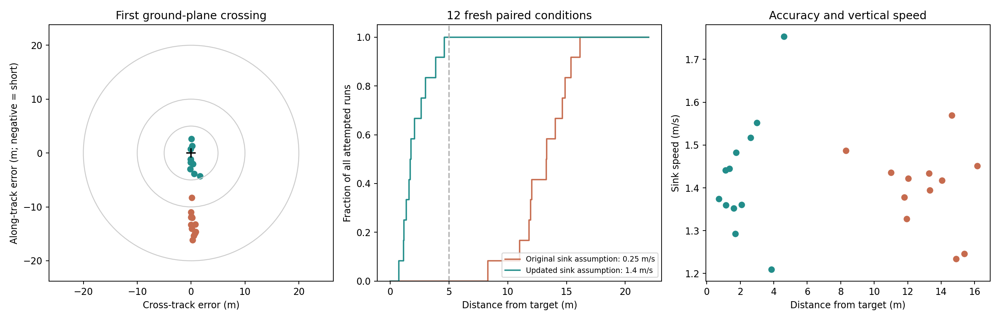

# Spot Landing: Fixing the Approach Before Tuning the Flare

I had left symmetric braking out of the ordinary pitch controller because pulling both brakes costs efficiency and can compromise the wing's stability. Landing gives it a more useful job: slow the aircraft for arrival. With the up-and-away controller working in simulation, I added a moderate brake flare using ArduPilot's existing landing state machine and altitude/time triggers.

The first Monte Carlo exposed a different problem. The aircraft followed the landing line closely, then consistently reached the ground short of the target. Before changing the brake schedule, I wanted to understand why the approach was delivering it to the wrong place.

## What the first batch told me

Across 24 randomized native AUTO landings, the median miss was 15.27 m. None landed within 5 m; the mean along-track error was 14.68 m short. The 90th-percentile absolute cross-track error was only 0.56 m. This was primarily a longitudinal aiming problem.

Eight matched no-flare flights helped separate the effects. The moderate flare reduced arrival ground speed by an average 0.79 m/s, but changed sink speed by only −0.04 m/s and radial miss by +0.26 m. Its strongest benefit in that batch was slower forward arrival. It did not fix the short bias.

## The approach was budgeting too much time in flare

ArduPilot already anticipates the distance travelled during flare. Its landing path aims at a point above and upstream of the uploaded LAND waypoint. The estimate blends approach sink rate with the configured landing sink rate:

$$
w = \frac{\mathrm{LAND\_FLARE\_AIM}}{100}, \qquad
\bar{v}_{z,f} = \max\!\left(w v_{z,\mathrm{land}} + (1-w)v_{z,\mathrm{approach}},\;0.1\right)
$$

$$
t_f = \frac{h_{\mathrm{aim}}}{\bar{v}_{z,f}}, \qquad
d_f = V_g t_f.
$$

The implementation also bounds that distance to half the final approach leg. With the altitude-only trigger used here, the aim height is 3 m.

The original settings were **LAND_FLARE_AIM = 50%** and **TECS_LAND_SINK = 0.25 m/s**. Our model was arriving at roughly 1.4–1.5 m/s downward. The much smaller configured sink rate gave the planner too much expected time to float forward. It therefore moved the upstream aim point too far back.

I changed the planning assumption to **TECS_LAND_SINK = 1.4 m/s**. In this paraglider implementation, throttle goes idle during flare and common brake ramps to a fixed pull. The setting informs the approach geometry; it does not make the aircraft regulate flare sink to 1.4 m/s.

## One bounded iteration

I used four previously sampled conditions to compare two candidates: remove the flare weighting with LAND_FLARE_AIM = 0, or retain the 50% weighting and use the measured model sink rate of 1.4 m/s. The latter put all four screening landings within 5 m, with misses of 1.70, 1.25, 2.34 and 4.65 m. Removing the weighting gave 7.59, 5.85, 0.36 and 9.88 m.

I then froze the 1.4 m/s candidate and drew **12 fresh conditions**, running both the original and candidate settings under each. The moderate flare remained unchanged throughout:

| Setting | Value |
|---|---:|
| Common brake target | 60% |
| Brake ramp | 30 percentage points/s |
| Differential travel reserve | 20% |
| Altitude trigger | 3 m |
| Time trigger | Disabled |
| Flare aim weighting | 50% |

The uncertainty draws cover wind from 0–2 m/s in any horizontal direction, smooth gust amplitudes up to 0.45 m/s, initial cross-track error ±10 m, height ±5 m, heading ±15°, speed ±10%, voltage 20.4–22.2 V, independent brake lift and drag scales of 0.6–1.4, actuator rates of 80–220 mm/s, command delay up to 0.12 s, and landing-datum error ±0.5 m. These are engineering test ranges, not a measured probability distribution of flying conditions.

All runs use the 1,758 g Trout Lake configuration, the mission-profile 9-DOF model, and the landing harness's original turn-gain preset. Each starts a fresh native SITL process and uploads an AUTO waypoint followed by a LAND item. The target stays at the uploaded landing location; no offset is fitted to the resulting point cloud.

## Fresh-condition results

All 24 held-out flights reached the ground plane, and the candidate improved every matched case.

| Fresh-condition metric | Original 0.25 m/s assumption | Updated 1.4 m/s assumption |
|---|---:|---:|
| Within 5 m | 0 / 12 | **12 / 12** |
| Median miss | 13.30 m | **1.73 m** |
| 90th-percentile miss | 15.34 m | **3.77 m** |
| Worst miss | 16.15 m | **4.60 m** |
| Median sink speed | 1.42 m/s | 1.41 m/s |
| 90th-percentile sink speed | 1.48 m/s | 1.55 m/s |
| Median ground speed | 3.64 m/s | 3.73 m/s |

The median miss fell by **87%**. The contact speeds remained similar, with a small increase in the upper sink-speed percentile. This iteration improved where the model arrived, without establishing a softer touchdown. Twelve successful samples do not establish a 100% success probability.

Native-log audits confirmed the requested sink and aim parameters, flare activation, the 60% common-brake bound, and output allocation bounds in every held-out run.

## Watch a landing

[Open the interactive spot-landing replay](https://davidingraham.github.io/assets/microagu-viewer/landing.html). Drag to orbit around the actual carriage model, scroll or pinch to zoom, and scrub to inspect the brake application. The floor and bullseye are fixed in world coordinates; the camera follows the aircraft. The rings mark 1, 2 and 5 m from the intended target.

This example missed by **1.70 m**. It is the successful trial closest to the candidate's median miss, rather than the best landing in the batch. The alternating steering commands visible in the brake plot come from the original turn-gain preset retained for this comparison; I did not tune them during this iteration.

The replay shows the final 22 seconds of a native AUTO flight. Carriage and canopy attitudes, propeller RPM, applied brake travel and throttle come from the simulator. The canopy mesh and suspension lines are schematic; the carriage is the exported SolidWorks assembly. The altitude profile exaggerates height for readability, while the 3D scene keeps physical scale.

<video autoplay muted loop playsinline controls preload="metadata" poster="assets/landing/spot-landing.jpg"><source src="assets/landing/spot-landing.mp4" type="video/mp4"></video>

## What this earns us before flying

This is useful evidence for the approach-planning correction. It leaves a separate job for flight testing: measure the transient sink and forward-speed response to common brake, the usable pull before loss of wing stability, and how much steering remains during flare.

The simulation endpoint is the first crossing of a flat ground plane by the payload CG. There is no impact, canopy-collapse or validated high-brake stall model. A small miss distance establishes simulated placement; the arrival speeds still matter, and these results do not establish a safe real-aircraft landing.

The candidate is saved as an explicit simulation parameter file on the feature branch. Automatic brake flare remains disabled by default in the firmware. The [next flight test card](next-flight-test-card.md) remains the route to checking the brake response aloft before attempting automated landings.

[Media and source provenance](assets/landing/provenance.json) · [Measured results and log audits](assets/landing/summary.json) · [Exact sampled configurations](assets/landing/experiment.json) · [Analysis and replay packaging script](https://github.com/DavidIngraham/ArduPilot-tinkering/blob/main/viewer/tools/landing_iteration_report.py) · [Tested feature-branch snapshot](https://github.com/DavidIngraham/ardupilot/commit/76c18af01d)

Raw telemetry and full truth recordings stay in Mission Planner. The article retains the final figure, a short presentation replay, video and reproduction scripts. Implementation and analysis were assisted by Codex.
