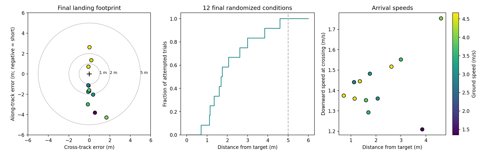

# Landing Micro-AGU: From TECS Approach to Brake Flare

Landing needs a different use of the controls than ordinary flight. I left symmetric braking out of the up-and-away pitch controller because it costs efficiency and can compromise wing stability. Near the ground, slowing the aircraft becomes the objective, and a controlled pull on both brakes becomes useful.

The landing architecture keeps ArduPilot's existing mission handling, approach geometry, height reference and flare triggers. The parafoil-specific work is in the response to the flare: command idle throttle, ramp common brake, and preserve differential steering. This article describes that division of responsibility and the final simulation results.

## What stays from fixed-wing TECS—and what changes

TECS is the Total Energy Control System. In a conventional airplane, throttle primarily manages total energy while pitch manages the distribution between speed and height. On approach, ArduPilot supplies a landing path and landing-specific demands and limits. During flare, ordinary TECS blends the demanded descent toward the configured landing sink rate and adjusts pitch control and pitch limits for landing. The pitch controller and elevator provide the authority to follow that demand.

Micro-AGU has no elevator. Its [existing longitudinal controller](controller-design.md) regulates height with throttle, using the established feedforward, vertical-speed feedback and pitch-rate damping. Differential brake provides steering. I do not ask the common brake to continuously track pitch or sink rate.

| Function | Conventional fixed-wing landing | Micro-AGU landing |
|---|---|---|
| Mission and final approach | Native LAND item and approach-line guidance | Same infrastructure |
| Height reference and flare decision | Existing landing altitude/rangefinder handling and altitude/time guards | Same infrastructure; no new AGL estimator |
| Approach longitudinal control | TECS coordinates throttle and pitch | Existing throttle-only parafoil height controller |
| Flare longitudinal response | Flare descent demand and landing pitch control/limits; normal landing throttle handling | Idle throttle demand, throttle integrator reset, scheduled common brake |
| Lateral control | Existing navigation and lateral controller remain active | Existing turn-rate controller and differential brakes remain active |
| After arrival | Existing landed detection and optional disarm | Same infrastructure |

**The current brake flare is a scheduled actuator command, not a closed-loop sink-rate controller.** The shared landing state machine decides when to flare; the new brake path decides how much line to pull and how quickly.

## The landing process

A LAND mission item starts the existing slope-landing sequence. Native alignment and progress checks move it from line-up into APPROACH. The navigation target is extended ahead along the landing line, avoiding a sudden turn back toward the LAND point after an overshoot. Meanwhile, the landing slope supplies the height demand to the existing throttle controller.

For this configuration, the normal flare trigger is **3 m above the landing reference**. The native logic also supports a time-to-ground trigger. Its detailed guards matter:

- The altitude trigger requires the approach stage and height at or below LAND_FLARE_ALT.
- The time trigger requires the approach stage, a positive LAND_FLARE_SEC, height at or below sink rate × flare time, and progress beyond halfway along the final leg.
- Passing the landing point without an in-range rangefinder can also force FINAL. The existing enabled crash-detection guard provides another route to motor shutdown.

The optional fixed-wing PREFLARE airspeed stage is not used in this setup. Entering **FINAL starts flare; it is not confirmation of touchdown**.

The automatic common-brake command has an additional gate: AUTO mode, LAND flight stage, native flare active, armed with safety off, both brake outputs assigned, and a positive PG_FLARE_PCT. If that gate becomes false, the stored automatic brake command clears. A go-around uses the existing abort/climb logic; a manual takeover returns to the existing pitch-stick brake command. Clearing a command does not make a physical servo move instantaneously.

After arrival, ArduPilot's existing not-flying detection and LAND_DISARMDELAY govern automatic disarming when enabled. The 9-DOF Monte Carlo stops at first ground-plane crossing; a separate native SITL test exercises ground handling and disarm.

## Approach geometry: leave room for the flare

The LAND point is the intended arrival location. ArduPilot aims the descending path at a point above and upstream of it, allowing for the forward travel expected during flare.

With downward sink rates defined positive, the planner uses:

$$
w = \frac{\mathrm{LAND\_FLARE\_AIM}}{100}, \qquad
\bar{v}_{z,f} = \max\!\left(w v_{z,\mathrm{land}} + (1-w)v_{z,\mathrm{approach}},\;0.1\right)
$$

$$
t_f = \frac{h_{\mathrm{aim}}}{\bar{v}_{z,f}}, \qquad
d_f = V_g t_f.
$$

The implementation constrains the weight to 0–1 and caps flare distance at half the final leg. With the altitude-only trigger used here, the aim height is 3 m. Ground speed makes the distance estimate responsive to wind.

The parafoil configuration uses **LAND_FLARE_AIM = 50%** and **TECS_LAND_SINK = 1.4 m/s**, consistent with the model's moderate-brake descent. Here, TECS_LAND_SINK supplies a planning assumption for the approach geometry. It does not cause the common brakes to regulate actual sink rate during flare.

## Flare control and brake allocation

The ordinary altitude and turn-rate loops are covered in [the controller-design article](controller-design.md). The new elements are the flare gate, common-brake ramp, allocation of shared brake travel, and the switch in throttle behavior.

When flare begins, the parafoil TECS branch commands idle, resets its throttle integrator and stops applying the ordinary height-feedback and pitch-damper throttle correction. Plane's existing output suppression and slew handling still govern the final motor command. This prevents the height controller from accumulating a demand for thrust while landing logic is suppressing it.

The common brake rises at a bounded rate to its target. In normalized travel, with valid parameter values:

$$
b_\star = \frac{\min(\mathrm{PG\_FLARE\_PCT},\,100-\mathrm{PG\_FLARE\_RES})}{100},
\qquad
b_k = \min(b_\star,\,b_{k-1}+r\,\Delta t).
$$

Here \(r\) is PG_FLARE_RATE divided by 100, in normalized travel per second. When the automatic flare gate is inactive, its stored \(b\) resets to zero.

Let \(u\) be signed differential demand, positive for a right turn. The mixer adds that demand on top of the common-brake floor:

$$
b_L = \operatorname{sat}_{[0,1]}\!\left(b+\max(-u,0)\right), \qquad
b_R = \operatorname{sat}_{[0,1]}\!\left(b+\max(u,0)\right).
$$

A turn therefore pulls one side farther without releasing the other below the common-brake command. Per-side servo calibration then maps these normalized commands into PWM and physical line travel.

Common brake consumes steering travel. The turn controller's output and anti-windup logic use the remaining fraction \(1-b\), taken from the preceding mixer cycle. PG_FLARE_RES also caps the common target so that some differential range remains available. This reserves command travel; it does not by itself establish aerodynamic steering authority near stall.

## The simulated landing configuration

| Parameter | Value | Role |
|---|---:|---|
| PG_FLARE_PCT | 60% | Common-brake target |
| PG_FLARE_RATE | 30 percentage points/s | Pull-in rate |
| PG_FLARE_RES | 20% | Minimum command travel reserved for differential steering |
| LAND_FLARE_ALT | 3 m | Altitude trigger |
| LAND_FLARE_SEC | 0 | Time trigger disabled |
| LAND_FLARE_AIM | 50% | Approach/flare sink weighting in the landing-path estimate |
| TECS_LAND_SINK | 1.4 m/s | Flare sink assumption for path planning |

At 60% common brake, 40% of normalized travel remains above the floor on either side. The 20% reserve would cap a larger common request at 80%. Starting from zero, the configured ramp takes two seconds to reach 60%; a low trigger or fast descent may leave less time than that.

## Final Monte Carlo results

The final evaluation used **12 fresh randomized conditions**, with the settings fixed before the runs. All flights reached the ground plane.

| Metric | Final configuration |
|---|---:|
| Within 5 m of target | **12 / 12** |
| Median miss | **1.73 m** |
| 90th-percentile miss | **3.77 m** |
| Worst miss | **4.60 m** |
| Median downward speed at crossing | 1.41 m/s |
| 90th-percentile downward speed | 1.55 m/s |
| Median ground speed | 3.73 m/s |

The trials varied horizontal wind from 0–2 m/s in any direction, smooth gust amplitudes up to 0.45 m/s, initial cross-track error ±10 m, height ±5 m, heading ±15°, speed ±10%, voltage 20.4–22.2 V, independent brake lift and drag scales of 0.6–1.4, actuator rates of 80–220 mm/s, command delay up to 0.12 s, and landing-datum error ±0.5 m. These are engineering test ranges, not measured environmental probabilities.

Each run used the 1,758 g Trout Lake configuration, the mission-profile 9-DOF model and the landing harness's original turn-gain preset. A fresh native SITL process flew an AUTO waypoint followed by a LAND item. Log audits confirmed the planning parameters, flare activation, common-brake bound and allocated output bounds.

These results establish simulated placement under the sampled conditions. Twelve successes do not establish a 100% success probability, and the arrival speeds remain part of the landing problem.

## Watch the complete control response

[Open the interactive spot-landing replay](https://davidingraham.github.io/assets/microagu-viewer/landing.html). Drag to orbit, scroll or pinch to zoom, and scrub to inspect the brake application. The moving floor conveys translation; its grid and the 1, 2 and 5 m bullseye rings are fixed to the ground at the intended target.

This flight missed by **1.70 m**, making it the successful trial closest to the final batch's median miss. The applet shows the last 22 seconds, with an altitude profile and synchronized throttle, applied-brake, sink-rate and ground-speed traces. Flare entry is marked so the response can be read against the command change. Use **Flare close-up** to jump to the transition; **Slow flare** plays it at 0.35× speed. The highlighted response includes both throttle cutoff and the brake ramp. The active alternating steering commands are from the original turn-gain preset used in this evaluation.

Carriage and canopy attitudes, propeller RPM, throttle and brake travel come from the simulator. The carriage uses the exported SolidWorks assembly; the canopy and suspension lines are schematic. The 3D scene keeps physical scale, while the side profile exaggerates height for readability.

## What remains for flight validation

The simulation ends at the first crossing of a flat ground plane by the payload CG. It has no impact, canopy-collapse or validated high-brake stall model. The next flight work is to measure the transient sink and forward-speed response to common brake, the usable pull before loss of wing stability, and steering authority during that pull.

Automatic brake flare remains disabled by default in the firmware. The explicit simulation parameter file and the [next flight test card](next-flight-test-card.md) preserve the distinction between a working control architecture and a flight-validated landing procedure.

[Final results and log audits](assets/landing/final-results.json) · [Final sampled configurations](assets/landing/final-conditions.json) · [Implementation snapshot](https://github.com/DavidIngraham/ardupilot/commit/76c18af01d) · [Plotting and replay scripts](https://github.com/DavidIngraham/ArduPilot-tinkering/tree/main/viewer/tools)

The implementation paths are [native slope landing](https://github.com/DavidIngraham/ardupilot/blob/76c18af01d/libraries/AP_Landing/AP_Landing_Slope.cpp), [parafoil TECS](https://github.com/DavidIngraham/ardupilot/blob/76c18af01d/libraries/AP_TECS/AP_TECS_Paraglider.cpp), and the [brake mixer](https://github.com/DavidIngraham/ardupilot/blob/76c18af01d/ArduPlane/servos.cpp). Raw telemetry and full truth recordings stay in Mission Planner. Implementation and analysis were assisted by Codex.
