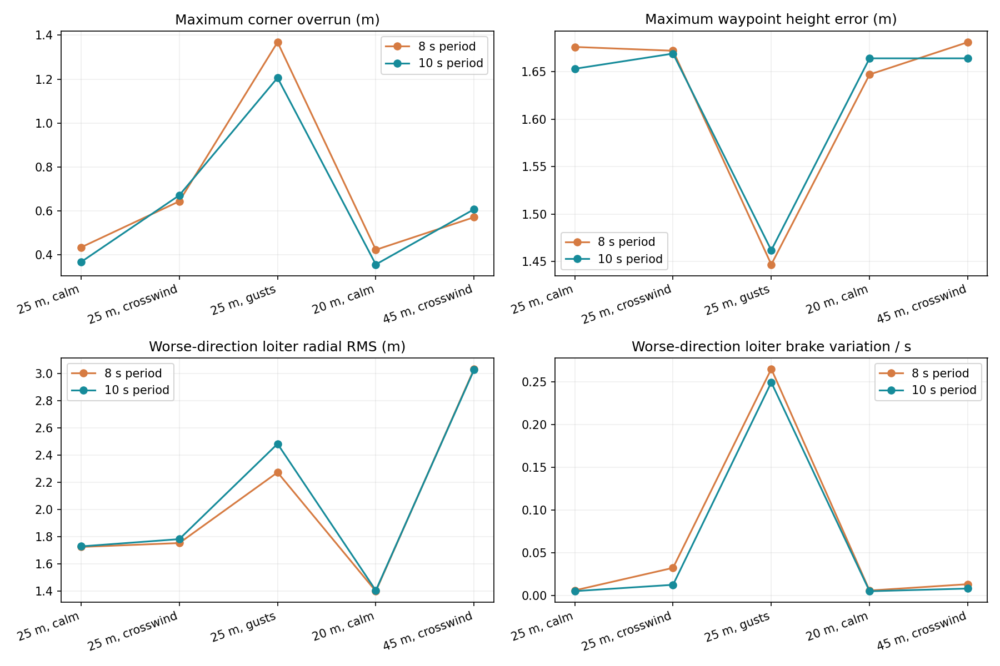
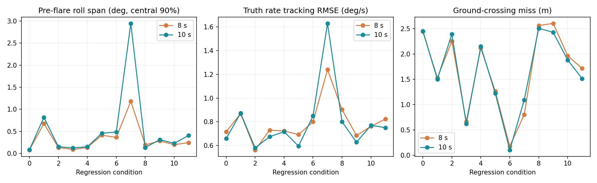
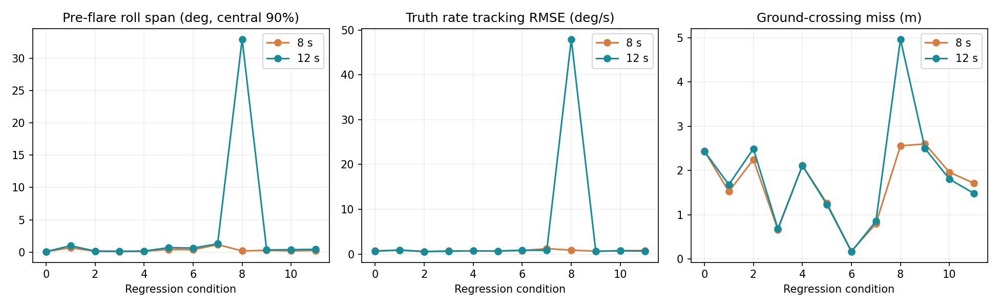
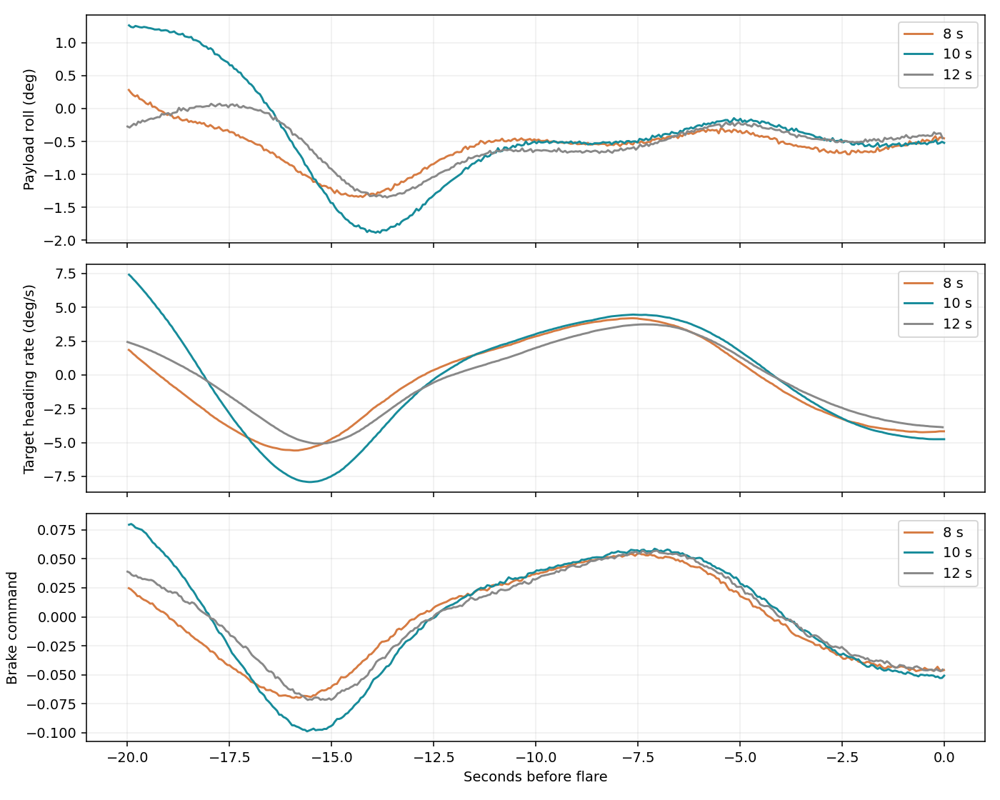

# L1 mission and landing regression

Selected: NAVL1_PERIOD=10 s, compared with 8 s. The 12 s intermediate candidate is retained in the tables but was not selected. All selected inner lateral and longitudinal gains are unchanged. NAVL1_DAMPING remains 1.0.

## Selection

Use a 10-second L1 period with damping 1.0 in the complete opt-in development profile. All existing inner-loop gains remain unchanged. Forty-two new native runs were completed during this bounded study. The selected candidate passed all five mission profiles and all twelve landing regression cases. Median miss on that twelve-case set is 1.70 m, worst 2.51 m; separate focused repeats reached 3.28 m.

This is a practical compromise: it fixes the calm large-amplitude oscillation while preserving ordinary mission performance. It is not a claim that every metric improves, and it does not establish stability for every possible initialization.

## Mission profiles

The extended native AUTO route includes altitude changes from 45 to 90 m, successive waypoint corners, right and left two-turn loiters, home loiter, and a brief handover to/from legacy control. Normal radius is 25 m; added tests use 20 and 45 m. Waypoint acceptance remains fixed at the existing angle-scaled 22 m setting. Native pass criteria are unmodified.

| Profile | Period (s) | Native pass | Max corner overrun (m) | Max waypoint height error (m) | Right / left radial RMS (m) |
|---|---:|---|---:|---:|---:|
| standard-calm-8 | 8 | True | 0.43 | 1.68 | 1.73 / 1.66 |
| standard-crosswind-8 | 8 | True | 0.64 | 1.67 | 1.75 / 1.69 |
| standard-gust-8 | 8 | True | 1.37 | 1.45 | 1.88 / 2.27 |
| standard-calm-12 | 12 | True | 0.36 | 1.67 | 1.74 / 1.67 |
| standard-crosswind-12 | 12 | True | 0.65 | 1.69 | 1.81 / 1.65 |
| standard-gust-12 | 12 | True | 1.41 | 2.29 | 1.72 / 1.91 |
| tight-calm-8 | 8 | True | 0.42 | 1.65 | 1.40 / 1.35 |
| tight-calm-12 | 12 | True | 0.36 | 1.67 | 1.42 / 1.36 |
| wide-crosswind-8 | 8 | True | 0.57 | 1.68 | 3.04 / 3.01 |
| wide-crosswind-12 | 12 | True | 0.55 | 1.67 | 3.04 / 3.00 |
| standard-calm-10 | 10 | True | 0.37 | 1.65 | 1.73 / 1.66 |
| standard-crosswind-10 | 10 | True | 0.67 | 1.67 | 1.78 / 1.65 |
| standard-gust-10 | 10 | True | 1.21 | 1.46 | 1.76 / 2.48 |
| tight-calm-10 | 10 | True | 0.36 | 1.66 | 1.41 / 1.35 |
| wide-crosswind-10 | 10 | True | 0.61 | 1.66 | 3.03 / 2.99 |

| Profile | Worst settled-leg cross-track RMS (m) | Maximum settled-segment command saturation (%) |
|---|---:|---:|
| standard-calm-8 | 0.077 | 0.00 |
| standard-crosswind-8 | 0.089 | 0.00 |
| standard-gust-8 | 0.706 | 0.00 |
| standard-calm-12 | 0.123 | 0.00 |
| standard-crosswind-12 | 0.143 | 0.00 |
| standard-gust-12 | 0.920 | 0.00 |
| tight-calm-8 | 0.065 | 0.00 |
| tight-calm-12 | 0.108 | 0.00 |
| wide-crosswind-8 | 1.855 | 0.00 |
| wide-crosswind-12 | 1.855 | 0.00 |
| standard-calm-10 | 0.095 | 0.00 |
| standard-crosswind-10 | 0.111 | 0.00 |
| standard-gust-10 | 0.948 | 0.00 |
| tight-calm-10 | 0.081 | 0.00 |
| wide-crosswind-10 | 1.827 | 0.00 |

## Landing regression

The twelve conditions were previously independent validation cases; after reuse here they are regression conditions, not fresh held-out evidence. Pre-flare metrics cover the final 20 seconds before the first active PGFL sample. Truth heading rate is reconstructed from simulator attitude and angular velocity; feedback filtering cannot manufacture an apparent improvement. Roll span means the central 90% span, not peak-to-peak.

| Case | Roll span 8 → 10 s (deg) | Truth rate RMSE 8 → 10 s (deg/s) | Miss 8 → 10 s (m) |
|---|---:|---:|---:|
| 0 | 0.08 → 0.08 | 0.72 → 0.66 | 2.44 → 2.45 |
| 1 | 0.68 → 0.82 | 0.87 → 0.87 | 1.53 → 1.50 |
| 2 | 0.13 → 0.15 | 0.56 → 0.58 | 2.25 → 2.39 |
| 3 | 0.09 → 0.13 | 0.73 → 0.67 | 0.66 → 0.62 |
| 4 | 0.14 → 0.15 | 0.72 → 0.72 | 2.12 → 2.15 |
| 5 | 0.41 → 0.46 | 0.69 → 0.59 | 1.26 → 1.22 |
| 6 | 0.37 → 0.49 | 0.80 → 0.85 | 0.18 → 0.10 |
| 7 | 1.18 → 2.95 | 1.24 → 1.63 | 0.80 → 1.09 |
| 8 | 0.19 → 0.14 | 0.90 → 0.80 | 2.56 → 2.51 |
| 9 | 0.28 → 0.31 | 0.68 → 0.63 | 2.60 → 2.43 |
| 10 | 0.20 → 0.23 | 0.76 → 0.77 | 1.96 → 1.88 |
| 11 | 0.25 → 0.41 | 0.82 → 0.75 | 1.71 → 1.51 |

## Why 12 seconds was not selected

The 12 s candidate passed all native mission and touchdown assertions, but landing condition 08 developed a severe approximately 0.2 Hz oscillation: roll span 32.94 deg, truth heading-rate error 47.92 deg/s, and commands reaching their limits. An immediate repeat settled, showing sensitivity rather than eliminating the original failure. Both runs remain in the evidence. Sixteen and twenty seconds settled that case but missed by about 3.8 m. Ten seconds settled calm air and two focused repeats of condition 08, then settled that case again in the complete landing set. Those three 10 s runs missed by 3.28, 2.67 and 2.51 m respectively. This is bounded evidence, not a proof covering every initialization.

The worst 10 s roll span in the twelve-case set is 2.95 deg in case 07 (versus 1.18 deg at 8 s). Its trace shows a larger early excursion that settles before flare, not the repeated large reversals seen in the rejected case. That tracking cost is retained rather than hidden by the touchdown statistics.

## Reproduction and limits

Raw files remain in Mission Planner/analysis/l1-regression-2026-10-13. run.py, investigate08.py, test10.py, run10_landings.py and run10_missions.py run the native tests, analyze_missions.py and analyze_landings.py audit logged parameters and compute truth metrics; plot.py and make_report.py generate these results. The three ordinary 8 s mission baselines and twelve 8 s landing baselines are reused audited recordings. Radius variations have new matched 8/12 s runs. Wind is physically applied in the simulation, not visual motion. Gusts are repeatable synthetic fields, not a calibrated turbulence spectrum.

Implementation and analysis assisted by Codex.
