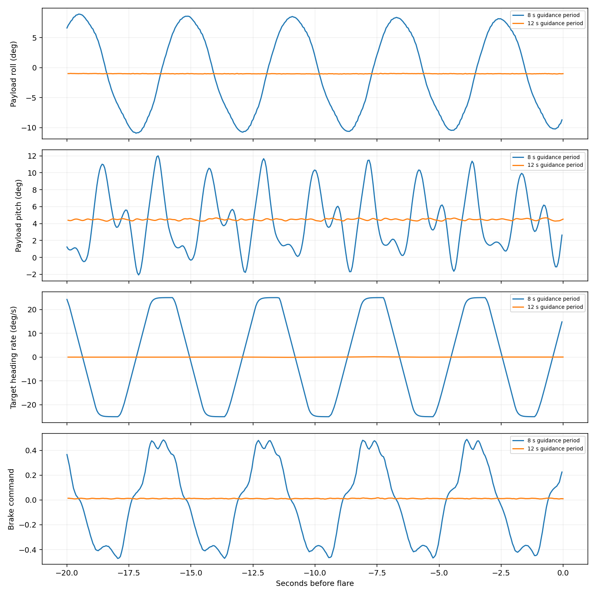

# Landing guidance bandwidth study

Changing only NAVL1_PERIOD from 8 to 12 seconds removes the large sustained calm-approach oscillation while preserving successful landings in five checked conditions. PG_TURN_FILT stays at 1 Hz; all inner lateral and longitudinal gains are unchanged. This is a landing candidate, not yet a replacement for the globally selected mission configuration.

## Matched checks

Metrics cover the final 20 seconds before the first active native PGFL sample. Roll span is the 95th minus 5th percentile of truth payload roll; tracking error uses truth heading rate. Miss is measured at payload-CG ground crossing.

| Condition | Roll span 8 → 12 s (deg) | Rate RMSE 8 → 12 s (deg/s) | Miss 8 → 12 s (m) |
|---|---:|---:|---:|
| Calm | 18.81 → 0.07 | 10.18 → 0.68 | 1.82 → 1.17 |
| Steady wind | 0.07 → 0.06 | 0.53 → 0.54 | 0.59 → 0.70 |
| Gentle gusts | 0.36 → 0.50 | 0.54 → 0.61 | 0.48 → 0.45 |
| Uncertainty case 02 | 17.86 → 0.27 | 5.95 → 0.53 | 1.97 → 0.50 |
| Uncertainty case 06 | 0.41 → 0.40 | 0.98 → 1.30 | 2.69 → 2.58 |

## Interpretation

At 8 seconds, the calm target heading rate repeatedly reaches ±25 deg/s. At 12 seconds it settles close to zero. The roll span falls from 18.81 to 0.067 deg, pitch span from 11.15 to 0.294 deg, and brake command variation from 0.508 to 0.020 normalized travel per second. Calm periods of 16 and 20 seconds also settle. Twelve seconds was selected as the quickest tested setting that settles, before examining its windy checks.

L1 lookahead distance scales with period and ground speed; increasing period reduces guidance bandwidth. The controlled parameter change strongly supports a full guidance/steering interaction as the cause of the large cycle. It is not a proof that every source of motion is identified. The earlier fixed-target trim analysis excluded waypoint guidance and therefore could not test this interaction.

Case 06 retains small roll motion but truth-rate RMSE rises from 0.98 to 1.30 deg/s and brake command variation from 0.033 to 0.068 per second. Gentle-gust RMSE also rises slightly (0.54 to 0.61 deg/s). Do not characterize the candidate as uniformly better. All five candidate ground misses are below 2.59 m.

## Scope and reproduction

Eight new native landing runs: three calm periods, four candidate wind/uncertainty checks, and one steady-wind baseline. The other baselines are existing recordings. Logged controller parameters and native pass status are audited by analyze.py. Raw telemetry stays in Mission Planner/analysis/landing-guidance-2026-10-13; scripts, configurations, compact results and final plot are archived here.

This bounded study is not a new Monte Carlo validation. Before promoting the period globally, rerun ordinary waypoint/loiter missions and the broader landing set, including approach smoothness metrics. Published applets and firmware defaults have not been changed by this study.

Implementation and analysis assisted by Codex.

Subsequent [full mission and landing regression](l1-regression-2026-10-13/report.md) rejected the 12-second intermediate setting and selected 10 seconds.
