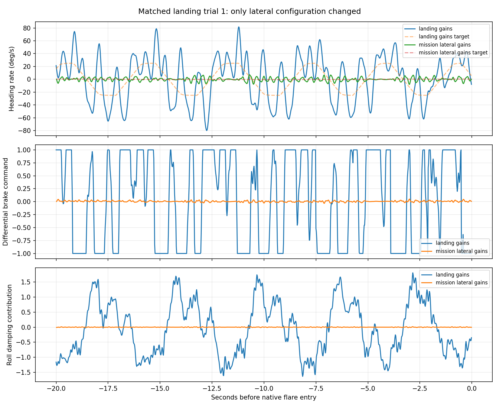
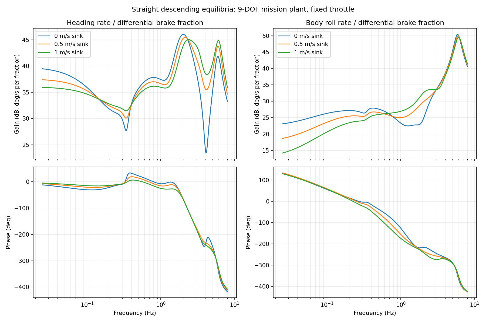
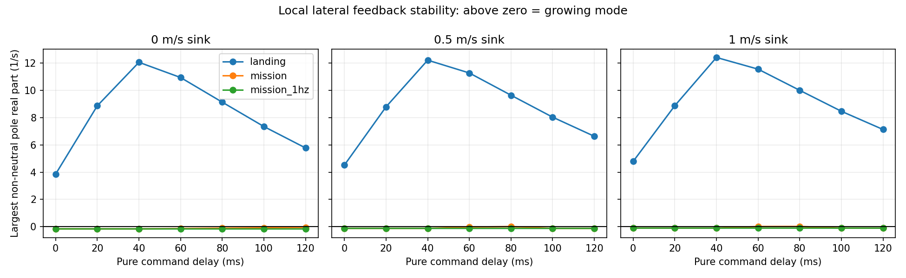
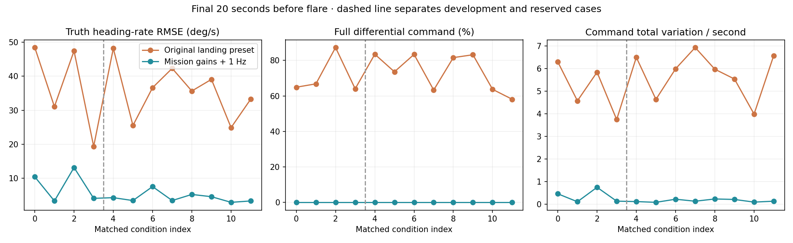

# Landing lateral diagnosis and descending-trim analysis

The initial screen below is retained as a research record. The selected configuration and full landing evaluation are summarized at the end.

The landing harness forces the original lateral gains unless explicitly overridden. These differ from the later mission candidate. This study changes only PG_TURN parameters for the matched landing runs; longitudinal, flare and environmental configuration remain those in each archived trial. Four trials were chosen by index (0–3), not by outcome. They are a diagnostic screen, not a fresh held-out validation set.

## Matched native landing screen

Metrics use the final 20 seconds before logged native flare entry, not the flare ramp. Saturation means absolute PGYR.Out >= 0.98. Rate error is PGYR.Tgt minus PGYR.Act. Touchdown refers to the model's first payload ground-plane crossing.

| Trial | Configuration | Rate RMSE (deg/s) | Saturation | Miss (m) |
|---|---|---:|---:|---:|
| 0 | landing gains | 44.69 | 64.9% | 1.36 |
| 0 | mission lateral gains | 3.78 | 0.0% | 5.53 |
| 1 | landing gains | 28.68 | 66.8% | 1.70 |
| 1 | mission lateral gains | 2.73 | 0.0% | 2.33 |
| 2 | landing gains | 42.71 | 87.3% | 1.15 |
| 2 | mission lateral gains | 28.38 | 4.5% | 0.11 |
| 3 | landing gains | 17.39 | 64.0% | 3.00 |
| 3 | mission lateral gains | 3.34 | 0.0% | 0.31 |

The published replay is trial 1. Its alternating full differential brake is materially reduced with the established mission configuration. Trial 2 still has substantial oscillation despite a small contact miss: spot accuracy alone would reward a poor response. Trial 0's miss becomes worse even as tracking becomes much smoother. This is why approach dynamics and landing accuracy must be evaluated separately.

## Descending equilibria

Solved the current 9-DOF mission plant at 22.2 V, straight flight, zero common brake, and 0, 0.5 and 1.0 m/s downward velocity. Maximum force/state-equilibrium residuals are below 2e-9 in the solver's mixed units. The 1.5 and 2.0 m/s requests did not balance and are excluded; failed solves do not establish a physical descent limit.

Throttle trims: 44.59%, 35.59%, 24.21%. Corresponding airspeeds: 4.38, 4.46, 4.54 m/s. Right brake trims: 3.75, 1.85, 0.56 mm. Linearization follows the active right-brake mixer branch with the configured 1500-us stroke and 55-mm drum calibration (71.995 mm per normalized command). It does not cross the unilateral mixer cusp.

The reduced local model has 15 mechanical perturbation coordinates plus motor RPM. Outputs are Euler heading rate and body roll rate, in degrees per second, matching the native controller. The discrete step is 2.5 ms. Closed-loop poles add two measurement filters and the PI integrator, with the native update order and airspeed scaling. Fixed target feedforward/target-shaping states do not affect these autonomous inner feedback poles.

Old landing gains produce an unstable oscillatory pair: real part +3.86/s at 2.79 Hz in level flight, increasing to +4.79/s at 2.52 Hz at 1 m/s sink. The mission gains have no growing non-neutral poles at these three trims. The arbitrary absolute-heading mode remains neutral; this is not a waypoint-guidance model.

Small nonlinear sine tests at 0.35 and 2.5 Hz, at every accepted trim, reproduce both plant transfer responses with relative complex errors below 1e-6. This verifies the local plant calculation against this simulator, not against flight data, and does not validate the entire closed-loop aircraft.

## Delay and nonlinear limits

The implemented brake actuator is a travel-rate bound, not a fitted first-order lag. At infinitesimal amplitude away from rate saturation its local transfer is unity. A separate pure-command-delay sweep of 0–120 ms assesses sensitivity; it is not a measured servo transfer function. The mission configuration remains locally stable in this sampled sweep, although level trim at 120 ms has a lightly damped approximately 2-Hz mode. A 1-Hz measurement-filter variant is retained as a hypothesis, not a selected tune.

These models hold throttle fixed and omit L1 guidance, estimator dynamics, finite-amplitude brake rate limiting, saturation, wind-varying trajectories, and the moving flare schedule. Partial common-brake equilibria and opposite mixer branches remain to be studied. The remaining bad trial cannot be explained or dismissed by a nominal local stability result.

## Next tuning sequence

1. Use the mission lateral configuration as the reference and retain the old landing run as diagnostic evidence.
2. Diagnose trial 2 using target, P, I, roll damping, airspeed, brake rate and saturation; test a small filter/damping change rather than sweeping every gain.
3. Compare ordinary mission tracking, both turn directions and loiters, descending approaches, opposing winds and actuator uncertainties. Keep additional landing trials untouched until a candidate is chosen.
4. Revisit flare placement after stabilizing the approach, since removing oscillatory brake drag changes the descent trajectory. Do not optimize lateral gains for contact error alone.

The initial screen did not change firmware defaults or published results. The subsequent promotion below updates the opt-in development profile and published landing results.

## Completed mission regression and targeted filter test

The established mission configuration passed a fresh native extended AUTO mission, including altitude changes, left/right turns and two-turn loiters in both directions. Maximum measured corner overrun was 0.64 m. This run is nominal/calm and is a regression check, not a matched improvement comparison.

On landing trial 2, changing only the measurement filter from 4 Hz to 1 Hz reduced unfiltered truth heading-rate tracking RMSE from 32.86 to 13.16 deg/s, and normalized command total variation per second from 3.12 to 0.74. Saturation fell from 4.5% to zero; miss changed from 0.11 to 0.31 m. Truth rate is computed from the payload quaternion and angular velocity, so lowering the reporting filter cannot manufacture this improvement. Filtered PGYR tracking errors are retained separately in the JSON and should not alone be compared across cutoff changes.

This is promising, but 13 deg/s is still substantial and only one 1-Hz landing was run. The 1-Hz variant has not passed the broader mission and held-out landing screen in this study and is not adopted as a default. Next examine finite-amplitude left/right brake transitions, throttle/airspeed variation and guidance coupling, then test the filter candidate across untouched cases. Nominal descending trim alone does not capture those mechanisms.

## Selected configuration and complete landing screen

Selected PG_TURN_FILT=1 Hz in the mission JSON/parameter file; FF=0.009,
P=0.005, I=0.002, RDAMP=0.003 and D_FF=0 remain the mission gains. The landing
harness now shares those lateral parameters by default while preserving its
longitudinal study setup. Generic firmware defaults are unchanged.

All twelve matched landings completed; eight conditions were reserved until
after the candidate had been fixed. Every case improved truth heading-rate
RMSE and brake-command variation relative to the old landing preset. The
selected configuration achieved 11/12 within 5 m, median miss 1.279 m, p90
3.498 m and worst 7.010 m. The worst landing is 7.009 m long and only 0.038 m
cross-track. Median sink is 1.407 m/s. These metrics are not a claim of universal
improvement in spot placement.

The before/after applets retain trial 1, which had already been published before
tuning. Its miss changes from 1.70 to 2.39 m while brake activity falls sharply.
Both replays cover the final 22 seconds with identical camera conventions and
no motion exaggeration. This case selection is not based on the candidate's
most favorable result.

Use tools/report_landing_lateral.py with --root pointing at the raw study,
--previous pointing at the prior heldout-candidate directory, and --output
pointing at docs/assets/lateral-landing. That tool checks logged PG_TURN gains,
unchanged TECS/landing parameters, matching uncertainty configurations, flare
activation and output bounds, and records BIN hashes. It generates the figures
and bounded before/after replays. tools/report_lateral_missions.py audits the
combined-controller mission tests separately.

[Final landing metrics and audits](../../docs/assets/lateral-landing/results.json)
· [Mission metrics and audits](../../docs/assets/lateral-landing/mission-results.json)

The blog's explanation deliberately distinguishes the old-gain configuration
error from incomplete coverage of landing trim states. Earlier work already
included shallow climb/descent and both turn directions; it would be inaccurate
to claim that all earlier linear analysis was level-flight only.
