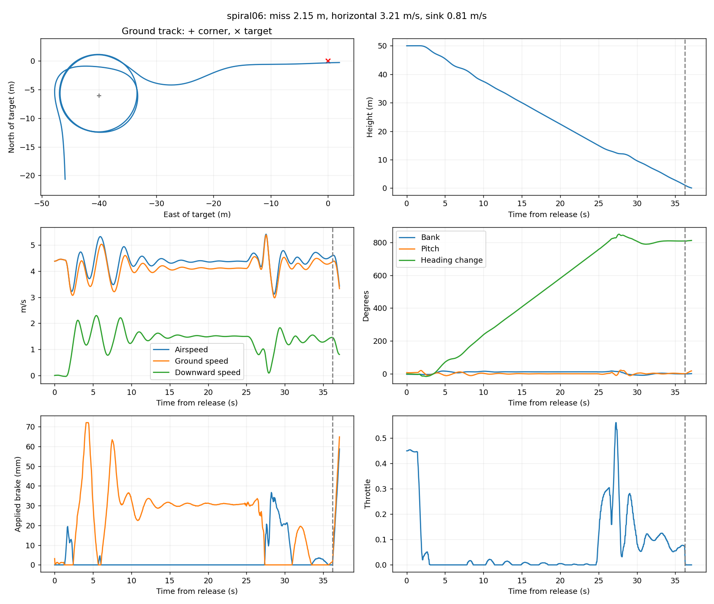
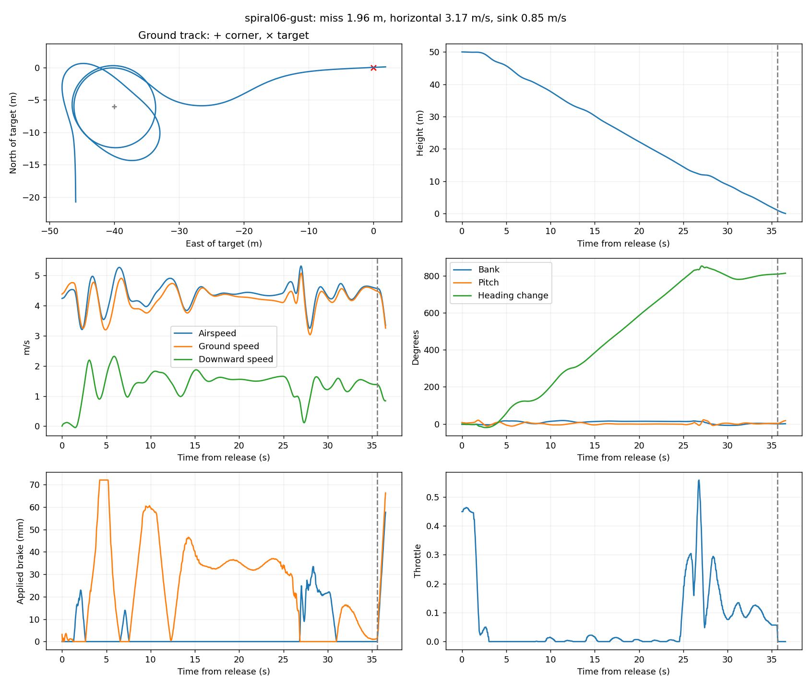
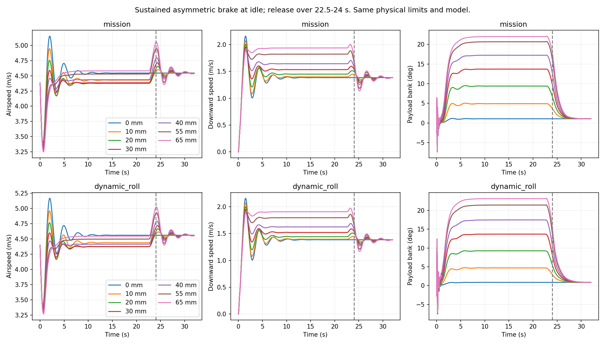

# Descending spiral to spot landing

Native AUTO now demonstrates a sustained descending orbit, tangent exit and scheduled brake flare. The final calm run turns about 826 degrees before LAND and reaches the ground plane 2.15 m from the target. A matched gentle-gust run turns 832 degrees and misses by 1.96 m. This is a spiral landing demonstration, not yet a settled, high-energy swoop.

## Results

| Final case | Peak bank | Airspeed entering LAND | Airspeed at flare | Target miss | Horizontal crossing speed | Downward crossing speed |
|---|---:|---:|---:|---:|---:|---:|
| Calm | 17.5 deg | 4.24 m/s | 4.60 m/s | 2.15 m | 3.21 m/s | 0.81 m/s |
| Gentle gust | 18.4 deg | 4.43 m/s | 4.57 m/s | 1.96 m | 3.17 m/s | 0.85 m/s |

The target and floor are earth-fixed. The replay follows actual simulated states and includes the entire descending orbit. It ends at first payload-CG ground-plane crossing, not modeled impact, sliding or canopy collapse. The pitch attitude is still about 18 degrees at crossing; position accuracy alone does not establish a settled landing. Full body and joint rates are retained in results.json.

## Does the spiral build speed?

Fourteen actuator-limited open-loop screens compare six asymmetric brake pulls and zero extra pull in each retained profile. Throttle is idle; brake ramps in over 1.5 s, holds until 22.5 s and releases by 24 s. Sustained metrics use 14–22 s; rollout peaks use 24–28 s. These free-flight screens do not implement ground contact.

At 65 mm additional right pull, the mission model settles at 4.58 m/s airspeed versus 4.55 m/s with zero extra pull. The alternative dynamic-roll profile gives 4.54 versus 4.56 m/s. Bank reaches about 22–23 degrees and sink increases to about 1.9 m/s, but horizontal speed decreases. Release briefly raises airspeed to about 5.0 m/s. The zero-extra-pull case retains level-trim line positions and a small glide turning bias; it is not an independently solved straight-glide trim.

In the final native runs, mean pre-LAND airspeed is about 4.4 m/s. Peaks around 5.3–5.4 m/s are transient. Read them alongside throttle and pitch: altitude capture and the transition to LAND can introduce powered pitch motion, so those peaks cannot all be credited to energy gained in the spiral. The model supports descending turns and transient recovery, but this experiment does not demonstrate sustained high-energy acceleration.

## Native architecture

MAV_CMD_NAV_LOITER_TO_ALT requests a 6 m clockwise orbit from 50 m entry altitude to 12 m, followed by LAND with native tangent-exit tracking. Actual exit height and total turns depend on the native altitude and heading-exit conditions. The final target is 40 m east and 6 m north of the orbit center.

The research harness changes L1 from 8 s to 10 s and the heading-rate cap from 65 to 25 deg/s when native mission sequence enters LAND. It uses mission status, not simulator truth feedback. Other inner-loop gains, aircraft mass, rigging, physical travel and aerodynamics are unchanged.

Flare uses 95% common brake, 5% steering reserve, 100 percentage points/s, a 1.1 m altitude trigger, LAND_FLARE_AIM=50 and TECS_LAND_SINK=0.5 m/s. The time trigger is disabled; other native flare conditions remain active. This is an experimental mission configuration, not an updated aircraft default.

## Development and limits

Seven native cases were attempted. The initial polygonal route failed to reach LAND; it skipped short segments without producing the intended continuous spiral. A 6 m loiter with 4 s L1 also failed, with repeatedly reversing heading-rate demands. A 10 m orbit with 10 s L1 completed but overshot by 11.4 m. Returning to a 6 m orbit with 8 s L1 completed the spiral. Adjusting exit altitude and final-leg distance produced the selected result. Every attempt is retained in attempts.json; five completed crossings are audited in results.json.

The final geometry was frozen for the gentle-gust check: 0.25 m/s horizontal amplitude, 0.0625 m/s vertical, 12 s base period and phase 0.7. These two checks are not a statistical reliability estimate. High-bank and high-brake dynamics remain extrapolations beyond the ordinary-flight calibration. Neither retained profile has validated canopy-collapse or aggressive-spiral behavior. No coefficients were changed to create the maneuver.

## Next useful step

Separate the recovery arc from altitude recapture: compare a deliberately unpowered terminal segment against the present TECS transition, then schedule brake onset against the resulting speed and swing phase. Keep a matched no-spiral approach as the energy baseline. A more aggressive spiral model needs evidence about turn loading and brake drag before changing its physics; both retained profiles currently predict nearly the same limitation.

## Reproduce

Run screen.py for authority checks. Run run.py configs/<case>.json sequentially for native cases, then analyze.py and package.py. The existing ArduPilot feature-branch binary, simulator and Python dependencies are required; paths at the top of the research scripts identify their inputs. Completed native runs are not overwritten. Raw logs and full traces remain in Mission Planner/analysis/spiral-swoop-2026-10-13; scripts, final plots, configurations, summaries and a compact replay are retained here.

Build viewer/ and serve the repository to open report.html, or use the viewer development server at landing.html?case=spiral. No firmware or simulator source changes are required.

Implementation and analysis assisted by Codex.
