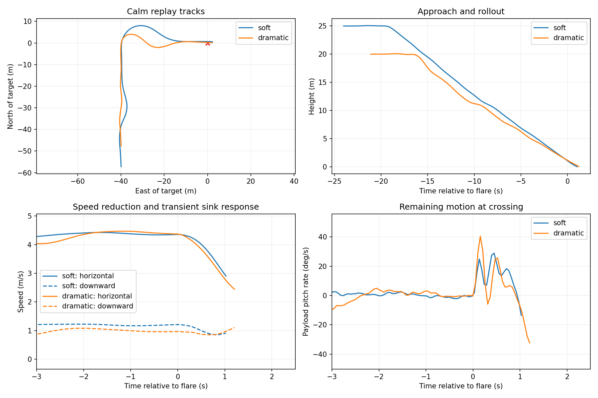
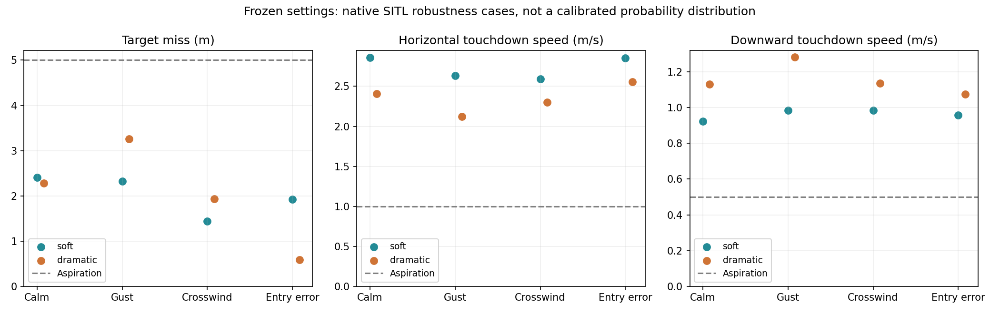
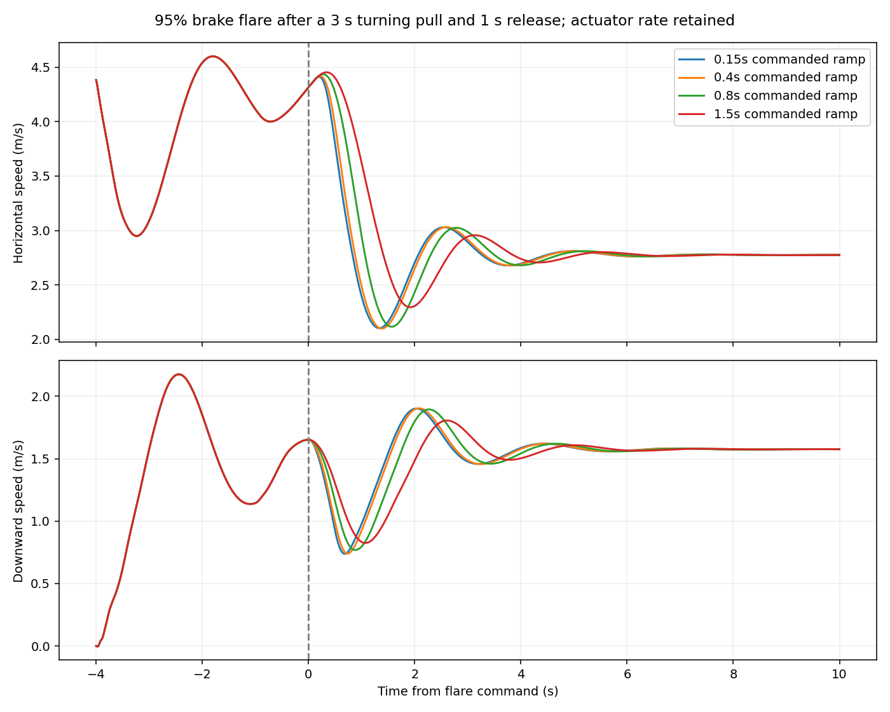

# Native turning-descent and flare demonstration

The simulator now completes a tight right-turning descent, rollout and brake flare with two approach settings. This is a precision turning-landing demonstration, **not yet a settled, near-zero-speed swoop**. The report retains the remaining forward speed and pitch motion rather than equating target accuracy with touchdown quality.

## Watch the native runs

[Soft approach](../../viewer/dist/landing.html?case=swoop-soft) · [Dramatic approach](../../viewer/dist/landing.html?case=swoop-dramatic)

The recordings use native ArduPilot outputs, the unchanged 9-DOF Trout Lake model and actual simulated gusts. Nothing is animated into the motion. The floor and bullseye are earth-fixed; the flight path is shown in 3D, and the altitude profile uses distance traveled through the turn. The animation ends at first payload-CG ground crossing, not a modeled physical landing or slide.

## Architecture and style settings

Both versions use AUTO waypoint guidance, the existing heading-rate controller, throttle-only parafoil TECS and native AP_Landing scheduled common-brake flare. No MPC or firmware changes were required for this demonstration. A short research harness specifies the mission and, for the dramatic style, changes the L1 period using native estimated heading.

| Setting | Soft | Dramatic |
|---|---:|---:|
| Entry / corner altitude | 25 / 10 m | 20 / 8 m |
| Distance to corner / final leg | 55 / 40 m | 45 / 40 m |
| Heading-rate command limit | 25 deg/s | 45 deg/s |
| L1 period | 10 s | 6 s, restored to 10 s after estimated heading passes 65° |
| L1 damping / measurement cutoff | 1.0 / 1 Hz | 1.0 / 1 Hz |
| Flare trigger | 1.1 m | 1.1 m |
| Common-brake target / reserve | 85% / 10% | 95% / 5% |
| Flare ramp | 100 percentage points/s | 100 percentage points/s |

In the calm recordings, the soft turn reaches roughly 11° of bank and the dramatic turn roughly 19°. The dramatic turn accelerates from about 3.7 to 4.5 m/s airspeed between 30° and 90° heading, close to ordinary flight speed rather than a sustained high-energy dive.

All other selected inner lateral and longitudinal gains are unchanged. These are tested presets, not a validated continuum obtained by interpolating controller gains. The dramatic schedule handles heading wrap at north; the earlier incorrect schedule and its affected recordings remain classified as development evidence, not final validation.

All eight final runs finish within 5 m; worst miss is 3.26 m. Horizontal crossing speeds span 2.12–2.86 m/s; downward speeds span 0.92–1.28 m/s. Payload pitch-rate magnitude reaches 33.7 deg/s at crossing. These velocities and residual motion fall short of the settled touchdown objective.

## Frozen-style robustness results

The four cases per style are calm air; synthetic gusts of 0.25 m/s horizontal amplitude and one-quarter that vertically; a 1 m/s northerly velocity component, crosswind to the eastbound final leg; and a combined entry perturbation (2 m lateral offset, +1 m height, +5° heading, +5% initial speed, 150 mm/s actuator rate and 60 ms command delay). These are engineering checks, not statistical reliability estimates.

| Run | Miss (m) | Horizontal speed (m/s) | Downward speed (m/s) | Bank at crossing (deg) | Pitch rate (deg/s) |
|---|---:|---:|---:|---:|---:|
| soft-calm | 2.41 | 2.86 | 0.92 | 1.5 | -17.2 |
| soft-gust | 2.32 | 2.64 | 0.98 | 2.0 | -13.7 |
| soft-crosswind | 1.44 | 2.59 | 0.99 | 0.5 | -23.6 |
| soft-entry | 1.92 | 2.85 | 0.96 | 2.0 | -15.6 |
| dramatic2-calm | 2.28 | 2.41 | 1.13 | 0.5 | -32.3 |
| dramatic2-gust | 3.26 | 2.12 | 1.28 | -1.6 | -33.7 |
| dramatic2-crosswind | 1.94 | 2.30 | 1.14 | 1.7 | -32.1 |
| dramatic2-entry | 0.59 | 2.56 | 1.08 | 0.3 | -23.0 |

The dramatic gust and crosswind cases spend about a quarter of the flare at the remaining differential-command limit. The bank remains small at crossing, but the narrow steering reserve is a real tradeoff. The [complete metrics](results.json) include physical travel limits, body rates and canopy–payload relative rotation and rate.

The aspirational 1 m/s horizontal and 0.5 m/s downward speeds were not achieved together. The flare produces a transient reduction in sink, but the forward-speed minimum occurs later and is accompanied by renewed sink and payload pitch motion. Simply increasing brake or changing the trigger cannot independently set position, both velocities and swing phase.

## Why the study stops here

The open-loop authority screen examined 20 turning/flare combinations, followed by 12 faster-flare sensitivity cases. It is a feasibility screen, not proof that no better control law exists. It found useful transient braking but did not demonstrate a near-stop touchdown. Full brake in this screen is an extrapolation: the model uses empirical lift and drag versus brake with a smooth angle-of-attack lift rolloff; it has no validated high-brake stall or canopy-collapse behavior.

This bounded result supports continued terminal-control work, but does not justify replacing all of TECS with MPC. The next useful comparison is a short optimized brake schedule with explicit pitch/swing penalties against a small terminal predictive controller. Both must use the same model, entry states and actuator limits. Real high-brake measurements remain necessary to establish whether the predicted recovery arc and flare are physical.

## Reproduction

`run.py` and `native.py` run the named native cases; `analyze.py` audits logs and computes crossing metrics; `publish.py` exports bounded replays and plots. `selection.json` identifies the final cases. `provenance.json` pins the unchanged simulator and native binary. Raw logs, full recordings, intermediate numerical traces and browser screenshots remain in Mission Planner/analysis/swoop-2026-10-13. Run the viewer build, then serve the tinkering repository over localhost to open the report and replay links.

Implementation and analysis assisted by Codex.
