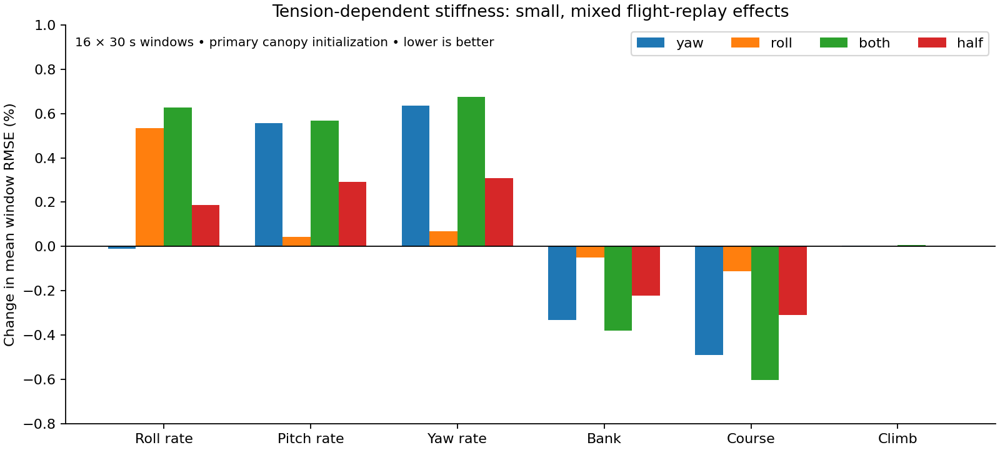
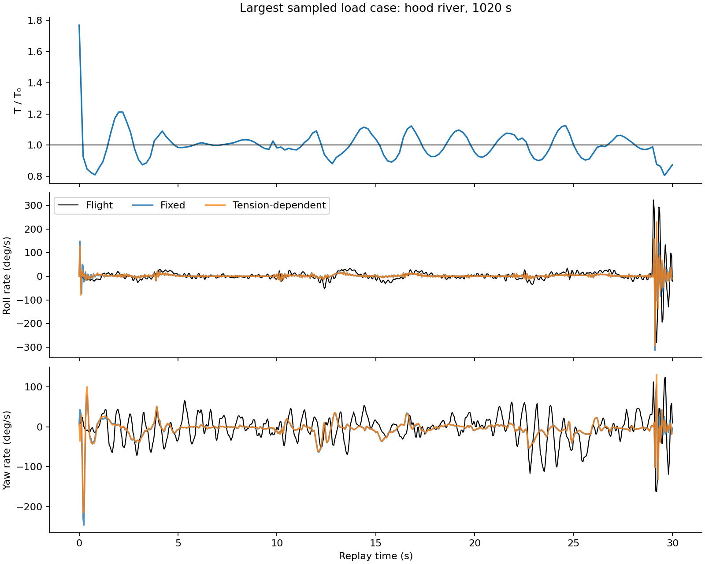
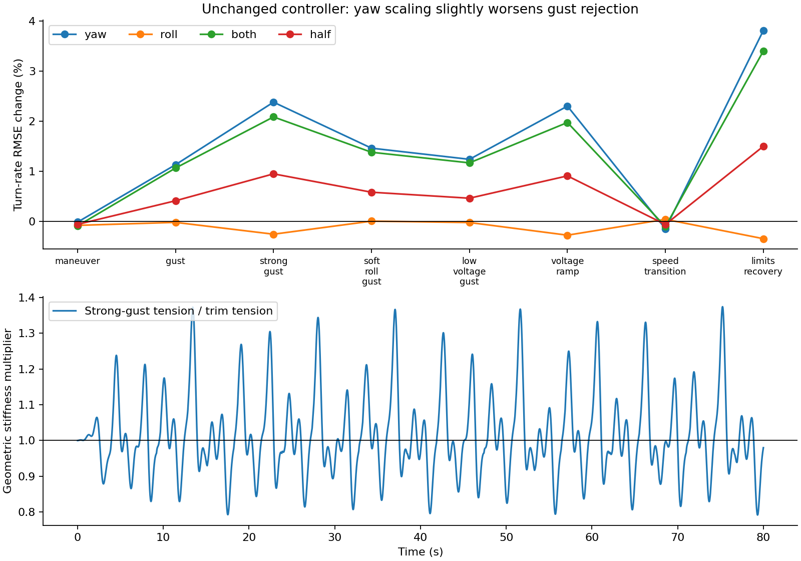

# Does tension-dependent joint stiffness close the flight-model gap?

We tested the hypothesis that a fixed suspension spring misses load-dependent restoring torque, causing the model's roll and yaw discrepancies. Scaling the geometric part of that spring with the solved tensile load produced small, mixed changes. It did not improve roll and yaw agreement together and did not meet the criterion in [the frozen plan](PLAN.md). This result concerns a scalar load-dependent spring, not the full mechanics of individual suspension lines.

The study ran 240 matched 30-second flight replays and 40 matched 80-second controller scenarios, plus eight integration-refinement reruns. All completed. No production simulator parameters, controller gains, or flight firmware were changed.

## What changed in the model

The original two-body model solves a point-joint reaction dynamically, but uses fixed roll stiffness and a payload-weight-based yaw coefficient. We retained the point constraint and changed only selected spring terms:

\[
 K_i(T)=K_{i0}\left[1+f_i\left(s-1\right)\right],\qquad
 s=\operatorname{clip}\left(\frac{T}{T_0},0.25,2\right).
\]

Here \(i\) is roll or yaw. The five variants are fixed \((f_r,f_y)=(0,0)\), yaw-only \((0,1)\), roll-only \((1,0)\), both \((1,1)\), and half-geometric \((0.5,0.5)\). Pitch stiffness, damping, aerodynamics, propulsion, geometry, and actuator handling remain as in the original model. The original mass-linear yaw mode is used; the optional nonlinear geometric-yaw mode is not used.

\(T=-\hat a^T J\), where \(J\) is the reaction force applied to the payload and \(\hat a\) points from the canopy CG toward its attachment. This measures the tensile projection, not the reaction magnitude or an assumed bank-angle load factor. The reference \(T_0\) comes from the existing 22.2 V straight-level trim: 11.4591 N for Hood River and 15.3523 N for Trout Lake. The soft-roll controller case uses its own profile's solved trim. Reference loads are not adjusted during a run.

Changing spring torque also changes joint reaction. We solve that dependency simultaneously rather than using the previous timestep's load. At a fixed state, the joint solve is affine:

\[
 J(s)=J_b+(s-1)\Delta J,\qquad
 T(s)=T_b+(s-1)\Delta T.
\]

Consequently, the unclipped solution is

\[
 s=\frac{T_b-\Delta T}{T_0-\Delta T}.
\]

The denominator is checked for a positive, nonsingular solution. The bounds regularize the sensitivity model; they do not represent slack. At the lower or upper bound the same clipped load relation is checked. No sampled loads reached either bound or became compressive. The point constraint still permits compression, so this remains a reduced model.

## Flight evidence: the predicted improvement did not appear

Each flight contributes eight preselected windows. Each window uses identical measured payload attitude, body rates and navigation velocity, recorded commands, initial RPM and voltage, and a constant initial wind estimate across variants. RPM then follows the model's propulsion dynamics. Canopy attitude is unobserved: the force-based initialization is repeated at 0.25, 0.35 and 0.45 rad assumed angle of attack, without fitting individual variants. All selected samples have valid flags. These flights already informed model development and are not independent validation data.

The primary score is the arithmetic mean of the 16 window RMSEs at 0.35 rad initialization. Body-rate and angular errors are in degrees/s and degrees; climb error is in m/s. Course is navigation course, not payload yaw. Angular differences are wrapped.

| Metric | Fixed | Both load-dependent | Change |
|---|---:|---:|---:|
| Roll-rate RMSE | 14.695 | 14.787 | +0.63% |
| Pitch-rate RMSE | 20.800 | 20.918 | +0.57% |
| Yaw-rate RMSE | 30.600 | 30.807 | +0.68% |
| Bank RMSE | 6.018 | 5.995 | −0.38% |
| Course RMSE | 63.441 | 63.059 | −0.60% |
| Climb RMSE | 0.418 | 0.418 | +0.01% |



Yaw-only scaling leaves aggregate roll error nearly unchanged and worsens yaw-rate error by 0.64%. Roll-only scaling worsens roll error by 0.53% and yaw error by 0.07%. Half-geometric scaling produces correspondingly smaller changes. No variant reduces both primary roll- and yaw-rate errors. The combined variant also worsens both rates in each flight when scored separately.

Changing the assumed canopy angle shifts absolute pitch-rate RMSE from 18.26 to 24.89 degrees/s for the fixed model, much more than this spring change. Across all three initializations, combined scaling changes roll-rate error between −0.10% and +0.63%, while yaw-rate error worsens by 0.63–0.72%. Thus the small primary result is not a robust improvement hidden by one particular initialization.

Large absolute rate/course errors remain; these open-loop replays are imperfect tests of suspension mechanics because canopy state, wind evolution, and other model errors are unresolved. As a supplementary check, scoring only the first five seconds also worsens combined-model roll/pitch/yaw RMSE: 20.71/35.17/45.78 becomes 21.08/35.41/46.22 degrees/s. That check does not replace the preselected 30-second scoring.

## Why the change is small

For combined scaling in the primary replays, the median sampled tension multiplier is 1.0004; the 5th–95th percentile interval is 0.915–1.107. The full sampled range is 0.532–1.770, widening to 0.423–1.776 across all initializations and variants. Flight diagnostics are sampled every 0.2 s, so these are sampled extrema, not guaranteed continuous-time bounds.

Most of the time, the proposed mechanism changes stiffness by about ten percent or less. Reducing the mission roll stiffness from 4.862 to the alternative dynamic-roll value of 1.0 Nm/rad through proportional tension scaling alone would require \(T/T_0\approx0.206\). That is far below the observed sampled loads. This does not establish which nominal stiffness is physically correct; it shows that this load correction cannot reconcile those two values under these replay conditions.

The following example is chosen by the largest sampled tensile load in the primary combined-model runs, rather than by apparent improvement. Its largest load occurs at initialization, so it should not be interpreted as a measured flight-load extreme. It shows how closely the two predictions track each other despite their remaining disagreement with flight.



## Controller regression: modest changes, no new failure in these scenarios

The existing conventional controller was kept unchanged, including its gain scaling, reference handling and actuator limits. Each variant sees the same gust realization. These simulations use truth state and airspeed; they test controller behavior under a changed plant, not flight agreement or observer robustness.

| Scenario | Fixed turn-rate RMSE (deg/s) | Combined RMSE | Change |
|---|---:|---:|---:|
| Maneuver | 1.157 | 1.156 | −0.09% |
| Gust | 5.677 | 5.738 | +1.07% |
| Strong gust | 10.481 | 10.700 | +2.09% |
| Soft-roll gust | 5.348 | 5.422 | +1.38% |
| Low-voltage gust | 5.695 | 5.761 | +1.17% |
| Voltage ramp | 8.703 | 8.875 | +1.98% |
| Speed transition | 1.667 | 1.665 | −0.10% |
| Limits/recovery | 7.418 | 7.671 | +3.41% |

The inherited results field `heading_rms` actually measures turn-rate tracking and is labeled accordingly here. Height RMSE changes are below 0.2% for the combined variant. All cases remain finite; that is a finite-duration regression result, not a stability proof.



## Numerical checks and limitations

- Fixed-variant replay matches the original compiled model exactly in the two audit maneuvers; the state maximum difference is zero. Nominal trim steps also match exactly across variants.
- An independent frozen-coefficient check sets the original spring coefficients to the scale computed at a disturbed state. Its reaction agrees within the audit tolerance, and its short-step derivative differs by at most 2.3e-9 in state units/s.
- In flight diagnostics, the implicit scale residual is at most 6.7e-16 and the joint acceleration-constraint residual at most 3.5e-13. The normalized solve denominator stays above 0.985.
- Doubling flight integration resolution from 32 to 64 substeps changes scored metrics by less than 0.0001% in the highest-load window from each flight. Doubling controller resolution from 16 to 32 substeps changes checked metrics by less than 0.000001% in strong gust and limits/recovery.
- Clipping, loads and algebraic diagnostics are sampled; they are not exhaustive assertions on every internal RK stage. No replay reported a singular-solve failure.

A full line model can produce effects that this experiment cannot: different tensions on each side, changing attachment moment arms, coupling between roll/yaw/pitch, and unilateral slack/re-tension. A scalar multiplier cannot test those hypotheses. It also does not test changing the nominal geometric stiffness, which was deliberately preserved to isolate load dependence.

The result supports keeping this as an isolated sensitivity model rather than adopting it as a flight-agreement improvement. The next useful test would measure restoring torque versus relative angle under several known suspension loads, or model individual attachment geometry and compare against those measurements. That would distinguish an incorrect nominal stiffness or geometry from missing load dependence without trying to identify both from payload-only flight logs.

## Reproduce

Use Rust and the locked research uv environment. From the repo root, run `uv sync --project research --locked` and `uv run --project simulation python research/tension-stiffness-2026-10-15/prepare.py`. Preparation copies the Rust workspace into ignored `model-rust/`, applies `tension.rs.inc`, and builds an isolated wheel there. The production package is untouched. `run.py` explicitly loads that wheel and refuses to use the production model as a substitute. New build hashes go to `model-rust/source-provenance.json`; the existing provenance and published results describe the historical study. Run `audit.py --checks-only` to check the force law against production Rust without rerunning flight studies or replacing results.

```bash
export OPENBLAS_NUM_THREADS=1
export PATH="$(realpath ../.venv/bin):$PATH"
python run.py
python closed.py
python audit.py
python report.py
```

The closed-loop harness reuses `../scheduled-state-feedback-2026-10-15/experiment.py` and its frozen study assets. The report and JSON summaries are committed. Large per-run traces and copied model binaries are regenerated locally and ignored. Raw flight data remain at their existing local location. See `flight-results.json`, `closed-results.json`, `audit-results.json`, and `summary.json` for the full results, all initializations, numerical checks and provenance.
