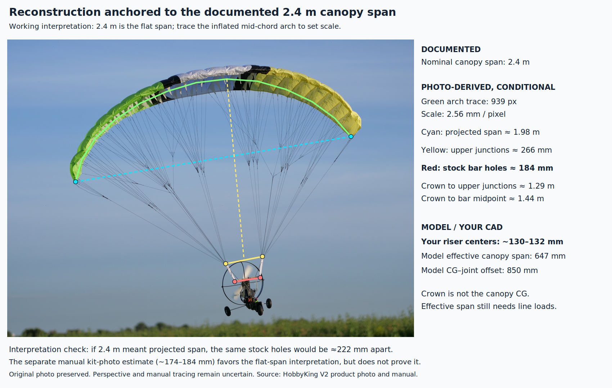
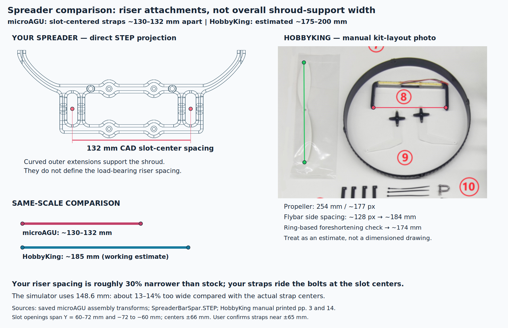

# Span-anchored canopy reconstruction and spreader audit

The canopy is documented as 2400 mm span in the HobbyKing V2 manual (printed page 1, PDF page 3). It does not explicitly distinguish flat from projected span. We use flat span as a working interpretation, then check it against independent photo geometry. This is approximate single-view reconstruction, not calibrated photogrammetry.

A manually traced approximate mid-chord arch in the original flight photograph is 938.94 px long. Assigning this 2.4 m gives 2.556 mm/px. The visible tip-to-tip chord is 775.31 px, or 1.98 m. The stock flybar attachment spacing is about 71.85 px, or 183.65 mm. The upper line junctions are instead about 265.68 mm apart: they must not be confused with the bar attachment spacing. Crown-to-upper-junction midpoint is 1.29 m; crown-to-bar midpoint is 1.44 m. Neither measures canopy-CG-to-joint distance directly.

If 2.4 m instead meant projected span, the stock bar estimate would become 222 mm. The manual kit-layout photo provides a separate rough check: its 254 mm propeller spans about 177 px, while the flybar sides are about 128 px apart, giving 184 mm. A crude correction using the prop-guard ellipse (227/215 px) gives 174 mm. Guard shape, part height, camera perspective, and uncertain endpoints prevent treating either as an exact dimension. Use roughly 175–200 mm for stock riser spacing, with 185 mm as a working estimate. Agreement favors the flat-span interpretation but does not prove it.

## User correction: load location is inside the slot

The cached assembly contains two m3_standard reference origins at assembly coordinates [0.044, -0.0743, 0.156] and [0.044, +0.0743, 0.156] m. Their 148.6 mm separation matches the simulator's hardcoded payload half-spacing, but these are fastener reference origins, not the force application points.

The user clarified: “The white nylon straps ride the bolt that goes in the slot in each end of the spreader” and “They are at +/-65ish ... centered in the slot.” The STEP geometry confirms open slots from local Y=60 to 72 mm and -72 to -60 mm, with geometric centers at +/-66 mm. Use approximately 130–132 mm between the loaded straps. Actual contact can move with strap width and loading; the CAD slot center is not a measured loaded contact location.

This changes the assessment:

| Quantity | Spacing |
|---|---:|
| microAGU loaded straps, user description and CAD slots | about 130–132 mm |
| Current simulator payload support spacing | 148.6 mm |
| HobbyKing stock flybar, photo estimate | about 175–200 mm; nominal working estimate 185 mm |

The custom riser spacing is roughly 30% narrower than stock (about 25–35% over the estimated range). The simulator spacing is about 13–14% wider than the actual custom spacing. The curved spar extensions are shroud supports; their width is irrelevant to this comparison.

For the current reduced yaw law, k_yaw is proportional to payload half-spacing times effective canopy half-spacing divided by height. Changing only payload half-spacing from 74.3 to 65–66 mm would reduce that nominal coefficient by about 11–13%. However, canopy half-spacing was fitted from dynamics and can compensate for incorrect payload spacing. This is a geometry correction to carry into re-identification, not proof that blindly changing one coefficient will improve flight agreement. The roll coefficient is independently specified and will not automatically receive this correction. Production model parameters have not been changed by this audit.

The 647 mm fitted effective canopy support span remains unvalidated by these images. Visible attachment geometry can constrain an explicit line model, but an effective tension-weighted support spacing cannot be read from a photo without load assumptions.

## Evidence and reproduction

- Manufacturer product and photograph: https://hobbyking.com/en_us/h-king-paramotor-v2-w-led-light-bar-2400mm-pnf.html
- Original photo: https://cdn-global-hk.hobbyking.com/media/catalog/product/9/3/9310670504-4-re.jpg
- Manufacturer manual, mirrored: https://www.air-rc.com/assets/pdf/Paramotor-V2_4284.pdf
- Manual printed page 3 supplies the kit photograph; printed page 14 specifies the outer flybar holes for riser shackles.
- CAD files and cached assembly hashes are recorded in cad-provenance.json. STEP files are millimeters. Saved exports date to December 2025; user clarification establishes which features carry the straps.
- reconstruction-landmarks.json contains pixel landmarks and calculations. draw_reconstruction.py generates native SVG annotation overlays, preserving original photo pixels, and renders PNGs with CairoSVG. cad_project.py reads STEP edges with OpenCascade and creates the CAD projection.

Earlier annotated-measurements files use propeller scaling and are superseded by the span-anchored reconstruction. Initial comparisons using 148.6 mm as the loaded strap spacing were corrected after the user's clarification.
